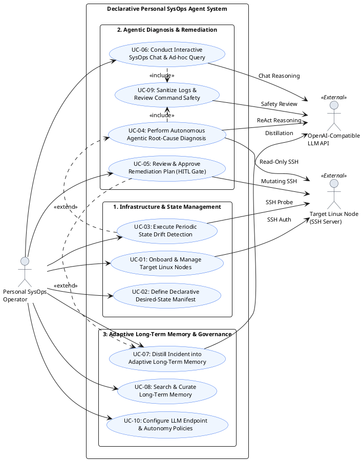
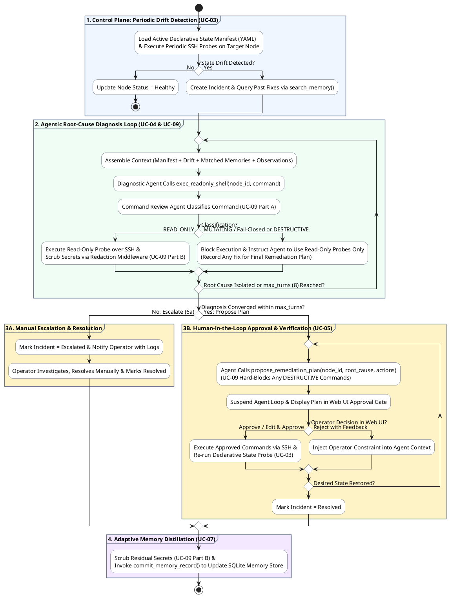
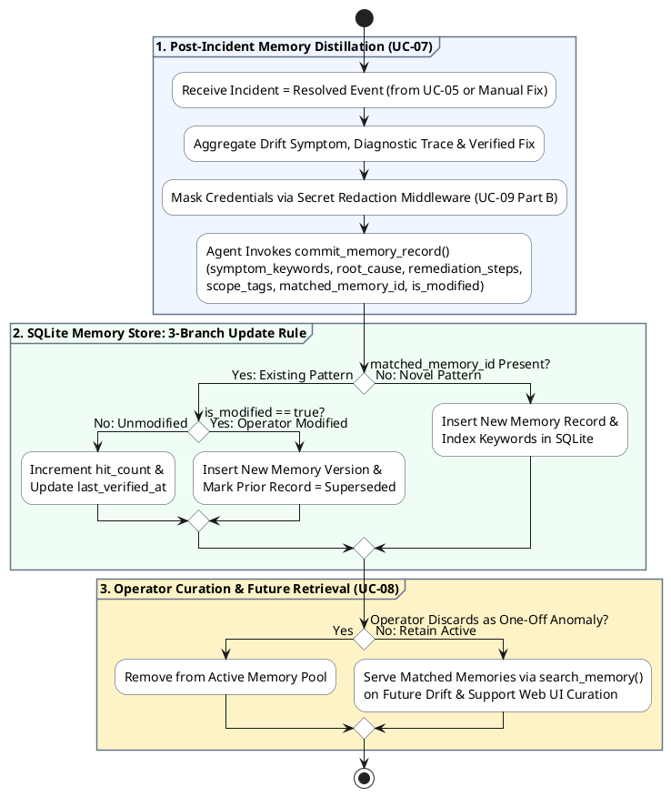
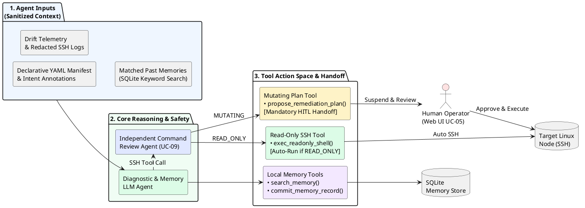

---
toc:
    depth_to: 2
puppeteer:
    format: "A4"
    printBackground: true
    margin:
        top: 15mm
        bottom: 15mm
        left: 20mm
        right: 20mm
---

<h3 style="margin: 10px;">Software Requirements Specification A Declarative Personal SysOps Agent with Adaptive Long-Term Memory</h3><b>2450313 徐佳咏、2351428 徐之涵、2352626 马小云、2451405 刘宸瑞</b>

## 1. Table of contents

[TOC]

---

## 2. Introduction

In the era of cloud-native development, independent developers, homelab enthusiasts, and academic researchers may manage from a few to dozens of cloud instances, local workstations, and containerized services.

In such cases, when encountering the exact same container OOM kill, failed SSL certificate renewal, or firewall block months later, developers often find they have long forgotten their previous troubleshooting steps and temporary scripts, needlessly wasting time and effort.

However, traditional operational tools suffer from extreme polarization: enterprise-grade tools are overly complex and require heavy configuration, making them unsuitable for individual-scale use; meanwhile, manual operations usually result in repetitive operational toil.

To bridge this gap, we propose a lightweight, single-daemon Declarative Personal SysOps Agent with Adaptive Long-Term Memory. The system is engineered specifically for individual operators to maintain desired infrastructure states and accelerate incident resolution across small Linux fleets without installing heavyweight agents on target hosts.

The core architecture unifies three synergistic capabilities:

1. **Lightweight Agentless Control Plane**: The agent core is packaged as a single Go binary with an embedded SQLite datastore and a Vue 3 web console. The system connects to target Linux nodes over standard SSH.
2. **Declarative Agentic State Reconciliation**: Operators define high-level desired states—such as container health, service reachability, certificate validity, and other specific metrics—via concise YAML manifests with natural-language intent annotations. When periodic health probes detect state drift, an LLM-powered reconciliation engine autonomously executes read-only diagnostic tools to localize the root cause and generates a remediation plan.
3. **Adaptive Long-Term Memory**: Once an incident is resolved, the system distills the core insights and solutions into structured memory records. When similar scenarios happen in the future, the system can retrieve these historical records via agentic keyword search, enabling rapid, context-aware recovery while preventing knowledge loss.

The system targets single-user, small-scale Linux environments, managing systemd services, Docker containers, host resources, and other personal infrastructure components, explicitly excluding multi-tenant enterprise RBAC.

---

## 3. Strategic analysis

### 3.1 SWOT

<table>
<tr>
<td>Strengths</td>
<td>1. Zero Target-Node Footprint: Agentless SSH execution requires no daemon installation on remote Linux servers. 2. Single-Binary Deployment: Go backend + embedded SQLite + static Vue 3 frontend allows one-command self-hosting. 3. Hybrid Declarative-Agentic Paradigm: Combines deterministic desired-state checks with flexible LLM root-cause diagnosis. 4. Adaptive Memory: Captures server-specific issues and historical fixes that static playbooks ignore.</td>
</tr>
<tr>
<td>Weaknesses</td>
<td>1. External LLM Dependency: Diagnostic quality and latency depend on third-party or locally hosted LLM inference capabilities. 2. Prompt & Context Token Limits: Without suitable context management, verbose system logs (`journalctl`, `docker logs`) can rapidly exhaust context windows.</td>
</tr>
<tr>
<td>Opportunities</td>
<td>1. Surge in Self-Hosting & Homelabs: Growing community of independent developers and researchers running personal cloud/local fleets. 2. Maturation of OpenAI-Compatible APIs: Low-cost, fast tool-calling models with high performance reduce operational cost. 3. Gap in Personal AIOps: Existing AIOps products exclusively target enterprise SRE teams rather than individual developers.</td>
</tr>
<tr>
<td>Threats</td>
<td>1. Destructive Command Execution Risk: An unguarded LLM could propose commands that corrupt data and cause unrecoverable damage. 2. Sensitive Data Leakage: Raw environment variables or secret keys sent to cloud LLM providers may expose secrets.</td>
</tr>
</table>

### 3.2 TOWS

<table>
<tr>
<td>SO</td>
<td>S1 + S3 + O1: Realize single-daemon deployment and declarative-agentic reconciliation to capture the homelab and indie developer market.</td>
</tr>
<tr>
<td>WO</td>
<td>W1 + O2: Optimize LLM dependency and cost by using structured tool outputs and efficient modern OpenAI-compatible models.</td>
</tr>
<tr>
<td>ST</td>
<td>S3 + S4 + T1: Counteract command execution risks by implementing a independent command review agent.</td>
</tr>
<tr>
<td>WT</td>
<td>W2 + T2: Design high-reliable agent context management to control secret exposure.</td>
</tr>
</table>

### 3.3 Business Goals and Initiatives

1. **Efficiency**
    - Target: Reduce mean time to diagnose and resolve recurring personal infrastructure incidents by at least 60% compared to manual SSH debugging.
    - Initiative: Build the agentic memory engine based on keyword search to retrieve relevant past incidents and remediation steps.
2. **Safety**
    - Target: Achieve 0% unauthorized unrecoverable state-mutating executions and 100% redaction coverage on standard credential patterns (API keys, explicit passwords).
    - Initiative: Design a independent command review agent with a Human-in-the-Loop approval workflow and secret redaction middleware.
3. **Usability**
    - Target: Enable a new user to deploy the control plane and onboard >=3 Linux nodes within 10 minutes.
    - Initiative: Package the entire system as a self-contained Go executable with an intuitive Web UI onboarding wizard.

---

## 4. Roadmap

| Timeline                 | Milestone                                                       | Key Deliverables                                                                                                                                                                                                               |
| :----------------------- | :-------------------------------------------------------------- | :----------------------------------------------------------------------------------------------------------------------------------------------------------------------------------------------------------------------------- |
| **Phase 1: Weeks 4–6**   | Idea & SRS Baseline                                             | • Approved idea. • Complete SRS with models and UI mockups.                                                                                                                                                                |
| **Phase 2: Weeks 7–9**   | Detailed System Design                                          | • Detailed system architecture models. • SQLite relational schema design. • OpenAPI specification between Gin backend and Vue 3 frontend.                                                                              |
| **Phase 3: Weeks 10–13** | Control Plane SSH Engine Agent Loop Adaptive Memory | • Multi-node SSH connection manager & YAML state manifest parser. • ReAct diagnostic agent with automatic read-only probes & user approval UI. • Secret redaction filter & post-incident memory distillation pipeline. |
| **Phase 4: Weeks 14–15** | Production Release & Evaluation                                 | • Latency/token cost benchmarking, memory lifecycle pruning, and final showcase.                                                                                                                                               |

---

## 5. Use case and business process modelling

### 5.1 Use Case Diagram and Concise Descriptions

1. **UC-01: Onboard & Manage Target Linux Nodes**
   Allows the operator to register, test, update, or remove target Linux servers by providing SSH connection parameters (host, port, username, and private key). The system verifies connectivity and stores encrypted credentials in SQLite without installing any remote daemon.
2. **UC-02: Define Declarative Desired-State Manifest**
   Enables the operator to author and validate YAML desired-state manifests specifying expected service states, container health, port reachability, certificate validity, and resource thresholds, paired with natural-language operational intent annotations.
3. **UC-03: Execute Periodic State Drift Detection**
   Triggered by the internal scheduler or manual operator request, the system executes lightweight deterministic SSH probes against target nodes to compare actual runtime states against declared manifests. When state drift is detected, it opens an incident and extends into `UC-04`.
4. **UC-04: Perform Autonomous Agentic Root-Cause Diagnosis**
   Upon drift detection, the diagnostic agent queries Adaptive Long-Term Memory via `search_memory` and iteratively executes safe, read-only diagnostic commands via `exec_readonly_shell` (verified by `UC-09`). Once diagnosis concludes, it submits a structured root-cause report and remediation plan via `propose_remediation_plan` for `UC-05`.
5. **UC-05: Review & Approve Remediation Plan (HITL Gate)**
   Presents the operator with the completed root-cause report, supporting diagnostic evidence, and proposed state-mutating remediation plan. The operator can approve, edit, or reject the plan; upon approval and verified state recovery, it extends into `UC-07`.
6. **UC-06: Conduct Interactive SysOps Chat & Ad-hoc Query**
   Provides a conversational Web UI where the operator can ask natural-language questions about fleet status or co-investigate anomalies with the agent. Read-only inspections run autonomously via `UC-09`, while any proposed write actions require `UC-05` human confirmation.
7. **UC-07: Distill Incident into Adaptive Long-Term Memory**
   Triggered when an incident is marked `Resolved` (via `UC-05` or after manual operator troubleshooting), the system compresses the transcript into a structured, secret-scrubbed memory record in SQLite and allows the operator to review or discard the entry.
8. **UC-08: Search & Curate Long-Term Memory**
   Allows the human operator via the Web UI Memory Hub to search historical operational memories using keyword queries, edit remediation templates, or archive outdated entries.
9. **UC-09: Sanitize Logs & Review Command Safety**
   Acts as a mandatory safety pipeline included across agent interactions, consisting of pre-execution command classification by an independent command review agent (`READ_ONLY`, `MUTATING`, `DESTRUCTIVE`) and post-execution log scrubbing via the Secret Redaction Middleware.
10. **UC-10: Configure LLM Endpoint & Autonomy Policies**
    Enables the operator to configure OpenAI-compatible API endpoints (URL, API key, model name), `max_turns` limits, secret redaction rules, and notification settings via the Web UI.

---

### 5.2 Detailed Use Case Specifications

#### 5.2.1 UC-02: Define Declarative Desired-State Manifest

| Field                     | Specification Details                                                                                                                                                                                                                                                                                                                                                                                       |
| :------------------------ | :---------------------------------------------------------------------------------------------------------------------------------------------------------------------------------------------------------------------------------------------------------------------------------------------------------------------------------------------------------------------------------------------------------- |
| **Actors**                | Primary: Personal SysOps Operator · Supporting: Target Linux Node                                                                                                                                                                                                                                                                                                                                           |
| **Preconditions**         | Operator is logged into the Web UI and at least one target Linux node is registered (`UC-01`).                                                                                                                                                                                                                                                                                                              |
| **Postconditions**        | • Success: Validated YAML manifest is saved as `Active` in SQLite and scheduled for periodic probing. • Draft / Failure (2a, 3a): Saved as `Draft` without scheduling, or rejected on validation error.                                                                                                                                                                                                 |
| **Trigger**               | Operator creates or edits a desired-state policy in the Web UI.                                                                                                                                                                                                                                                                                                                                             |
| **Main Success Scenario** | 1. Operator selects target node(s) and defines desired states (services, containers, resource thresholds, and natural-language intent). 2. System validates YAML syntax and schema structure. 3. Operator runs a dry-run probe to compare actual node state against the desired baseline. 4. Operator activates the manifest; system marks it `Active` and schedules periodic probes (`UC-03`). |
| **Extensions**            | • 2a. Validation Error: System highlights invalid fields and blocks activation. • 3a. Node Unreachable: System warns the operator and saves the manifest as `Draft` (unscheduled).                                                                                                                                                                                                                      |

#### 5.2.2 UC-04: Perform Autonomous Agentic Root-Cause Diagnosis

| Field                     | Specification Details                                                                                                                                                                                                                                                                                                                                                                                                                                                                                                                                                                                                                                                                                                                                                                                                                                                                                                                           |
| :------------------------ | :---------------------------------------------------------------------------------------------------------------------------------------------------------------------------------------------------------------------------------------------------------------------------------------------------------------------------------------------------------------------------------------------------------------------------------------------------------------------------------------------------------------------------------------------------------------------------------------------------------------------------------------------------------------------------------------------------------------------------------------------------------------------------------------------------------------------------------------------------------------------------------------------------------------------------------------------- |
| **Actors**                | Initiator: System (`UC-03` Drift Event) · Supporting: OpenAI-Compatible LLM API, Target Linux Node                                                                                                                                                                                                                                                                                                                                                                                                                                                                                                                                                                                                                                                                                                                                                                                                                                              |
| **Preconditions**         | `UC-03` detects state drift on an `Active` manifest; LLM API endpoint is configured (`UC-10`).                                                                                                                                                                                                                                                                                                                                                                                                                                                                                                                                                                                                                                                                                                                                                                                                                                                  |
| **Postconditions**        | • Success: `Incident = Pending Approval` with Root-Cause Report and Remediation Plan awaiting `UC-05`. • Escalation (6a): `Incident = Escalated` with diagnostic logs attached for manual investigation; no plan queued.                                                                                                                                                                                                                                                                                                                                                                                                                                                                                                                                                                                                                                                                                                                    |
| **Trigger**               | State drift event emitted by `UC-03` (e.g., container exit or disk usage > 85%).                                                                                                                                                                                                                                                                                                                                                                                                                                                                                                                                                                                                                                                                                                                                                                                                                                                                |
| **Main Success Scenario** | 1. System opens an incident session and calls `search_memory` with drift symptom keywords to retrieve matching historical fixes from SQLite. 2. System builds the initial prompt with the manifest, drift alert, and matched memory records. 3. Diagnostic Agent formulates a hypothesis and calls `exec_readonly_shell` with an inspection command (e.g., `df -h`, `journalctl -n 50`, `docker logs --tail 50`). 4. `UC-09` (Part A) verifies via the command review agent that the candidate command is `READ_ONLY`. 5. System runs the probe over SSH, scrubs secrets from the output via `UC-09` (Part B), and appends the observation to the context. 6. Steps 3–5 repeat within configurable `max_turns` (default: 8) until the root cause is isolated. 7. Agent calls `propose_remediation_plan` to submit the Root-Cause Summary and Remediation Actions, setting the incident to `Pending Approval` (`UC-05`). |
| **Extensions**            | • 4a. Non-Read-Only Command Attempted Mid-Diagnosis: `UC-09` blocks execution and instructs the agent to record any fix for `propose_remediation_plan` while using only read-only probes during diagnosis. • 6a. Turn Ceiling (`max_turns`) Reached: System halts the loop, marks `Incident = Escalated`, and alerts the operator with collected logs.                                                                                                                                                                                                                                                                                                                                                                                                                                                                                                                                                                                      |

#### 5.2.3 UC-05: Review & Approve Remediation Plan (HITL Gate)

| Field                     | Specification Details                                                                                                                                                                                                                                                                                                                                                                                                                                                                                                        |
| :------------------------ | :--------------------------------------------------------------------------------------------------------------------------------------------------------------------------------------------------------------------------------------------------------------------------------------------------------------------------------------------------------------------------------------------------------------------------------------------------------------------------------------------------------------------------- |
| **Actors**                | Primary: Personal SysOps Operator · Supporting: Target Linux Node                                                                                                                                                                                                                                                                                                                                                                                                                                                            |
| **Preconditions**         | An incident is in `Pending Approval` state with a root-cause report and remediation plan from `UC-04` (or `UC-06`).                                                                                                                                                                                                                                                                                                                                                                                                          |
| **Postconditions**        | • Success: Approved commands run over SSH, state convergence is verified, `Incident = Resolved`, and `UC-07` is triggered. • Rejection / Persistent Drift (2b, 4a): `Incident` stays open for re-planning or follow-up diagnosis; `UC-07` is not triggered.                                                                                                                                                                                                                                                              |
| **Trigger**               | Operator opens a `Pending Approval` incident in the Web UI.                                                                                                                                                                                                                                                                                                                                                                                                                                                                  |
| **Main Success Scenario** | 1. Web UI displays the drift alert, diagnostic trace, matched memory, root cause, and proposed remediation actions with risk levels. 2. Operator reviews the remediation parameters and clicks Approve & Execute. 3. System executes the approved commands on the target node over SSH and updates execution status in the Web UI. 4. System re-runs the declarative state probe (`UC-03`) to verify desired-state convergence. 5. Upon probe pass, system marks `Incident = Resolved` and triggers `UC-07`. |
| **Extensions**            | • 2a. Operator Edits Parameters: Operator modifies command parameters before approving (checked by `UC-09` to block `DESTRUCTIVE` operations); modification is recorded for `UC-07`. • 2b. Operator Rejects Plan: Operator rejects with feedback; agent incorporates the constraint and generates a revised plan. • 4a. Drift Persists: System keeps the incident open and prompts for a follow-up diagnostic round or manual fix.                                                                                   |

#### 5.2.4 UC-07: Distill Incident into Adaptive Long-Term Memory

| Field                     | Specification Details                                                                                                                                                                                                                                                                                                                                                                                                                                                                                                                                                                                                                                                                                                                                                                                                                                                                                                                      |
| :------------------------ | :----------------------------------------------------------------------------------------------------------------------------------------------------------------------------------------------------------------------------------------------------------------------------------------------------------------------------------------------------------------------------------------------------------------------------------------------------------------------------------------------------------------------------------------------------------------------------------------------------------------------------------------------------------------------------------------------------------------------------------------------------------------------------------------------------------------------------------------------------------------------------------------------------------------------------------------- |
| **Actors**                | Initiator: System (on `Incident = Resolved`) · Primary: Personal SysOps Operator · Supporting: OpenAI-Compatible LLM API                                                                                                                                                                                                                                                                                                                                                                                                                                                                                                                                                                                                                                                                                                                                                                                                                   |
| **Preconditions**         | An incident transitions to `Resolved` (via `UC-05` verification or manual operator resolution of an `Escalated` incident).                                                                                                                                                                                                                                                                                                                                                                                                                                                                                                                                                                                                                                                                                                                                                                                                                 |
| **Postconditions**        | • Success: Sanitized memory record is inserted or updated in SQLite (`Active`, with any replaced version marked `Superseded`). • Discarded (5a): Raw logs remain archived locally; no long-term memory entry is indexed.                                                                                                                                                                                                                                                                                                                                                                                                                                                                                                                                                                                                                                                                                                               |
| **Trigger**               | Incident status transitions to `Resolved`.                                                                                                                                                                                                                                                                                                                                                                                                                                                                                                                                                                                                                                                                                                                                                                                                                                                                                                 |
| **Main Success Scenario** | 1. System aggregates the drift symptom, key diagnostic observations, operator adjustments, and verified remediation steps. 2. `UC-09` (Part B) secret redaction middleware strips residual credentials or sensitive strings. 3. LLM calls `commit_memory_record` to distill the transcript into structured fields (`symptom_keywords`, `root_cause`, `remediation_steps`, `scope_tags`, `matched_memory_id`, `is_modified`). 4. System applies the 3-branch storage rule in SQLite: &nbsp;&nbsp;• Unmatched (`matched_memory_id = null`): Inserts a new memory record and indexes its keywords; &nbsp;&nbsp;• Matched & Unmodified (`is_modified = false`): Increments `hit_count` and updates `last_verified_at`; &nbsp;&nbsp;• Matched & Modified (`is_modified = true`): Inserts a new memory version and marks the prior record `Superseded`. 5. Operator reviews the distilled memory card in the Web UI. |
| **Extensions**            | • 5a. Operator Discards One-Off Anomaly: Operator marks the incident as non-recurring; system removes the record from active memory.                                                                                                                                                                                                                                                                                                                                                                                                                                                                                                                                                                                                                                                                                                                                                                                                       |

#### 5.2.5 UC-09: Sanitize Logs & Review Command Safety

| Field                     | Specification Details                                                                                                                                                                                                                                                                                                                                                                                                                                                                                                                                                                                                                                                                                                                                                                                                                                                      |
| :------------------------ | :------------------------------------------------------------------------------------------------------------------------------------------------------------------------------------------------------------------------------------------------------------------------------------------------------------------------------------------------------------------------------------------------------------------------------------------------------------------------------------------------------------------------------------------------------------------------------------------------------------------------------------------------------------------------------------------------------------------------------------------------------------------------------------------------------------------------------------------------------------------------- |
| **Actors**                | Initiator: System (`<<include>>` by `UC-04`, `UC-06`) · Supporting: OpenAI-Compatible LLM API (Command Review Agent)                                                                                                                                                                                                                                                                                                                                                                                                                                                                                                                                                                                                                                                                                                                                                       |
| **Preconditions**         | Agent emits a candidate shell command (Part A) or raw command/log text is ingested from SSH (Part B).                                                                                                                                                                                                                                                                                                                                                                                                                                                                                                                                                                                                                                                                                                                                                                      |
| **Postconditions**        | Candidate command is assigned a safety policy (`READ_ONLY`, `MUTATING`, or `DESTRUCTIVE`); all outbound/stored log text has sensitive credentials masked.                                                                                                                                                                                                                                                                                                                                                                                                                                                                                                                                                                                                                                                                                                                  |
| **Trigger**               | Synchronous interception before SSH execution (Part A) and after SSH output capture (Part B).                                                                                                                                                                                                                                                                                                                                                                                                                                                                                                                                                                                                                                                                                                                                                                              |
| **Main Success Scenario** | Part A — Pre-Execution Command Safety Review: 1. Independent Command Review Agent classifies the candidate command into one of three tiers: &nbsp;&nbsp;• `READ_ONLY` (`df`, `free`, `ps`, `systemctl status`, `docker logs --tail`): Approved for unsupervised execution. &nbsp;&nbsp;• `MUTATING` (`systemctl restart`, `truncate`, `rm`, config edits): Blocked during `UC-04` diagnosis; gated for `UC-05` human confirmation when proposed as remediation. &nbsp;&nbsp;• `DESTRUCTIVE` (`rm -rf /`, `mkfs`, `dd`, disabling `sshd`): Hard-blocked unconditionally, logged, and alerted in Web UI. Part B — Post-Execution Log Secret Redaction: 2. Before SSH output or transcripts are sent to the LLM API or saved to SQLite, the Secret Redaction Middleware masks API keys, passwords, tokens, and private keys with `[REDACTED_SECRET]`. |
| **Extensions**            | • 1a. Ambiguous or Obfuscated Command (Fail-Closed): If syntax is obfuscated (`eval`, base64 piping) or cannot be verified as `READ_ONLY`, the system fails closed as `MUTATING` (or `DESTRUCTIVE` if targeting root/block devices) and blocks unsupervised execution.                                                                                                                                                                                                                                                                                                                                                                                                                                                                                                                                                                                                     |

---

### 5.3 Primary Business Process Diagrams

#### 5.3.1 Process 1: Declarative State Reconciliation & Human-in-the-Loop Remediation

#### 5.3.2 Process 2: Adaptive Long-Term Memory Distillation & Retrieval

---

### 5.4 Agent Inputs, Tools, and Human Handoff

<!-- pagebreak -->

<table style="table-layout: fixed; width: 100%; word-break: break-word; border-collapse: collapse;">
  <thead>
    <tr>
      <th style="width: 20%; text-align: left;">Tool Name</th>
      <th style="width: 25%; text-align: left;">Input Parameters</th>
      <th style="width: 28%; text-align: left;">Action Scope</th>
      <th style="width: 27%; text-align: left;">Execution Mode &amp; Handoff Point</th>
    </tr>
  </thead>
  <tbody>
    <tr>
      <td><code>search_memory</code></td>
      <td>keywords: string[] count: int = 3</td>
      <td>Queries local SQLite memory store via text keyword matching for past incidents and verified fixes (<code>UC-04</code>, <code>UC-06</code>).</td>
      <td>Unsupervised: Local read-only SQLite query; <code>count</code> limits retrieved records to bound context window usage.</td>
    </tr>
    <tr>
      <td><code>exec_readonly_shell</code></td>
      <td>node_id: string command: string</td>
      <td>Executes read-only diagnostic commands (<code>df -h</code>, <code>free -m</code>, <code>ps</code>, <code>systemctl status</code>, <code>journalctl -n</code>, <code>docker logs --tail</code>, <code>docker inspect</code>) on target node over SSH (<code>UC-04</code>, <code>UC-06</code>).</td>
      <td>Unsupervised if <code>READ_ONLY</code>: Evaluated by Command Review Agent (<code>UC-09</code> Part A), with output scrubbed by <code>UC-09</code> Part B. Blocked immediately if <code>MUTATING</code> (or fail-closed) or <code>DESTRUCTIVE</code>.</td>
    </tr>
    <tr>
      <td><code>propose_remediation_plan</code></td>
      <td>node_id: string root_cause: string actions: { description, command, risk_level }[]</td>
      <td>Concludes diagnosis and submits the root-cause analysis along with an ordered list of proposed state-mutating remediation actions (<code>UC-04</code> &rarr; <code>UC-05</code>).</td>
      <td>Mandatory Human Handoff (<code>UC-05</code>): Any <code>DESTRUCTIVE</code> command in <code>actions</code> is hard-blocked by <code>UC-09</code>; <code>MUTATING</code> actions suspend the agent loop until the operator approves, edits, or rejects the plan in the Web UI.</td>
    </tr>
    <tr>
      <td><code>commit_memory_record</code></td>
      <td>symptom_keywords: string[] root_cause: string remediation_steps: string[] scope_tags: string[] matched_memory_id?: string is_modified?: bool</td>
      <td>Persists or updates a secret-scrubbed episodic memory entry in SQLite after an incident is marked <code>Resolved</code> (<code>UC-07</code>).</td>
      <td>Post-Resolution Automated + Human Review (<code>UC-07</code>): Scrubbed by <code>UC-09</code> Part B and committed to SQLite (inserting new, incrementing <code>hit_count</code>, or superseding <code>matched_memory_id</code>); operator can review or discard one-off anomalies in the Web UI.</td>
    </tr>
  </tbody>
</table>

---

## 6. Glossary

1. **Declarative State Manifest**: A structured YAML document (augmented with natural-language intent annotations) in which an operator specifies the desired end-state of a target node's services or specific resources without prescribing procedural step-by-step scripts.

2. **State Drift**: Any observed divergence between a target Linux node's actual runtime state (measured via SSH probes) and the expectations defined in its active Declarative State Manifest.

3. **Declarative Agentic State Reconciliation**: A hybrid control loop that combines deterministic state-drift detection with LLM-driven root-cause reasoning and remediation synthesis to restore a drifted node back to its declared desired state.

4. **Adaptive Long-Term Memory**: A structured local data store of historical incidents that automatically evolves over time.

5. **Memory Distillation**: The post-incident process where the LLM compresses a noisy multi-turn diagnostic and remediation transcript into a concise, reusable, and secret-scrubbed episodic memory record.

6. **Human-in-the-Loop**: A mandatory architectural checkpoint that suspends agent execution whenever a dangerous command is proposed, transferring control to a human operator to approve, modify, or reject the action.

7. **Agentless Control Plane**: A deployment model in which the central management daemon communicates with target servers exclusively over standard SSH connections, requiring zero persistent background agents installed on managed nodes. The word "agent" here refers to a binary that runs on the target node, not the LLM.

8. **Read-Only Diagnostic Probe**: A non-destructive inspection command (e.g., `df -h`, `docker inspect`, `systemctl status`) verified as incapable of altering filesystem, network, or process state on the target host.

9. **Mutating Remediation Action**: Any shell command or lifecycle operation capable of altering target node state (e.g., restarting containers, deleting files, modifying firewall rules, or changing configuration files).

10. **Secret Redaction Middleware**: A local data-sanitization pipeline that detects and masks credentials, secret keys in command outputs before they are transmitted to external LLM APIs or saved to disk.

---

## 7. Supplementary specification

### 7.1 Usability

- **Single-Binary Zero-Config Startup**: The entire control plane (Go backend, embedded SQLite engine, agent loop engine) shall be distributable as a single executable (with compiled Vue 3 static assets) that initializes without external dependencies & configuration.
- **Rapid Onboarding**: A developer familiar with Linux and SSH shall be able to install the system, register 3 target nodes, and activate a built-in declarative manifest template within 10 minutes.

### 7.2 Security

- **Credential Encryption**: All target node SSH private keys, passphrases, and third-party LLM API keys stored in SQLite shall be encrypted derived from a master host key.
- **Agent Command Validation**: Every candidate command shall pass through a independent command review agent before SSH execution.

### 7.3 Maintainability

- **LLM Adapter**: Switching between different OpenAI compatible LLM providers shall require only configuration changes in the UI / config files without modifying agent core code.

### 7.4 Performance

- **Control Plane Footprint**: While monitoring up to 20 Linux nodes at 60-second probe intervals, the control plane daemon shall consume less than 300 MB of RAM and less than 10% idle CPU on a typical 4-vCPU host.

### 7.5 Reliability

- **Bounded SSH Timeouts**: Every individual SSH command execution shall enforce a strict configurable timeout. Unreachable nodes shall trigger exponential backoff (with warning on Web UI) rather than blocking the scheduler worker pool.
- **LLM Degradation**: If the external LLM API is unreachable or rate-limited, the system's ability to perform deterministic state drift detection, alerting shall continue to function uninterrupted.

### 7.6 Accuracy / Reliability

- **Acceptable Error Rate**: 0% false-negative rate for the command review agent, and ≥ 80% root-cause diagnostic accuracy on standard personal SysOps faults.
- **Verification Method**: Evaluated offline using fault-injection test scenarios against test Linux nodes, and verified at runtime by automatically re-running the declarative state probe after remediation to confirm actual state convergence.

### 7.7 Latency and Cost

- **Acceptable Response Time**: Periodic SSH state probes shall complete in < 2 seconds per node, and end-to-end multi-turn agent diagnosis shall complete within 120 seconds.
- **Rough Cost per Use**: Routine monitoring incurs $0 LLM cost as probes run deterministically in Go. The LLM is invoked only upon state drift, costing less than $0.5 per incident on average.

### 7.8 Autonomy

- **Unsupervised Execution**: Scheduled declarative state probes, long-term memory keyword searches, and read-only diagnostic commands (e.g., `df`, `free`, `systemctl status`, `docker logs`) verified by the command review agent execute autonomously.
- **Human Confirmation Required**: Any state-mutating or high-risk operation (truncating logs, deleting files, or modifying configurations) immediately suspends the agent loop and requires explicit operator approval in the Web UI.

### 7.9 Privacy

- **Accessible Data Scope**: The agent only accesses system metrics, service statuses, and bounded log slices on registered Linux nodes within the configured SSH user's permissions.
- **Third-Party Data Transmission**: All outbound prompts and command outputs pass through the local Secret Redaction Middleware to mask credentials, API keys, and passwords before reaching external LLM providers.

---

## 8. UI mockups

### 8.1 Screen 1: Fleet Overview & Node Health Web Page

As the landing web page of the control panel, this view provides a left navigation bar, top action header, summary metric cards with visual progress bars, and a structured node status table with direct action buttons for inspecting nodes or reviewing pending approvals.

@import "./mockups/screen1_overview.html"

### 8.2 Screen 2: Declarative State Policy Builder & Live Drift Inspector Web Page

This web page provides a visual form builder for defining desired-state rules (storage thresholds, service health assertions, and natural-language operational intent) on the left, paired with a real-time desired-versus-actual state comparison panel on the right.

@import "./mockups/screen2_policy.html"

### 8.3 Screen 3: Agent Diagnostic Trace & Human-in-the-Loop Approval Web Page

When state drift triggers an incident, this web page displays the matched historical memory entry, structured cards summarizing the read-only diagnostic checks automatically completed by the agent, and an interactive approval form where the operator reviews, adjusts, or approves the proposed state-mutating remediation actions.

@import "./mockups/screen3_approval.html"

### 8.4 Screen 4: Adaptive Long-Term Memory Hub Web Page

This web page enables operators to search, filter, review, and curate historical incident records stored in the Adaptive Long-Term Memory bank. Each memory card presents the symptom signature, verified remediation workflow, credential redaction audit status, and lifecycle controls for updating or archiving aging entries.

@import "./mockups/screen4_memory.html"

---

## 9. References

1. **B. Beyer, C. Jones, J. Petoff, and N. R. Murphy, Eds., _Site Reliability Engineering: How Google Runs Production Systems_. Sebastopol, CA, USA: O'Reilly Media, 2016.**
   The book serves as the foundational text that popularized the SRE discipline globally. It transformed modern DevOps practices and remains essential reading for software engineers, system administrators, and engineering leaders seeking to run reliable, scalable systems at scale.

2. **S. Yao, J. Zhao, D. Yu, N. Du, I. Shafran, K. Narasimhan, and Y. Cao, "ReAct: Synergizing reasoning and acting in language models," in _International Conference on Learning Representations (ICLR)_, 2023.**
   This paper introduces the ReAct paradigm, interleaving chain-of-thought reasoning traces with external tool actions in large language models.

3. **Y. Chen _et al._, "Automatic root cause analysis via large language models for cloud incidents," in _Proceedings of the Nineteenth European Conference on Computer Systems (EuroSys)_, 2024, pp. 674–688.**
   This paper evaluates LLM-assisted root-cause analysis on real-world cloud incidents, highlighting challenges such as log context bloat, hallucinated commands, and domain drift.

---

## 10. Team member contributions

- 2450313 徐佳咏: , 25%
- 2351428 徐之涵: , 25%
- 2352626 马小云: , 25%
- 2451405 刘宸瑞：, 25%

Web UI and backend, LLM agent with memory management, state reconciliation engine, SysOps specific tasks

---

## 11. AI tools reflection

- Tool chain: Gemini 3.8 Flash in Google AI Studio, Gemini 4 Argon in OpenCode
- Cost: covered by Google AI Pro & OpenCode Go subscription
- Pros / cons: communicate about the project concept, helpful in brain storming, English translations, and generating UI mockups and UML diagrams, but easily provides ideas that are too complex or too simple
- Verification: manually review & rewrite
- Enhancement: correct & rewrite AI output to align with our true design intent
- Artifacts: no specific artifacts
