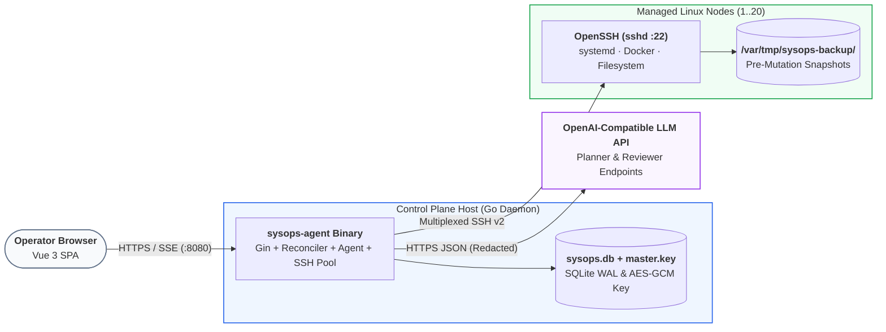
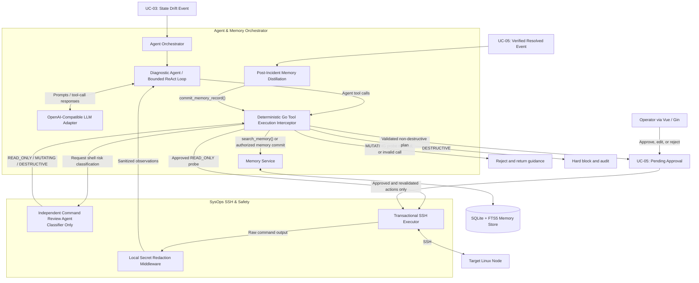
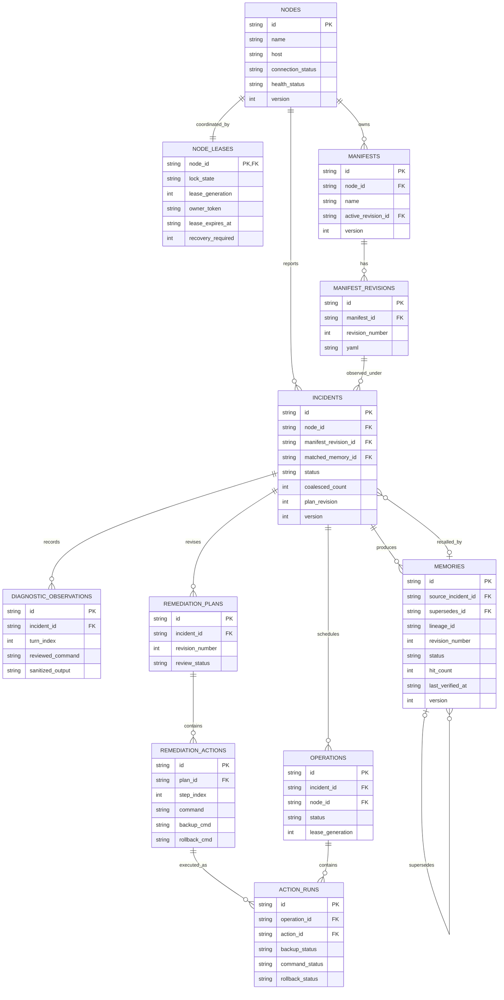

---
toc:
    depth_to: 2
puppeteer:
    format: "A4"
    printBackground: true
    timeout: 3000
    margin:
        top: 10mm
        bottom: 10mm
        left: 14mm
        right: 14mm
---

<style>
.markdown-preview.markdown-preview {
    font-family: "Times New Roman", "宋体";
    font-size: 11pt;
}
.markdown-preview.markdown-preview svg,
.markdown-preview.markdown-preview img {
    max-width: 100% !important;
    height: auto !important;
    display: block;
    margin: 10px auto;
}
</style>

<center><h3 style="margin: 10px;">Design<br/>A Declarative Personal SysOps Agent with Adaptive Long-Term Memory</h3><b>2450313 徐佳咏、2351428 徐之涵、2352626 马小云、2451405 刘宸瑞</b></center>

## 0. Table of contents

[TOC]

---

## 1. Design Summary

Since Part I SRS, we have translated our black-box requirements into an implementation-ready architecture packaged within a single Go binary, an embedded SQLite datastore, and a Vue 3 web console. We decomposed the system into four cohesive subsystems—Web & API Gateway, State Reconciliation Engine, Agent & Memory Orchestrator, and SysOps SSH & Safety—formalized across C4 Logical, Deployment, and Technology views, UML behavioral/structural models, and Architecture Decision Records.

**What Changed and Why**

Translating high-level requirements into concrete interaction and state models exposed three operational gaps that required refining our Part I baseline:

1. **Transactional Remediation with Pre-Mutation Backups and Compensation (Refining `UC-05`)**:
   Part I assumed approved multi-step remediation plans would either wholly succeed or fail cleanly. In practice, a command failing midway leaves a target Linux host in a partially mutated state. Applying the Compensating Transaction Pattern, every mutating action in `propose_remediation_plan` now requires a pre-mutation backup (`backup_cmd` saving snapshots to `/var/tmp/sysops-backup/<incident_id>`) and a paired `rollback_cmd`. Execution runs sequentially under fail-fast semantics: if step $k$ fails, execution halts, the incident transitions to `Partially_Failed`, and the Web UI exposes per-step status alongside a one-click reverse rollback workflow.
2. **Per-Node Concurrency Locking and Incident Coalescing (Refining `UC-03`, `UC-04`, `UC-05`)**:
   Part I lacked mutual exclusion when multiple state drifts occur simultaneously on the same host. We introduced a Per-Node Lease Lock and Coordinator (`IDLE`, `PROBING`, `DIAGNOSING`, `PENDING_APPROVAL`, `REMEDIATING`). On a locked node, identical drift signals coalesce into the active incident, while distinct drifts enter a serialized queue (`QUEUED_ON_LOCK`) rather than spawning duplicate LLM loops. An exclusive `REMEDIATING` lock also suspends routine `UC-03` probes on that host until post-remediation verification finishes.
3. **Deterministic Tool Execution Interceptor (Refining `UC-04`, `UC-09`)**:
   To correct our Part I component diagram—where the Review Agent appeared to invoke SSH/Plan tools directly—we introduced a deterministic Go Tool Execution Interceptor. The Diagnostic Agent emits all tool calls; the Interceptor intercepts each call, queries the Review Agent strictly as a sidecar classifier (`READ_ONLY`, `MUTATING`, `DESTRUCTIVE`), and routes approved read-only commands to SSH or suspends mutating plans at the `UC-05` approval gate.

All architectural views, ADRs, relational schemas, UML models, and updated UI mockups are complete, establishing a concrete baseline for Part III PoC validation.

---

## 2. Architecture and Key Decisions

### 2.1 Logical architecture

The system adopts a modular monolith and Ports and Adapters architecture organized into four subsystems:

1. **Web & API Gateway**: Serves the embedded Vue 3 SPA, exposes REST endpoints for node/manifest management, HITL approval (`UC-05`), and memory curation (`UC-08`), and streams real-time diagnostic and step-execution states via Server-Sent Events (SSE).
2. **State Reconciliation Engine**: Parses declarative YAML manifests (`UC-02`), schedules deterministic SSH probes (`UC-03`), and enforces per-node mutual exclusion via the Node Lease Lock & Incident Coordinator.
3. **Agent & Memory Orchestrator**: Executes the bounded ReAct diagnostic loop (`UC-04`), interactive chat (`UC-06`), FTS5 memory retrieval, and post-incident memory distillation (`UC-07`), intercepting all agent tool calls via the Tool Execution Interceptor.
4. **SysOps SSH & Safety Subsystem**: Enforces `UC-09` guardrails via the Command Review Adjudicator (safety classification) and Secret Redaction Middleware (credential scrubbing), and executes probes, backups, repairs, and rollbacks through the Transactional SSH Executor.


### 2.2 Deployment architecture

To meet the Single-Binary Zero-Config (`SRS 7.1`) and Agentless Control Plane (`SRS 6.7`) requirements, the runtime topology spans three nodes without external databases or remote monitoring agents:

1. **Control Plane Host**: Runs the `sysops-agent` Go executable (embedding compiled Vue 3 static assets via `go:embed`), paired with a local SQLite database (`sysops.db` in WAL mode) and an AES-256-GCM host key (`master.key`) for credential encryption. It also exposes port to provide the web console to the operator.
2. **Target Linux Nodes (1–20 Hosts)**: Standard Linux servers accessible via `sshd` (Port 22). During `UC-05` execution, pre-mutation file/state snapshots are staged in `/var/tmp/sysops-backup/<incident_id>/` on the target host.
3. **LLM Inference Endpoint**: Any cloud or self-hosted (Ollama/vLLM) OpenAI-compatible API endpoint accessed over HTTPS.



### 2.3 Technology architecture

| Layer                   | Selected Technology                   | Alternatives Considered       | Rationale & Trade-offs                                                                                                                                                             |
| :---------------------- | :------------------------------------ | :---------------------------- | :--------------------------------------------------------------------------------------------------------------------------------------------------------------------------------- |
| **Backend Runtime**     | **Go**                                | Python (FastAPI), Rust        | Compiles backend, concurrency scheduler, SSH pool, and frontend into one zero-dependency binary, avoiding Python runtime packaging overhead.                                       |
| **Web & Streaming**     | **Gin + SSE (Server-Sent Events)**    | WebSockets, gRPC-Web          | Diagnostic traces and step statuses stream unidirectionally while approvals use REST `POST`; SSE provides lighter connection management and auto-reconnection than WebSockets.     |
| **Frontend UI**         | **Vue 3 + TypeScript + Tailwind CSS** | React / Next.js, HTMX         | Compiles to compact static assets while supporting reactive state needed for the YAML Policy Builder and step-by-step Rollback Console.                                            |
| **Datastore & Memory**  | **Embedded SQLite (WAL + FTS5**)      | PostgreSQL + pgvector, Milvus | External vector DBs break single-binary deployment. SysOps faults rely on exact lexical tokens (unit names, exit codes, error flags), where FTS5 BM25 ranking excels at zero cost. |
| **Node Transport**      | **Native Go SSH**                     | Ansible Runner, Custom Agent  | Custom agents violate zero-footprint rules; Ansible subprocesses add startup overhead.                                                                                             |
| **LLM Integration**     | **OpenAI-Compatible JSON Tool API**   | LangChain, Vendor SDKs        | Thin custom client avoids heavy framework abstraction and enables zero-code switching across cloud or local LLM providers (`SRS 7.3`).                                             |
| **Shell Safety Parser** | **Go `mvdan.cc/sh/v3` AST Parser**    | Regex Matching                | Parses shell pipelines, subshells, and redirections into an AST before Review Agent evaluation, preventing obfuscated command bypasses where simple regex filters fail.            |

### 2.4 Key decisions

【每个人都撰写，最后徐佳咏整理总结】

【徐之涵】【马小云】【刘宸瑞】

#### ADR-01: Single-Binary Agentless Control Plane with Per-Node Lease Locking

- **Context**: The system must deploy as a lightweight personal tool (`SRS 7.1`) while preventing concurrent drift probes (`UC-03`), agentic diagnostics (`UC-04`), and state-mutating repairs (`UC-05`) from colliding on the same target Linux host.
- **Options**: (1) Distributed microservices + Redis locks + remote agents; (2) Uncoordinated SSH goroutines; (3) Single-binary Go daemon with SQLite-backed Per-Node Lease Locks.
- **Decision**: Adopt Option 3, enforcing a per-node lock state machine (`IDLE`, `PROBING`, `DIAGNOSING`, `PENDING_APPROVAL`, `REMEDIATING`) with heartbeat-renewed TTLs (`lease_expires_at`).
- **Consequences**: Identical drift signals on a locked node coalesce into the active incident (`coalesced_count++`), distinct drifts queue serially (`QUEUED_ON_LOCK`), and `REMEDIATING` locks suppress routine `UC-03` probes until post-repair verification completes. Heartbeat TTLs prevent deadlocked nodes if an SSH or LLM session hangs.

#### ADR-02: Embedded SQLite FTS5 Memory Retrieval with Three-Branch Adaptive Evolution

- **Context:** The control plane must remain lightweight, agentless, and deployable as a single Go binary with a local SQLite database (`SRS 7.1`). It must also retrieve past verified incident solutions during `UC-04` without repeatedly asking the LLM to solve the same operational failure from scratch. Personal SysOps incidents often contain highly specific lexical identifiers (such as `nginx.service`, `OOMKilled`, an exit code, or a configuration error), while remembered fixes must retain provenance, distinguish stale versions, and never become autonomous execution instructions.

- **Options:** (1) Use local SQLite FTS5 with BM25 text ranking and explicit version/status columns; (2) deploy PostgreSQL with pgvector for combined relational and embedding-based search; or (3) maintain a separate vector database such as Milvus with embedding generation and synchronization. The alternatives can improve semantic recall when users describe equivalent problems using different wording, but add operational dependencies, model/embedding costs, data synchronization, and backup complexity that conflict with the small-scale deployment target.

- **Decision:** Select **SQLite WAL + FTS5** as the primary memory store. Index sanitized `symptom_keywords`, `root_cause`, `remediation_steps`, and `scope_tags` using an external-content `memories_fts` table synchronized with `memories`. Use parameterized queries, operational-token normalization, BM25 ranking, a scope filter, and `status = ACTIVE`, returning a bounded top-k set (default `search_memory.count = 3`). Apply the deterministic `UC-07` **three-branch evolution rule** only after verified resolution: **unmatched** incidents insert a new active record; **matched, unchanged** successful fixes increment `hit_count` and update `last_verified_at`; **matched, modified** fixes insert a successor version and mark the prior version `SUPERSEDED`. Preserve `source_incident_id`, version lineage, and incident-scoped idempotency receipts, and allow manual archiving without destroying audit history.

- **Consequences and Trade-offs:** The decision avoids a separate search service, supports reproducible and inexpensive retrieval of exact system-error tokens, and integrates memory updates with other SQLite operations in atomic transactions. It also gives operators clear provenance and predictable version behavior. In exchange, FTS5 cannot guarantee semantic matching across paraphrases or changing log vocabulary, may require normalization for punctuation-rich SysOps identifiers, and does not independently determine whether an older fix is still safe in a new host context. Search hits are **advisory evidence only**: command execution remains subject to `CHG-03` interception and `UC-05` approval. Part III should validate retrieval precision/recall and stale-memory behavior on a small fault-injection corpus before considering an optional semantic reranker.

### 2.5 Quality attributes

【刘宸瑞】

### 2.6 Architectural Risks

【刘宸瑞】

### 2.7 Agentic Systems

#### 2.7.1 Agent Roles and Trust Boundaries

The Agent & Memory Orchestrator performs bounded, evidence-driven diagnosis after the State Reconciliation Engine detects drift (`UC-03`). It consists of a **Diagnostic Agent**, a **Memory Service**, a post-resolution **Memory Distillation** workflow, and a deterministic Go **Tool Execution Interceptor**. The Diagnostic Agent uses an OpenAI-compatible LLM to form hypotheses, request observations, and propose a remediation plan; it has no direct SSH, database-write, or approval authority. The Memory Service performs local SQLite FTS5 retrieval and persists versioned records. The distillation workflow transforms *verified* resolved incidents into reusable, sanitized troubleshooting knowledge (`UC-07`).

The independent **Command Review Agent** belongs to the SysOps SSH & Safety subsystem, not to the tool-execution control path. It returns a classification (`READ_ONLY`, `MUTATING`, or `DESTRUCTIVE`) for candidate shell commands, but never invokes the SSH executor or the remediation tools. Instead, the deterministic Go interceptor mediates every agent-originated tool call, applies lifecycle and permission checks, obtains safety verdicts when shell commands are involved, and routes requests to the appropriate service. This separation addresses `CHG-03` and prevents an LLM from granting itself execution privileges.

#### 2.7.2 Internal Orchestration and Tool-Call Architecture

The following diagram distinguishes agent reasoning, deterministic authorization, human approval, SSH execution, and memory operations. The inter-agent review call returns only a safety verdict; all actual dispatch remains with the interceptor and the execution subsystem.



**Tool contracts and execution boundaries**

| Tool | Main inputs | Behavior and authority |
| :--- | :--- | :--- |
| `search_memory` | `keywords: string[]`, `count: int = 3` | Read-only FTS5 search over active, relevant memories; results provide prior verified fixes as evidence, not instructions to execute. |
| `exec_readonly_shell` | `node_id`, `command` | The interceptor requests independent safety classification. Only confirmed `READ_ONLY` commands are dispatched to SSH; ambiguous, mutating, or destructive probes are not executed. |
| `propose_remediation_plan` | `node_id`, `root_cause`, `actions[]` | Persists a proposed plan for `UC-05`; it does **not** execute commands. Each mutating action specifies a command, `backup_cmd`, and `rollback_cmd` for review and subsequent safe execution (`CHG-01`). Destructive actions are rejected. |
| `commit_memory_record` | `symptom_keywords`, `root_cause`, `remediation_steps`, `scope_tags`, optional `matched_memory_id`, `is_modified` | Allowed only after the incident has reached verified `Resolved`; commits sanitized knowledge through the Memory Service using the three-branch update rule (`UC-07`). |

#### 2.7.3 Short-Term Context and Long-Term Memory Retrieval

For each incident, the orchestrator constructs a **short-term diagnostic context** from the active YAML manifest, observed drift, node and service identifiers, bounded and sanitized diagnostic output, relevant operator feedback, and at most three retrieved memories (`search_memory` default `count = 3`). SQLite FTS5 with BM25 ranking prioritizes exact operational tokens such as service names, exit codes, and log error signatures. Only `Active` memories matching the incident's applicable scope should enter retrieval; `Superseded` and `Archived` versions are excluded from the default search. Retrieved fixes are advisory evidence and must not bypass command review or human approval.

The orchestrator retains concise observations and tool outcomes rather than unbounded raw logs. SSH probes use bounded commands (for example, `journalctl -n 50` or `docker logs --tail 50`), and context can be summarized between turns while preserving key error signatures and causal evidence. The local Secret Redaction Middleware removes credentials, tokens, and private keys before diagnostic output is persisted in SQLite, sent to an external LLM endpoint, or streamed to the UI. The web console receives sanitized progress summaries, not private raw model reasoning. An OpenAI-compatible adapter permits local or cloud inference without changing the orchestration logic.

#### 2.7.4 Bounded ReAct Diagnosis (`UC-04`)

When `UC-03` detects drift and the per-node coordinator grants a `DIAGNOSING` lease (`CHG-02`), the orchestrator first searches historical memories and builds the initial context. The Diagnostic Agent then follows a bounded **Reason–Act–Observe** loop: (1) infer a likely cause from available evidence; (2) issue a diagnostic tool call; (3) let the interceptor and safety subsystem vet and execute an eligible read-only probe; and (4) incorporate the redacted observation into the next inference step. The configured default ceiling is `max_turns = 8` (`SRS UC-04`). If a command is not read-only, the interceptor refuses it and instructs the agent to collect evidence through safe probes or defer the change to the remediation plan.

If sufficient evidence is obtained, the agent submits a structured root-cause summary and ordered remediation actions through `propose_remediation_plan`. The incident transitions to `PENDING_APPROVAL` and waits for explicit operator review (`UC-05`); the Diagnostic Agent never runs the proposed mutations itself. If the turn ceiling is reached or useful diagnosis cannot proceed, the incident is marked `Escalated` with the available sanitized evidence, rather than guessing or automatically repairing the host. If the LLM endpoint is unavailable, deterministic drift detection and alerting continue independently, while agent diagnosis is deferred or escalated (`SRS 7.5`).

#### 2.7.5 Safety, Human Handoff, and Post-Resolution Memory

The local interceptor provides the enforceable boundary between untrusted model output and privileged tools. Command parsing and review must fail closed on unsupported or obfuscated shell syntax; the Review Agent's result is input to a deterministic policy decision, not permission by itself. `DESTRUCTIVE` commands are hard-blocked and audited. `MUTATING` operations are prohibited during autonomous diagnosis and require a reviewed, versioned plan plus explicit human approval. After approval, the SysOps SSH & Safety subsystem performs the `backup_cmd`, then the change, and finally post-change verification; failures enter the compensating recovery path described in `CHG-01` and `ADR-03`. The approval and recovery details belong to `UC-05` and the SSH subsystem, rather than the Diagnostic Agent.

Only after the desired-state probe confirms recovery and the incident reaches `Resolved` does `UC-07` begin memory distillation. The system extracts the observed symptoms, confirmed root cause, verified remediation, and any operator modifications, scrubs sensitive content, and invokes `commit_memory_record`. Its three-branch policy inserts a new memory for an unmatched incident, increments `hit_count` and refreshes `last_verified_at` for an unchanged successful reuse, or inserts a new version and marks the old entry `Superseded` when the fix was modified. Operators may inspect and archive one-off memories (`UC-08`). This process separates temporary diagnostic context from reusable, provenance-linked long-term knowledge, while ensuring that unverified LLM suggestions are never treated as successful fixes.

**Design consistency:** This section implements the `UC-04`, `UC-07`, and `UC-09` behaviors in Part I SRS; the `CHG-01` transactional plan, `CHG-02` node lease coordination, and `CHG-03` deterministic interceptor refinements in Part II; and the REST/SSE and versioned memory interfaces proposed in the team's HW2 API design.

---

## 3. Design Models

### 3.1 Domain & Structural Class Diagrams

【刘宸瑞】

### 3.2 Relational Data Model

#### 3.2.1 Data Model and Persistence Boundaries

The control plane uses **embedded SQLite** with Write-Ahead Logging (WAL) for operational state and **FTS5** for keyword-based incident-memory retrieval. This choice preserves the project's single-binary, agentless deployment requirement (`ADR-01`) and avoids a separate database or vector-search service (`ADR-02`). The schema must support three connected lifecycles: (1) a managed node's declarative policy and detected drift (`UC-02/03`); (2) bounded, reviewed diagnosis and human-approved, recoverable remediation (`UC-04/05/09`); and (3) verified incident-to-memory distillation, retrieval, versioning, and curation (`UC-07/08`).

Database columns store **durable domain facts**, whereas the API presents versioned resource representations. For example, the API's `lock_state` is derived from the `node_leases` row; `manifest_version` resolves to an immutable `manifest_revisions` record; and the incident's current plan revision is represented by the latest `remediation_plans` row. Operational event delivery is supported by a durable `events` outbox, not by treating an SSE connection as persistent storage.

#### 3.2.2 Entity–Relationship Diagram

The following logical ER diagram shows primary and foreign keys (`PK`, `FK`). SQLite uses `TEXT` for opaque IDs and UTC timestamps, `INTEGER` for versions/counters, and JSON-valid `TEXT` for compact structured fields. Abbreviated attributes are expanded in the schema summary and the accompanying SQL appendix.



`MEMORIES.supersedes_id` points to an earlier version within the same lineage; a newly revised entry is the active successor of the old one. `INCIDENTS.matched_memory_id` records the principal historical memory selected for a resolved incident; an optional incident–memory match table can record additional retrieved candidates if full retrieval provenance is required. `EVENTS`, `IDEMPOTENCY`, and `MEMORY_DISTILLATIONS` are infrastructure/audit tables explained below and intentionally omitted from the main domain diagram for readability.

#### 3.2.3 Core Tables, Keys, and Indexes

| Table | Important columns and constraints | Purpose / access pattern |
| :--- | :--- | :--- |
| `nodes` | `id` PK; `name`, `host`, `port`, `username`, `host_key_fingerprint`, `connection_status`, `health_status`, `last_probe_at`, `version`; encrypted credential blob never returned by API | Registered Linux nodes (`UC-01/03`). `connection_status` is not conflated with health or lock state. |
| `node_leases` | `node_id` PK/FK; `lock_state`, `owner_token`, monotonic `lease_generation`, `lease_expires_at`, `recovery_required` | SQLite-backed per-node coordinator (`CHG-02`); exclusive ownership and safety on uncertain remote execution. |
| `manifests` + `manifest_revisions` | `manifests.node_id` FK; active revision pointer; immutable `(manifest_id, revision_number)` unique key; YAML and validation state in revisions | Versioned declarative policies. A running incident stays bound to the revision observed when drift occurred, even when a policy is edited later. |
| `incidents` | `id` PK; `node_id`, `manifest_revision_id` FKs; `status`, `drift_signature`, `drift_summary`, `coalesced_count`, `root_cause_summary`, `matched_memory_id`, `plan_revision`, `version`, `resolved_at` | Traces a fault from `OPEN`/`DIAGNOSING` to `PENDING_APPROVAL`, `RESOLVED`, or `ESCALATED`, including `QUEUED_ON_LOCK` and `PARTIALLY_FAILED`. |
| `diagnostic_observations` | `id` PK; `incident_id` FK; `turn_index`, `tool_name`, `review_verdict`, sanitized command/observation, `created_at` | Bounded, redacted evidence for the ReAct trace; no raw secrets or private model reasoning are stored (`UC-04/09`). |
| `remediation_plans` + `remediation_actions` | `(incident_id, revision_number)` unique; ordered `(plan_id, step_index)` unique; each action has `command`, mandatory `backup_cmd` and `rollback_cmd`, risk and review metadata | Immutable reviewed plan revisions. A plan edit creates a new revision; previously approved steps cannot silently change (`CHG-01`, `ADR-03`). |
| `operations` + `action_runs` | `operations` records operation/worker/lease generation; `action_runs` records backup, command and compensation states for a specific approved action | Tracks execution and recovery outcomes without mutating the reviewed command definitions. Timeout/uncertain status is explicit. |
| `memories` | `id` PK; `lineage_id`, `revision_number`, `supersedes_id` FK; `source_incident_id` FK; `symptom_keywords`, `root_cause`, `remediation_steps`, `scope_tags`, `status`, `hit_count`, `last_verified_at`, `version` | Reusable, verified, redacted knowledge with provenance, optimistic concurrency, and audit-preserving version lineage (`UC-07/08`). |
| `events` | Autoincrement `id`; `resource_type`, `resource_id`, `resource_version`, `type`, sanitized JSON `payload`, `committed_at` | Durable transactional event/outbox for ordered SSE updates and reconnect replay (`ADR-04`). |
| `idempotency` + `memory_distillations` | `(operator_id, key)` unique for operator commands; `memory_distillations.incident_id` unique for all UC-07 branches | Prevents duplicate operations or duplicate post-resolution memory commits. |

Indexes target the most common operations: `incidents(node_id, status, updated_at)`, `remediation_plans(incident_id, revision_number)`, `remediation_actions(plan_id, step_index)`, `memories(status, last_verified_at)`, and an FTS5 index on searchable memory text. A partial unique index on `memories(lineage_id) WHERE status = 'ACTIVE'` prevents two simultaneously active versions of one troubleshooting pattern; `UNIQUE(supersedes_id)` prevents a previous version from acquiring two immediate successors. Foreign keys are enabled on every SQLite connection; WAL supports concurrent readers while short transactions serialize writes.

#### 3.2.4 SQLite FTS5 Search and Context Retrieval

The `memories_fts` virtual table indexes four searchable fields in `memories`: `symptom_keywords`, `root_cause`, `remediation_steps`, and `scope_tags`. An **external-content** FTS5 index keyed by the `memories` rowid and synchronized through insert/update/delete triggers avoids a second independent source of truth. The Memory Service normalizes diagnostic terms, constructs a safely escaped FTS query, and uses bound parameters to prevent user-provided text from being interpreted as arbitrary SQL or untrusted FTS query syntax. It joins ranked FTS matches back to `memories`, filters `status = 'ACTIVE'` and applicable scope, and uses `bm25(...)` ranking with a configurable top-`k` limit (default `search_memory.count = 3` in Part I SRS).

For example, a future incident involving `nginx.service` and an address-in-use error can recover a prior verified memory containing those tokens; it does **not** automatically execute its stored remediation steps. Keyword retrieval is lightweight and particularly useful for exact SysOps identifiers, but it can miss semantically similar incidents with different wording. This limitation is a known trade-off of `ADR-02`, not a claim of semantic-equivalent search. `Superseded` and `Archived` records remain available for audit but are excluded from normal retrieval.

#### 3.2.5 Adaptive Memory Evolution (`UC-07`)

A memory write is authorized only after an incident has been **verified `RESOLVED`** (post-remediation desired-state check or verified manual resolution). The distillation pipeline receives the redacted symptom, confirmed cause, successful steps, scope tags, and a reference to any matched memory. The following cases are implemented in one SQLite transaction, with a corresponding `memory.updated` event inserted into the `events` outbox:

| Verified outcome | Transactional update | Observable result |
| :--- | :--- | :--- |
| **New pattern** (`matched_memory_id IS NULL`) | Insert a new `memories` row: new lineage, `revision_number = 1`, `status = 'ACTIVE'`, `hit_count = 1`, `source_incident_id = resolved incident`; FTS5 trigger indexes its searchable fields. | New searchable memory with incident provenance. |
| **Existing pattern, unchanged fix** (`is_modified = false`) | Claim an idempotent incident-scoped distillation receipt, then update the *active matched version*: `hit_count += 1`, `last_verified_at = verification time`, `version += 1`. | Existing knowledge gains another verified use without an unnecessary duplicate version. |
| **Existing pattern, modified fix** (`is_modified = true`) | Mark the old row `SUPERSEDED`, insert the verified replacement in the same `lineage_id` with `revision_number + 1`, `supersedes_id = old.id`, `status = 'ACTIVE'` and new incident provenance. | Version history is preserved; only the new revision is used for future retrieval. |

If the operator later edits a memory through `PATCH /memories/{id}`, the service follows the versioning path but **does not change `last_verified_at` merely because of the edit**. `POST /memories/{id}/archives` changes the current record to `ARCHIVED` rather than deleting evidence or incident links. All three branches record a unique `memory_distillations(incident_id)` receipt as part of the same transaction. A repeated or retried distillation event must not create a duplicate memory or increment `hit_count` twice; all branches maintain the one-active-version-per-lineage invariant. This is especially important when an internal distillation worker retries after an uncertain commit response.

#### 3.2.6 Integrity, Safety, and API Alignment

The schema implements `CHG-01` by storing pre-mutation backups, compensation commands and individual execution outcomes; `CHG-02` by storing per-node lease ownership/generation and incident coalescing counts; and `CHG-03` by recording **reviewed tool outcomes** without granting database or SSH privileges to the LLM. All persisted diagnostic text, memory content and event payloads must pass local secret redaction before commit. SSH credentials are encrypted at rest and are never represented in responses or SSE payloads.

For `ADR-04`, resource changes and their corresponding outbox events are committed atomically; the REST/SSE gateway can replay events by increasing event `id` after reconnection. The UI's `GET /memories`, `GET /memories/{id}`, `PATCH /memories/{id}` and archive action map to `memories` and `memories_fts`, while node and incident DTO versions map to their corresponding `version` fields. A plan approval is bound to the current incident/plan revision and an idempotency key. This design keeps the Agent & Memory subsystem's persistence consistent with the separate SysOps SSH & Safety and Web/API designs without treating model output as an authoritative database mutation.

**Implementation appendix:** The companion `SAD_HW2_XZH_3_2_schema.sql` is a proposed, executable SQLite schema illustrating these tables, FTS5 triggers and indexes. The ER diagram and discussion above constitute the required design artifact; the SQL file is provided for cross-checking and Part III implementation planning.

### 3.3 Agent & Memory Diagrams

This section specifies the interaction order for the Agent & Memory Orchestrator's two principal use cases. **Sequence 1** refines autonomous diagnosis (`UC-04`) with command-safety review and log sanitization (`UC-09`); **Sequence 2** refines adaptive memory distillation after a verified incident resolution (`UC-07`). The diagrams complement the component responsibilities defined in Section 2.7 and use the versioned SQLite persistence model from Section 3.2. All LLM-generated tool requests cross a **deterministic Go Tool Execution Interceptor**: the Command Review Agent is a classifier, never an SSH executor (`CHG-03`).

#### 3.3.1 Sequence 1: Autonomous Root-Cause Diagnosis, Tool Safety Review, and Log Redaction (`UC-04`, `UC-09`)

```mermaid
sequenceDiagram
    autonumber
    participant C as Node Lease Coordinator
    participant O as Agent Orchestrator
    participant M as Memory Service
    participant DB as SQLite
    participant D as Diagnostic Agent / LLM
    participant I as Go Tool Interceptor
    participant R as Command Review Agent
    participant E as SSH Executor
    participant S as Secret Redaction Middleware
    participant UI as Gin API / Web UI

    Note over C,O: UC-03 has detected drift; node lease enters DIAGNOSING
    C->>O: Start diagnosis(incident_id, manifest, drift)
    O->>M: search_memory(symptom_keywords, count = 3)
    M->>DB: FTS5 lookup (ACTIVE records, scope, BM25)
    DB-->>M: Ranked verified memories
    M-->>O: Top matching memories (read-only evidence)
    O->>O: Assemble bounded, sanitized context

    loop ReAct turns while unresolved (max_turns = 8)
        O->>D: Infer next step from context and observations
        D-->>O: Tool call: exec_readonly_shell(node_id, command)
        O->>I: Intercept tool call with incident and lease context
        I->>I: Validate tool, command AST, policy, and lease
        I->>R: Request safety classification (no execution)
        R-->>I: READ_ONLY / MUTATING / DESTRUCTIVE verdict

        alt Validated READ_ONLY
            I->>E: Execute approved bounded diagnostic probe
            E-->>S: Raw SSH output (local boundary only)
            S-->>I: Redacted output, exit code, and timeout status
            I-->>O: Sanitized observation / tool result
            O->>DB: Persist sanitized diagnostic observation
            O->>O: Append concise evidence to context
        else MUTATING or ambiguous syntax
            I-->>O: Reject diagnosis-time mutation (fail closed)
            O->>O: Keep proposed change for human-reviewed plan
        else DESTRUCTIVE
            I-->>O: Hard block and produce auditable denial
            O->>DB: Persist sanitized safety denial
        end
    end

    alt Root cause established within turn limit
        D-->>O: propose_remediation_plan(root_cause, actions)
        O->>I: Intercept and validate proposed plan
        I->>I: Require command, backup_cmd, rollback_cmd per action
        I->>R: Classify proposed commands and recovery commands
        R-->>I: Safety verdicts for plan steps
        alt Any DESTRUCTIVE / invalid action
            I-->>O: Reject plan; require revision or escalation
        else Plan is non-destructive and well-formed
            I->>DB: Save versioned plan; set PENDING_APPROVAL
            DB-->>UI: Committed plan event available for sanitized SSE
            Note over UI,E: UC-05 approval is required; no mutation executes here
        end
    else Turn ceiling reached, LLM unavailable, or no safe progress
        O->>DB: Mark incident ESCALATED; save sanitized evidence
        DB-->>UI: Committed escalation event available for SSE
    end
```

**Interaction rationale.** The State Reconciliation Engine performs deterministic drift detection and hands the incident to the Agent Orchestrator only when the per-node coordinator permits diagnosis (`CHG-02`). Before calling the LLM, the orchestrator performs local `search_memory` and includes up to three relevant, currently `ACTIVE` troubleshooting memories, alongside the YAML policy, drift symptom, and bounded diagnostic evidence. Previously successful fixes are **context**, not permission to run commands automatically.

In each bounded ReAct turn, the Diagnostic Agent proposes a tool call, but the **Go Tool Execution Interceptor** owns the dispatch decision. It checks the requested tool, command syntax, current incident state, and lease context. For candidate shell calls, the independent Review Agent returns only a `READ_ONLY`, `MUTATING`, or `DESTRUCTIVE` classification. An approved read-only probe may reach the SSH executor; diagnostic-time mutations are refused, ambiguous commands fail closed, and destructive commands are hard-blocked and audited. Crucially, **there is no direct arrow from the Review Agent to SSH**. Every SSH output is redacted locally **before** it is returned to the LLM, persisted as a diagnostic observation, or exposed via the API/SSE stream (`UC-09`).

The normal loop stops when sufficient evidence supports a diagnosis, or at the configured ceiling (`max_turns = 8` by default). The agent then requests `propose_remediation_plan` with an ordered set of steps. Each mutating step includes the proposed `command`, `backup_cmd`, and `rollback_cmd` from `CHG-01`; the interceptor checks the plan for prohibited actions and persists an acceptable proposal as a **versioned, unexecuted** plan in `PENDING_APPROVAL`. The actual approval, pre-mutation backup, fail-fast execution, convergence verification, and rollback belong to `UC-05` and the SysOps SSH & Safety design (Sections 3.4–3.5 and `ADR-03`). If diagnosis stalls or the model is unavailable, the incident is escalated rather than attempting an unverified fix. All surfaced progress consists of sanitized summaries and tool results, not raw private model reasoning (`ADR-04`).

#### 3.3.2 Sequence 2: Verified Incident Distillation and Three-Branch Memory Evolution (`UC-07`)

```mermaid
sequenceDiagram
    autonumber
    participant C as Incident Coordinator / UC-05
    participant O as Agent & Memory Orchestrator
    participant S as Secret Redaction Middleware
    participant L as LLM Distiller
    participant M as Memory Service
    participant DB as SQLite + FTS5
    participant G as Gin API / SSE Dispatcher
    actor U as Operator / Memory Hub

    Note over C,O: Verified UC-03 convergence (or verified manual resolution) is required
    C->>DB: Commit incident status = RESOLVED
    C->>O: Trigger UC-07(incident_id)
    O->>DB: Load verified fix, incident, matched memory, operator edits
    DB-->>O: Source evidence and completed action outcomes
    O->>S: Scrub source evidence before LLM transmission
    S-->>O: Sanitized incident history
    O->>L: Distill into structured memory fields
    L-->>O: symptom_keywords, root_cause, remediation_steps, scope_tags
    O->>S: Validate and re-scrub proposed memory text
    S-->>O: Sanitized memory candidate
    O->>M: commit_memory_record(incident_id, candidate, matched_memory_id, is_modified)
    M->>DB: BEGIN IMMEDIATE; verify RESOLVED; check unique distillation receipt

    alt Receipt already exists (retry)
        DB-->>M: Return previously committed memory_id and branch
        Note over M,DB: No second insert and no duplicate hit_count increment
    else First successful distillation
        alt No matched memory (new pattern)
            M->>DB: INSERT ACTIVE memory (new lineage, source_incident_id)
            DB->>DB: FTS5 insert trigger indexes searchable text
        else Matched ACTIVE memory, unchanged verified fix
            M->>DB: UPDATE hit_count += 1, last_verified_at, version += 1
            Note over M,DB: Reuse existing memory ID; no new version
        else Matched ACTIVE memory, verified modified fix
            M->>DB: UPDATE old memory status = SUPERSEDED
            M->>DB: INSERT new ACTIVE version with supersedes_id and provenance
            DB->>DB: FTS5 insert trigger indexes new searchable text
        end
        M->>DB: INSERT memory_distillations receipt and memory.updated event
        M->>DB: COMMIT atomic memory update plus event
    end
    DB-->>M: Existing or newly committed memory ID
    M-->>O: Memory commit outcome / branch
    G->>DB: Read committed events in increasing event ID
    DB-->>G: memory.updated event from durable outbox
    G-->>U: Sanitized SSE memory.updated (ID, status, version)
    U->>G: GET /memories/{id} to refresh if needed
    G-->>U: Current sanitized record and lineage
    Note over U,DB: UC-08 edits create a version; archives exit ACTIVE retrieval
```

**Trigger and evidence.** Memory distillation is not an ordinary continuation of the diagnostic loop. It starts **only after** an incident has been marked `RESOLVED` through an actual desired-state convergence check (`UC-05` followed by `UC-03`) or verification of a manual repair. A proposed fix, a successful SSH exit code alone, or an unverified LLM claim is insufficient. The orchestrator aggregates the drift signature, redacted observations, confirmed root cause, successfully executed remediation, and operator modifications. Sensitive data is scrubbed before the LLM distiller sees the history and again before committing its structured output. The model proposes a memory record; it does **not** perform arbitrary SQL updates.

**Atomic three-branch policy.** `commit_memory_record` invokes the deterministic Memory Service, which verifies that the source incident is resolved and consults the `memory_distillations(incident_id)` idempotency receipt before writing. Its three outcomes follow Part I `UC-07`:

| Condition | SQLite action | Retrieval effect |
| :--- | :--- | :--- |
| `matched_memory_id = null` | Insert a new `ACTIVE` memory, with new lineage and `source_incident_id`. | Indexed in FTS5 and eligible for relevant future searches. |
| Match found and `is_modified = false` | Increment the existing active record's `hit_count` and refresh `last_verified_at` and row `version`. | Reuses the verified solution without creating a redundant memory version. |
| Match found and `is_modified = true` | Mark old record `SUPERSEDED`; insert a replacement `ACTIVE` version linked through `supersedes_id`, with provenance of the new verified incident. | The current version is searchable by default; the previous version remains auditable. |

All successful writes, the incident-scoped distillation receipt, and the durable `memory.updated` event are committed **in one SQLite transaction**. A worker retry after an uncertain response reads the receipt and returns the earlier result rather than creating a duplicate record or counting the same incident twice. SQLite FTS5 triggers maintain the index for newly inserted or text-modified records. The default `search_memory` query filters out `SUPERSEDED` and `ARCHIVED` records; retained versions are available for history and operator review. A user-initiated edit through the `UC-08` API also creates a new version but **must not fabricate a new verification timestamp**. The UI is notified with `memory.updated` through the durable SSE outbox (`ADR-04`) and can refresh the latest record and version lineage.

**Consistency and failure handling.** If the distiller returns invalid structured fields, redaction cannot be completed, or SQLite commits fail, `UC-07` records an operational failure/retry state without publishing a verified reusable memory. The confirmed `RESOLVED` incident is not reverted solely because post-resolution memory distillation failed. A missing, archived, superseded, or stale `matched_memory_id` must be revalidated against the current lineage before applying the reuse or revision branch; the service must not silently update a non-current version. The proposed design keeps AI output advisory, makes data changes deterministic and auditable, and separates the Memory Service from the security-sensitive SSH executor.

**Cross-section traceability.** Sequence 1 covers `UC-04` + `UC-09`, the new interceptor boundary in `CHG-03`, bounded diagnosis and context control in Section 2.7, and the `PENDING_APPROVAL` handoff to `UC-05`. Sequence 2 covers `UC-07` + `UC-08`, the `memories`/`memories_fts`/`memory_distillations` tables from Section 3.2, the three-branch memory decision in `ADR-02`, and the durable `memory.updated` event expected by the REST/SSE interface (`ADR-04`).

### 3.4 State Machine Diagrams

【刘宸瑞】

### 3.5 Drift & Remediation Diagrams

【刘宸瑞】

### 3.6 API Interfaces

【马小云】

---

## 4. Updated Requirements

1. **CHG-01 — Transactional Remediation & Rollback (`SRS 5.2.3 UC-05` & `5.4 propose_remediation_plan`)**
    - **Change**: Replaced atomic batch execution with sequential fail-fast execution backed by mandatory pre-mutation snapshots (`backup_cmd` saving state to `/var/tmp/sysops-backup/<incident_id>/`, verified with `exit_code == 0` before running `command`) and paired compensation commands (`rollback_cmd`). If step $k$ fails, remaining steps $k+1..N$ are skipped, the incident enters `Partially_Failed`, and the Web UI exposes per-step statuses (`Succeeded`, `Failed`, `Skipped`) with one-click **Auto-Rollback** ($k-1 \dots 1$) or re-planning.
    - **Rationale**: Multi-step SSH mutations are non-atomic; midway failure leaves target nodes in an inconsistent state without pre-change backups and compensation logic.
2. **CHG-02 — Per-Node Concurrency Locking & Coalescing (`SRS 5.1 UC-03`, `5.2.2 UC-04` & `5.2.3 UC-05`)**
    - **Change**: Introduced a per-node lease lock (`IDLE`, `PROBING`, `DIAGNOSING`, `PENDING_APPROVAL`, `REMEDIATING`) in SQLite. On drift detection, if a node is locked by the same drift signature, `coalesced_count` increments without spawning a second LLM loop; if locked by a distinct drift signature, the new incident enters `Queued_On_Lock` and re-probes the node upon lock release. Active `REMEDIATING` locks suppress routine `UC-03` probe ticks.
    - **Rationale**: Prevents duplicate LLM loops, concurrent SSH write races, and false-positive drift alerts while services restart.
3. **CHG-03 — Tool Execution Interceptor Boundary (`SRS 5.2.2 UC-04`, `5.2.5 UC-09` & `5.4 Diagram`)**
    - **Change**: Replaced direct agent-to-agent tool routing in the Part I component diagram with a deterministic Go Tool Execution Interceptor. The Diagnostic Agent initiates all tool calls; the Interceptor queries the Review Agent strictly for a safety verdict (`READ_ONLY`, `MUTATING`, `DESTRUCTIVE`) and dispatches read-only probes or suspends mutating plans for `UC-05` approval.
    - **Rationale**: Aligns the structural model with `UC-04`/`UC-09` semantics, where the Diagnostic Agent calls tools and the Review Agent acts solely as a policy classifier.

---

## 5. UI and UX Design

### 5.1 Key Screens Mockups

【马小云】

### 5.2 User Flows

【马小云】

---

## 6. Open Issues and Risks

【每个人都撰写至少一条，最后徐佳咏整理总结】

【徐之涵】【马小云】【刘宸瑞】

1. **Lock Starvation & Cascade Resolution of Queued Incidents**:
    - Uncertainty: While an incident waits in `PENDING_APPROVAL` for operator review, distinct drifts on the same node wait in `Queued_On_Lock`. Delayed human approval could delay diagnosing secondary drifts, or the primary fix (e.g., freeing disk space) might implicitly resolve the queued drift.
    - Part III PoC Validation: Test a two-tier lock (allowing read-only `UC-04` diagnosis under a shared lock while `PENDING_APPROVAL` is idle, reserving exclusive locks for `REMEDIATING`) and enforce an automatic `UC-03` re-probe on dequeue to auto-close already healed incidents.


**R-XZH: Stale or Misleading Memory Retrieval across Host Versions.**

- **Uncertainty:** Keyword-based FTS5 can retrieve a previously successful fix that shares an error string with a new incident but was verified on a different Linux distribution, package version, service configuration, or host. Conversely, semantically similar issues with different wording may be missed. `hit_count` measures previously verified reuse, not present-day applicability. A historical repair must not become an automatic command merely because it ranks highly.

- **Proposed mitigation:** Store source-incident provenance, verification timestamps, scope tags, and immutable version lineage; exclude `ARCHIVED` and `SUPERSEDED` entries from default retrieval; expose retrieval evidence to the diagnostic agent as context, not as a privileged instruction. Require fresh read-only diagnostics and independent review of any proposed command, followed by explicit human approval for mutation. Consider an age warning and scope-based ranking rules where environment information is available.

- **Part III PoC validation:** Construct a labeled set of repeated and near-duplicate incidents (including mismatched OS/service versions and paraphrased log messages). Compare top-3 FTS5 retrieval results with expected relevant memories, record precision@3 and recall@3, and manually inspect false matches. Verify that archived or superseded records are not injected into default context, that a mismatched historical fix cannot bypass command review or HITL approval, and that an operator-edited replacement keeps the old memory in the audit trail. The exact acceptance thresholds should be agreed with the team before testing, rather than reported as measured results in Part II.

---

## 7. AI Tools Reflection

【每个人都撰写，最后徐佳咏整理总结】

### xjy

- Tool chain: Gemini 4 Argon in Google AI Studio and OpenCode
- Cost: covered by Google AI Pro & OpenCode Go subscription
- Pros / cons: communicate about the project concept, helpful in brain storming, English translations, and generating UML diagrams, but easily provides ideas that are too complex or too simple
- Verification: manually review & rewrite
- Enhancement: correct & rewrite AI output to align with our true design intent
- Artifacts: no specific artifacts

### xzh

- Tool chain: ChatGPT for technical writing, Mermaid diagrams, and relational data modeling
- Cost: covered by ChatGPT subscription
- Pros / cons: accelerated drafting and highlighted design dependencies, but could introduce incorrect details or overlook edge cases
- Verification: reviewed the drafts against the SRS, team design, and related pull requests; checked the diagrams and integration
- Enhancement: corrected and revised AI-generated text and diagrams to align with the SRS and team design
- Artifacts: 2.7, 3.2, 3.3, ADR-02, and related risk and references

### mxy

【马小云】

### lcr

【刘宸瑞】

---

## 8. Annotated References

【每个人按需撰写】

【徐之涵】【马小云】【刘宸瑞】

1. **B. Beyer, C. Jones, J. Petoff, and N. R. Murphy, Eds., _Site Reliability Engineering: How Google Runs Production Systems_. Sebastopol, CA, USA: O'Reilly Media, 2016.**
   This foundational work formalizes Site Reliability Engineering (SRE) principles including declarative state management, toil elimination through idempotent automation, alert deduplication, and safe change management. Chapters on Eliminating Toil, Practical Alerting, and Data Processing Pipelines demonstrate how uncoordinated automation and concurrent alert storms often worsen production incidents rather than resolving them.
   These principles directly shaped our State Reconciliation Engine and Per-Node Lease Lock Coordinator (`Section 2.1`, `ADR-01`). Rather than treating periodic SSH checks as stateless cron jobs that blindly invoke an LLM on every failure tick, we separated deterministic drift detection (`UC-03`, \$0 token cost) from bounded agentic diagnosis (`UC-04`). Specifically, the book's analysis of concurrent automation hazards motivated our per-node lock state machine (`IDLE`, `PROBING`, `DIAGNOSING`, `PENDING_APPROVAL`, `REMEDIATING`), which coalesces duplicate drift alerts, serializes distinct faults on the same host, and suppresses routine health probes during active `REMEDIATING` windows. Finally, its emphasis on post-change verification informed our mandatory post-remediation `UC-03` convergence check before marking any incident `Resolved`.


**S. Yao, J. Zhao, D. Yu, N. Du, I. Shafran, K. Narasimhan, and Y. Cao, “ReAct: Synergizing reasoning and acting in language models,” in *Proceedings of the International Conference on Learning Representations (ICLR)*, 2023.** https://arxiv.org/abs/2210.03629

Yao et al. introduce ReAct, a method that interleaves language-model reasoning with actions that gather information from tools or external environments. The core idea is that a system can revise its next action based on newly observed evidence rather than issuing an entire action plan without feedback. This is directly relevant to our `UC-04` diagnostic workflow: the Diagnostic Agent receives a drift report, proposes a bounded read-only inspection step, obtains a sanitized observation, and updates its diagnosis until it can justify a remediation proposal or reaches the configured turn ceiling. The paper informs the *reason–act–observe* structure, but it does not by itself provide security guarantees for a shell-capable agent. We therefore place a deterministic Go Tool Execution Interceptor between model-generated requests and privileged tools (`CHG-03`). The independent Command Review Agent supplies only a classification; the interceptor applies fail-closed policy, and mutation is reserved for the human-approved `UC-05` workflow. We also cap diagnosis at `max_turns = 8` and restrict logged output and memory retrieval to bounded context so an incident cannot produce an uncontrolled loop or context explosion. Thus, ReAct contributes the interaction pattern, while our own architecture adds explicit permissions, auditable handoff, safe degradation, and post-action verification appropriate to personal Linux operations. This separation is a central design decision because a convincing model-generated explanation is not equivalent to a safe command or a verified repair.

**SQLite Project, “SQLite FTS5 Extension,” SQLite Documentation.** https://www.sqlite.org/fts5.html

The SQLite FTS5 documentation describes an embedded full-text indexing facility, including `MATCH` queries, the built-in `bm25()` ranking function, external-content tables, and the triggers needed to keep an external-content index synchronized with its underlying relational data. It supplies the technical foundation for `ADR-02` and the retrieval design in Section 3.2. Our system stores canonical structured memory records in the ordinary `memories` table and maintains a `memories_fts` index for searchable symptoms, root causes, remediation steps, and environment scope. FTS5 allows exact operational terms such as service identifiers and error messages to be retrieved without deploying PostgreSQL or a separate embedding service; the returned top-k results then help initialize the Diagnostic Agent's context. The documentation also makes clear that external-content indexes must be actively synchronized, which motivates our insert/update/delete triggers and the planned checks for index consistency during Part III. We use BM25 only as a lexical relevance signal, then apply the application's own `ACTIVE` status and scope filters; a high search rank never authorizes execution or proves that a historical fix still applies. The design is intentionally modest: it accepts the limitations of keyword matching, retains auditable superseded versions, and treats all retrieved steps as untrusted historical evidence subject to current diagnosis and safety gates. The official reference therefore supports both our implementation choice and its stated trade-offs, rather than serving as an unsupported claim that FTS5 solves semantic retrieval.

---

## 9. Team member contributions

【最后徐佳咏撰写】
