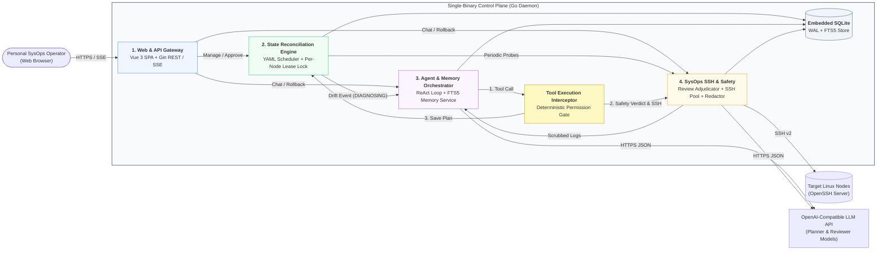

---
toc:
    depth_to: 2
puppeteer:
    format: "A4"
    printBackground: true
    timeout: 3000
    margin:
        top: 10mm
        bottom: 10mm
        left: 14mm
        right: 14mm
---

<h3 style="margin: 10px;">Design A Declarative Personal SysOps Agent with Adaptive Long-Term Memory</h3><b>2450313 徐佳咏、2351428 徐之涵、2352626 马小云、2451405 刘宸瑞</b>

## 0. Table of contents

[TOC]

---

## 1. Design Summary

Since Part I SRS, we have translated our black-box requirements into an implementation-ready architecture packaged within a single Go binary, an embedded SQLite datastore, and a Vue 3 web console. We decomposed the system into four cohesive subsystems—Web & API Gateway, State Reconciliation Engine, Agent & Memory Orchestrator, and SysOps SSH & Safety—formalized across C4 Logical, Deployment, and Technology views, UML behavioral/structural models, and Architecture Decision Records.

**What Changed and Why**

Translating high-level requirements into concrete interaction and state models exposed three operational gaps that required refining our Part I baseline:

1. **Transactional Remediation with Pre-Mutation Backups and Compensation (Refining `UC-05`)**:
   Part I assumed approved multi-step remediation plans would either wholly succeed or fail cleanly. In practice, a command failing midway leaves a target Linux host in a partially mutated state. Applying the Compensating Transaction Pattern, every mutating action in `propose_remediation_plan` now requires a pre-mutation backup (`backup_cmd` saving snapshots to `/var/tmp/sysops-backup/<incident_id>`) and a paired `rollback_cmd`. Execution runs sequentially under fail-fast semantics: if step $k$ fails, execution halts, the incident transitions to `Partially_Failed`, and the Web UI exposes per-step status alongside a one-click reverse rollback workflow.
2. **Per-Node Concurrency Locking and Incident Coalescing (Refining `UC-03`, `UC-04`, `UC-05`)**:
   Part I lacked mutual exclusion when multiple state drifts occur simultaneously on the same host. We introduced a Per-Node Lease Lock and Coordinator (`IDLE`, `PROBING`, `DIAGNOSING`, `PENDING_APPROVAL`, `REMEDIATING`). On a locked node, identical drift signals coalesce into the active incident, while distinct drifts enter a serialized queue (`QUEUED_ON_LOCK`) rather than spawning duplicate LLM loops. An exclusive `REMEDIATING` lock also suspends routine `UC-03` probes on that host until post-remediation verification finishes.
3. **Deterministic Tool Execution Interceptor (Refining `UC-04`, `UC-09`)**:
   To correct our Part I component diagram—where the Review Agent appeared to invoke SSH/Plan tools directly—we introduced a deterministic Go Tool Execution Interceptor. The Diagnostic Agent emits all tool calls; the Interceptor intercepts each call, queries the Review Agent strictly as a sidecar classifier (`READ_ONLY`, `MUTATING`, `DESTRUCTIVE`), and routes approved read-only commands to SSH or suspends mutating plans at the `UC-05` approval gate.

All architectural views, ADRs, relational schemas, UML models, and updated UI mockups are complete, establishing a concrete baseline for Part III PoC validation.

---

## 2. Architecture and Key Decisions

### 2.1 Logical architecture

The system adopts a modular monolith and Ports and Adapters architecture organized into four subsystems:

1. **Web & API Gateway**: Serves the embedded Vue 3 SPA, exposes REST endpoints for node/manifest management, HITL approval (`UC-05`), and memory curation (`UC-08`), and streams real-time diagnostic and step-execution states via Server-Sent Events (SSE).
2. **State Reconciliation Engine**: Parses declarative YAML manifests (`UC-02`), schedules deterministic SSH probes (`UC-03`), and enforces per-node mutual exclusion via the Node Lease Lock & Incident Coordinator.
3. **Agent & Memory Orchestrator**: Executes the bounded ReAct diagnostic loop (`UC-04`), interactive chat (`UC-06`), FTS5 memory retrieval, and post-incident memory distillation (`UC-07`), intercepting all agent tool calls via the Tool Execution Interceptor.
4. **SysOps SSH & Safety Subsystem**: Enforces `UC-09` guardrails via the Command Review Adjudicator (safety classification) and Secret Redaction Middleware (credential scrubbing), and executes probes, backups, repairs, and rollbacks through the Transactional SSH Executor.

### 2.2 Deployment architecture

To meet the Single-Binary Zero-Config (`SRS 7.1`) and Agentless Control Plane (`SRS 6.7`) requirements, the runtime topology spans three nodes without external databases or remote monitoring agents:

1. **Control Plane Host**: Runs the `sysops-agent` Go executable (embedding compiled Vue 3 static assets via `go:embed`), paired with a local SQLite database (`sysops.db` in WAL mode) and an AES-256-GCM host key (`master.key`) for credential encryption. It also exposes port to provide the web console to the operator.
2. **Target Linux Nodes (1–20 Hosts)**: Standard Linux servers accessible via `sshd` (Port 22). During `UC-05` execution, pre-mutation file/state snapshots are staged in `/var/tmp/sysops-backup/<incident_id>/` on the target host.
3. **LLM Inference Endpoint**: Any cloud or self-hosted (Ollama/vLLM) OpenAI-compatible API endpoint accessed over HTTPS.

### 2.3 Technology architecture

| Layer                   | Selected Technology                   | Alternatives Considered       | Rationale & Trade-offs                                                                                                                                                             |
| :---------------------- | :------------------------------------ | :---------------------------- | :--------------------------------------------------------------------------------------------------------------------------------------------------------------------------------- |
| **Backend Runtime**     | **Go**                                | Python (FastAPI), Rust        | Compiles backend, concurrency scheduler, SSH pool, and frontend into one zero-dependency binary, avoiding Python runtime packaging overhead.                                       |
| **Web & Streaming**     | **Gin + SSE (Server-Sent Events)**    | WebSockets, gRPC-Web          | Diagnostic traces and step statuses stream unidirectionally while approvals use REST `POST`; SSE provides lighter connection management and auto-reconnection than WebSockets.     |
| **Frontend UI**         | **Vue 3 + TypeScript + Tailwind CSS** | React / Next.js, HTMX         | Compiles to compact static assets while supporting reactive state needed for the YAML Policy Builder and step-by-step Rollback Console.                                            |
| **Datastore & Memory**  | **Embedded SQLite (WAL + FTS5**)      | PostgreSQL + pgvector, Milvus | External vector DBs break single-binary deployment. SysOps faults rely on exact lexical tokens (unit names, exit codes, error flags), where FTS5 BM25 ranking excels at zero cost. |
| **Node Transport**      | **Native Go SSH**                     | Ansible Runner, Custom Agent  | Custom agents violate zero-footprint rules; Ansible subprocesses add startup overhead.                                                                                             |
| **LLM Integration**     | **OpenAI-Compatible JSON Tool API**   | LangChain, Vendor SDKs        | Thin custom client avoids heavy framework abstraction and enables zero-code switching across cloud or local LLM providers (`SRS 7.3`).                                             |
| **Shell Safety Parser** | **Go `mvdan.cc/sh/v3` AST Parser**    | Regex Matching                | Parses shell pipelines, subshells, and redirections into an AST before Review Agent evaluation, preventing obfuscated command bypasses where simple regex filters fail.            |

### 2.4 Key decisions

【每个人都撰写，最后徐佳咏整理总结】

【徐之涵】【马小云】【刘宸瑞】

#### ADR-01: Single-Binary Agentless Control Plane with Per-Node Lease Locking

- **Context**: The system must deploy as a lightweight personal tool (`SRS 7.1`) while preventing concurrent drift probes (`UC-03`), agentic diagnostics (`UC-04`), and state-mutating repairs (`UC-05`) from colliding on the same target Linux host.
- **Options**: (1) Distributed microservices + Redis locks + remote agents; (2) Uncoordinated SSH goroutines; (3) Single-binary Go daemon with SQLite-backed Per-Node Lease Locks.
- **Decision**: Adopt Option 3, enforcing a per-node lock state machine (`IDLE`, `PROBING`, `DIAGNOSING`, `PENDING_APPROVAL`, `REMEDIATING`) with heartbeat-renewed TTLs (`lease_expires_at`).
- **Consequences**: Identical drift signals on a locked node coalesce into the active incident (`coalesced_count++`), distinct drifts queue serially (`QUEUED_ON_LOCK`), and `REMEDIATING` locks suppress routine `UC-03` probes until post-repair verification completes. Heartbeat TTLs prevent deadlocked nodes if an SSH or LLM session hangs.

### 2.5 Quality attributes

【刘宸瑞】

### 2.6 Architectural Risks

【刘宸瑞】

### 2.7 Agentic Systems

【徐之涵】

---

## 3. Design Models

### 3.1 Domain & Structural Class Diagrams

【刘宸瑞】

### 3.2 Relational Data Model

【徐之涵】

### 3.3 Agent & Memory Diagrams

【徐之涵】

### 3.4 State Machine Diagrams

【刘宸瑞】

### 3.5 Drift & Remediation Diagrams

【刘宸瑞】

### 3.6 API Interfaces

【马小云】

---

## 4. Updated Requirements

1. **CHG-01 — Transactional Remediation & Rollback (`SRS 5.2.3 UC-05` & `5.4 propose_remediation_plan`)**
    - **Change**: Replaced atomic batch execution with sequential fail-fast execution backed by mandatory pre-mutation snapshots (`backup_cmd` saving state to `/var/tmp/sysops-backup/<incident_id>/`, verified with `exit_code == 0` before running `command`) and paired compensation commands (`rollback_cmd`). If step $k$ fails, remaining steps $k+1..N$ are skipped, the incident enters `Partially_Failed`, and the Web UI exposes per-step statuses (`Succeeded`, `Failed`, `Skipped`) with one-click **Auto-Rollback** ($k-1 \dots 1$) or re-planning.
    - **Rationale**: Multi-step SSH mutations are non-atomic; midway failure leaves target nodes in an inconsistent state without pre-change backups and compensation logic.
2. **CHG-02 — Per-Node Concurrency Locking & Coalescing (`SRS 5.1 UC-03`, `5.2.2 UC-04` & `5.2.3 UC-05`)**
    - **Change**: Introduced a per-node lease lock (`IDLE`, `PROBING`, `DIAGNOSING`, `PENDING_APPROVAL`, `REMEDIATING`) in SQLite. On drift detection, if a node is locked by the same drift signature, `coalesced_count` increments without spawning a second LLM loop; if locked by a distinct drift signature, the new incident enters `Queued_On_Lock` and re-probes the node upon lock release. Active `REMEDIATING` locks suppress routine `UC-03` probe ticks.
    - **Rationale**: Prevents duplicate LLM loops, concurrent SSH write races, and false-positive drift alerts while services restart.
3. **CHG-03 — Tool Execution Interceptor Boundary (`SRS 5.2.2 UC-04`, `5.2.5 UC-09` & `5.4 Diagram`)**
    - **Change**: Replaced direct agent-to-agent tool routing in the Part I component diagram with a deterministic Go Tool Execution Interceptor. The Diagnostic Agent initiates all tool calls; the Interceptor queries the Review Agent strictly for a safety verdict (`READ_ONLY`, `MUTATING`, `DESTRUCTIVE`) and dispatches read-only probes or suspends mutating plans for `UC-05` approval.
    - **Rationale**: Aligns the structural model with `UC-04`/`UC-09` semantics, where the Diagnostic Agent calls tools and the Review Agent acts solely as a policy classifier.

---

## 5. UI and UX Design

### 5.1 Key Screens Mockups

【马小云】

### 5.2 User Flows

【马小云】

---

## 6. Open Issues and Risks

【每个人都撰写至少一条，最后徐佳咏整理总结】

【徐之涵】【马小云】【刘宸瑞】

1. **Lock Starvation & Cascade Resolution of Queued Incidents**:
    - Uncertainty: While an incident waits in `PENDING_APPROVAL` for operator review, distinct drifts on the same node wait in `Queued_On_Lock`. Delayed human approval could delay diagnosing secondary drifts, or the primary fix (e.g., freeing disk space) might implicitly resolve the queued drift.
    - Part III PoC Validation: Test a two-tier lock (allowing read-only `UC-04` diagnosis under a shared lock while `PENDING_APPROVAL` is idle, reserving exclusive locks for `REMEDIATING`) and enforce an automatic `UC-03` re-probe on dequeue to auto-close already healed incidents.

---

## 7. AI Tools Reflection

【每个人都撰写，最后徐佳咏整理总结】

### xjy

- Tool chain: Gemini 4 Argon in Google AI Studio and OpenCode
- Cost: covered by Google AI Pro & OpenCode Go subscription
- Pros / cons: communicate about the project concept, helpful in brain storming, English translations, and generating UML diagrams, but easily provides ideas that are too complex or too simple
- Verification: manually review & rewrite
- Enhancement: correct & rewrite AI output to align with our true design intent
- Artifacts: no specific artifacts

### xzh

【徐之涵】

### mxy

【马小云】

### lcr

【刘宸瑞】

---

## 8. Annotated References

【每个人按需撰写】

【徐之涵】【马小云】【刘宸瑞】

1. **B. Beyer, C. Jones, J. Petoff, and N. R. Murphy, Eds., _Site Reliability Engineering: How Google Runs Production Systems_. Sebastopol, CA, USA: O'Reilly Media, 2016.**
   This foundational work formalizes Site Reliability Engineering (SRE) principles including declarative state management, toil elimination through idempotent automation, alert deduplication, and safe change management. Chapters on Eliminating Toil, Practical Alerting, and Data Processing Pipelines demonstrate how uncoordinated automation and concurrent alert storms often worsen production incidents rather than resolving them.
   These principles directly shaped our State Reconciliation Engine and Per-Node Lease Lock Coordinator (`Section 2.1`, `ADR-01`). Rather than treating periodic SSH checks as stateless cron jobs that blindly invoke an LLM on every failure tick, we separated deterministic drift detection (`UC-03`, \$0 token cost) from bounded agentic diagnosis (`UC-04`). Specifically, the book's analysis of concurrent automation hazards motivated our per-node lock state machine (`IDLE`, `PROBING`, `DIAGNOSING`, `PENDING_APPROVAL`, `REMEDIATING`), which coalesces duplicate drift alerts, serializes distinct faults on the same host, and suppresses routine health probes during active `REMEDIATING` windows. Finally, its emphasis on post-change verification informed our mandatory post-remediation `UC-03` convergence check before marking any incident `Resolved`.

---

## 9. Team member contributions

【最后徐佳咏撰写】
