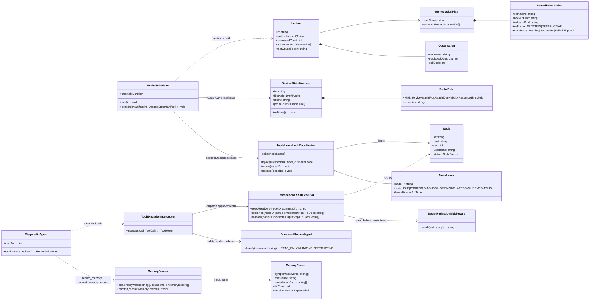
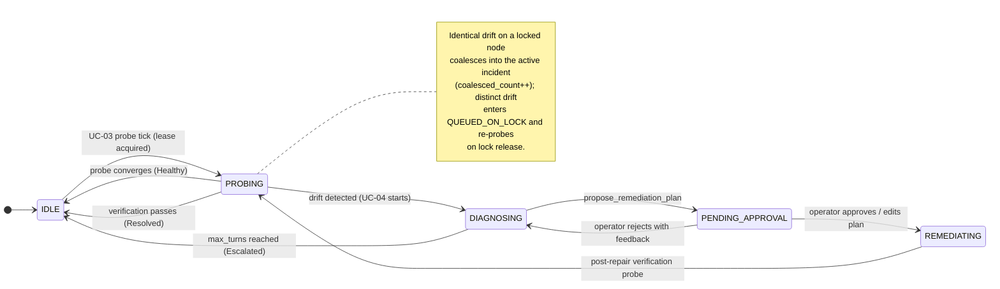
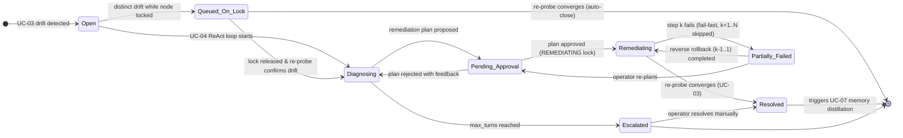
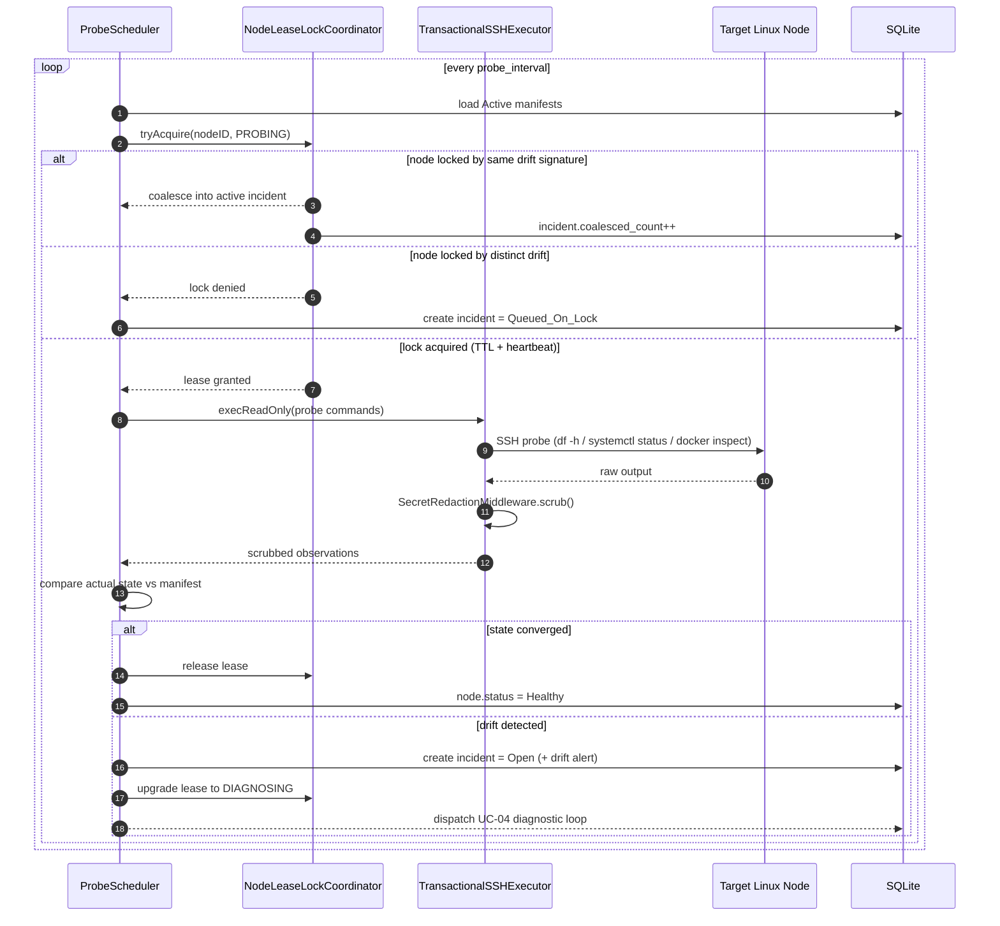
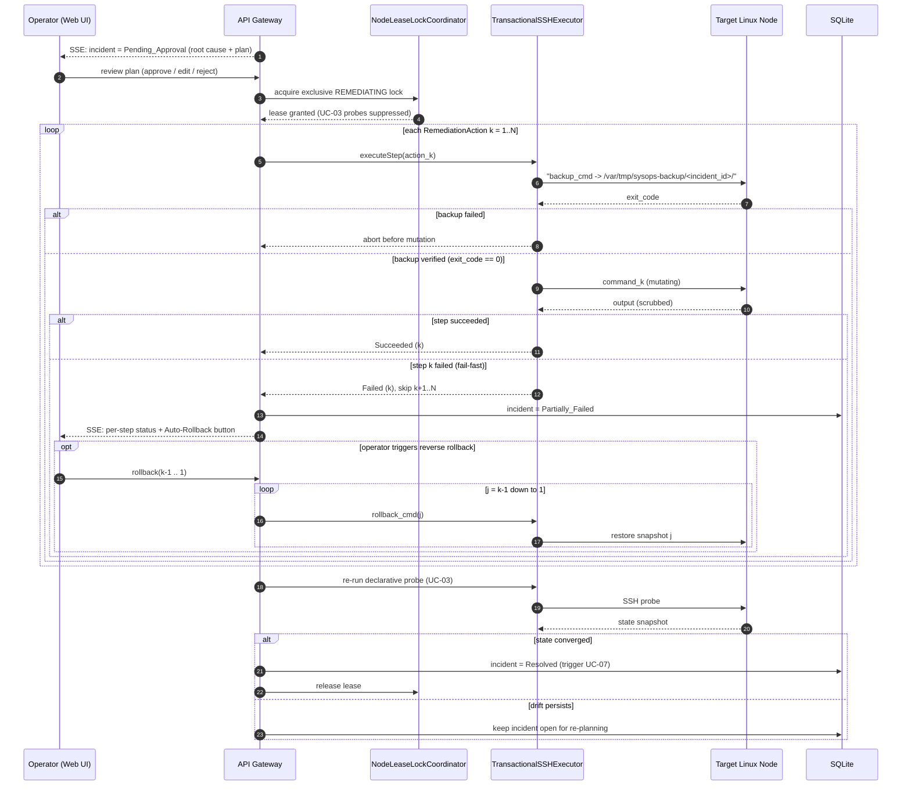

---
toc:
    depth_to: 2
puppeteer:
    format: "A4"
    printBackground: true
    timeout: 3000
    margin:
        top: 10mm
        bottom: 10mm
        left: 14mm
        right: 14mm
---

<h3 style="margin: 10px;">Design A Declarative Personal SysOps Agent with Adaptive Long-Term Memory</h3><b>2450313 徐佳咏、2351428 徐之涵、2352626 马小云、2451405 刘宸瑞</b>

## 0. Table of contents

[TOC]

---

## 1. Design Summary

Since Part I SRS, we have translated our black-box requirements into an implementation-ready architecture packaged within a single Go binary, an embedded SQLite datastore, and a Vue 3 web console. We decomposed the system into four cohesive subsystems—Web & API Gateway, State Reconciliation Engine, Agent & Memory Orchestrator, and SysOps SSH & Safety—formalized across C4 Logical, Deployment, and Technology views, UML behavioral/structural models, and Architecture Decision Records.

**What Changed and Why**

Translating high-level requirements into concrete interaction and state models exposed three operational gaps that required refining our Part I baseline:

1. **Transactional Remediation with Pre-Mutation Backups and Compensation (Refining `UC-05`)**:
   Part I assumed approved multi-step remediation plans would either wholly succeed or fail cleanly. In practice, a command failing midway leaves a target Linux host in a partially mutated state. Applying the Compensating Transaction Pattern, every mutating action in `propose_remediation_plan` now requires a pre-mutation backup (`backup_cmd` saving snapshots to `/var/tmp/sysops-backup/<incident_id>`) and a paired `rollback_cmd`. Execution runs sequentially under fail-fast semantics: if step $k$ fails, execution halts, the incident transitions to `Partially_Failed`, and the Web UI exposes per-step status alongside a one-click reverse rollback workflow.
2. **Per-Node Concurrency Locking and Incident Coalescing (Refining `UC-03`, `UC-04`, `UC-05`)**:
   Part I lacked mutual exclusion when multiple state drifts occur simultaneously on the same host. We introduced a Per-Node Lease Lock and Coordinator (`IDLE`, `PROBING`, `DIAGNOSING`, `PENDING_APPROVAL`, `REMEDIATING`). On a locked node, identical drift signals coalesce into the active incident, while distinct drifts enter a serialized queue (`QUEUED_ON_LOCK`) rather than spawning duplicate LLM loops. An exclusive `REMEDIATING` lock also suspends routine `UC-03` probes on that host until post-remediation verification finishes.
3. **Deterministic Tool Execution Interceptor (Refining `UC-04`, `UC-09`)**:
   To correct our Part I component diagram—where the Review Agent appeared to invoke SSH/Plan tools directly—we introduced a deterministic Go Tool Execution Interceptor. The Diagnostic Agent emits all tool calls; the Interceptor intercepts each call, queries the Review Agent strictly as a sidecar classifier (`READ_ONLY`, `MUTATING`, `DESTRUCTIVE`), and routes approved read-only commands to SSH or suspends mutating plans at the `UC-05` approval gate.

All architectural views, ADRs, relational schemas, UML models, and updated UI mockups are complete, establishing a concrete baseline for Part III PoC validation.

---

## 2. Architecture and Key Decisions

### 2.1 Logical architecture

The system adopts a modular monolith and Ports and Adapters architecture organized into four subsystems:

1. **Web & API Gateway**: Serves the embedded Vue 3 SPA, exposes REST endpoints for node/manifest management, HITL approval (`UC-05`), and memory curation (`UC-08`), and streams real-time diagnostic and step-execution states via Server-Sent Events (SSE).
2. **State Reconciliation Engine**: Parses declarative YAML manifests (`UC-02`), schedules deterministic SSH probes (`UC-03`), and enforces per-node mutual exclusion via the Node Lease Lock & Incident Coordinator.
3. **Agent & Memory Orchestrator**: Executes the bounded ReAct diagnostic loop (`UC-04`), interactive chat (`UC-06`), FTS5 memory retrieval, and post-incident memory distillation (`UC-07`), intercepting all agent tool calls via the Tool Execution Interceptor.
4. **SysOps SSH & Safety Subsystem**: Enforces `UC-09` guardrails via the Command Review Adjudicator (safety classification) and Secret Redaction Middleware (credential scrubbing), and executes probes, backups, repairs, and rollbacks through the Transactional SSH Executor.

### 2.2 Deployment architecture

To meet the Single-Binary Zero-Config (`SRS 7.1`) and Agentless Control Plane (`SRS 6.7`) requirements, the runtime topology spans three nodes without external databases or remote monitoring agents:

1. **Control Plane Host**: Runs the `sysops-agent` Go executable (embedding compiled Vue 3 static assets via `go:embed`), paired with a local SQLite database (`sysops.db` in WAL mode) and an AES-256-GCM host key (`master.key`) for credential encryption. It also exposes port to provide the web console to the operator.
2. **Target Linux Nodes (1–20 Hosts)**: Standard Linux servers accessible via `sshd` (Port 22). During `UC-05` execution, pre-mutation file/state snapshots are staged in `/var/tmp/sysops-backup/<incident_id>/` on the target host.
3. **LLM Inference Endpoint**: Any cloud or self-hosted (Ollama/vLLM) OpenAI-compatible API endpoint accessed over HTTPS.

### 2.3 Technology architecture

| Layer                   | Selected Technology                   | Alternatives Considered       | Rationale & Trade-offs                                                                                                                                                             |
| :---------------------- | :------------------------------------ | :---------------------------- | :--------------------------------------------------------------------------------------------------------------------------------------------------------------------------------- |
| **Backend Runtime**     | **Go**                                | Python (FastAPI), Rust        | Compiles backend, concurrency scheduler, SSH pool, and frontend into one zero-dependency binary, avoiding Python runtime packaging overhead.                                       |
| **Web & Streaming**     | **Gin + SSE (Server-Sent Events)**    | WebSockets, gRPC-Web          | Diagnostic traces and step statuses stream unidirectionally while approvals use REST `POST`; SSE provides lighter connection management and auto-reconnection than WebSockets.     |
| **Frontend UI**         | **Vue 3 + TypeScript + Tailwind CSS** | React / Next.js, HTMX         | Compiles to compact static assets while supporting reactive state needed for the YAML Policy Builder and step-by-step Rollback Console.                                            |
| **Datastore & Memory**  | **Embedded SQLite (WAL + FTS5**)      | PostgreSQL + pgvector, Milvus | External vector DBs break single-binary deployment. SysOps faults rely on exact lexical tokens (unit names, exit codes, error flags), where FTS5 BM25 ranking excels at zero cost. |
| **Node Transport**      | **Native Go SSH**                     | Ansible Runner, Custom Agent  | Custom agents violate zero-footprint rules; Ansible subprocesses add startup overhead.                                                                                             |
| **LLM Integration**     | **OpenAI-Compatible JSON Tool API**   | LangChain, Vendor SDKs        | Thin custom client avoids heavy framework abstraction and enables zero-code switching across cloud or local LLM providers (`SRS 7.3`).                                             |
| **Shell Safety Parser** | **Go `mvdan.cc/sh/v3` AST Parser**    | Regex Matching                | Parses shell pipelines, subshells, and redirections into an AST before Review Agent evaluation, preventing obfuscated command bypasses where simple regex filters fail.            |

### 2.4 Key decisions

【每个人都撰写，最后徐佳咏整理总结】

【徐之涵】【马小云】

#### ADR-01: Single-Binary Agentless Control Plane with Per-Node Lease Locking

- **Context**: The system must deploy as a lightweight personal tool (`SRS 7.1`) while preventing concurrent drift probes (`UC-03`), agentic diagnostics (`UC-04`), and state-mutating repairs (`UC-05`) from colliding on the same target Linux host.
- **Options**: (1) Distributed microservices + Redis locks + remote agents; (2) Uncoordinated SSH goroutines; (3) Single-binary Go daemon with SQLite-backed Per-Node Lease Locks.
- **Decision**: Adopt Option 3, enforcing a per-node lock state machine (`IDLE`, `PROBING`, `DIAGNOSING`, `PENDING_APPROVAL`, `REMEDIATING`) with heartbeat-renewed TTLs (`lease_expires_at`).
- **Consequences**: Identical drift signals on a locked node coalesce into the active incident (`coalesced_count++`), distinct drifts queue serially (`QUEUED_ON_LOCK`), and `REMEDIATING` locks suppress routine `UC-03` probes until post-repair verification completes. Heartbeat TTLs prevent deadlocked nodes if an SSH or LLM session hangs.

#### ADR-03: Transactional Remediation with Pre-Mutation Backups, Step Compensation, and a Local Safety Pipeline

- **Context**: Approved remediation plans (`UC-05`) execute multiple mutating shell commands over SSH. SSH commands are non-transactional: if step $k$ of $N$ fails midway, the target host is left in a partially mutated state with no way to reverse the $k-1$ steps that already succeeded. In parallel, the Diagnostic Agent may emit unsafe or obfuscated commands, and raw SSH outputs may carry credentials that must never reach external LLM providers (`SRS 7.2`, `7.9`).
- **Options**: (1) Execute approved plans directly and rely on ad-hoc manual cleanup scripts when something breaks; (2) Require LVM/ZFS snapshots or a remote agent daemon on every target node to guarantee whole-transaction rollback; (3) Compensating-transaction execution inside the control plane: every mutating action carries a mandatory `backup_cmd` plus a paired `rollback_cmd`, steps run sequentially under fail-fast semantics, and the whole pipeline is gated by an independent command review agent and a local secret redaction middleware.
- **Decision**: Adopt Option 3. Each `RemediationAction` in `propose_remediation_plan` now requires a `backup_cmd` (staging file/state snapshots under `/var/tmp/sysops-backup/<incident_id>/` on the target node, verified with `exit_code == 0` before the mutating `command` runs) and a paired `rollback_cmd` restoring that snapshot. Steps execute sequentially; if step $k$ fails, steps $k+1 \dots N$ are skipped, the incident transitions to `Partially_Failed`, and the Web UI exposes per-step statuses (`Succeeded`, `Failed`, `Skipped`) with a one-click reverse rollback ($k-1 \dots 1$) or re-planning. Independently, the deterministic Go Tool Execution Interceptor queries the Command Review Agent strictly as a classifier (`READ_ONLY` / `MUTATING` / `DESTRUCTIVE`) and hard-blocks any `DESTRUCTIVE` verdict, while the Secret Redaction Middleware masks credential patterns in all SSH outputs before they reach the LLM API or SQLite.
- **Consequences**: Any single-step failure becomes recoverable as long as its pre-mutation backup succeeded; the residual risk shifts to backup/rollback correctness, which the UI surfaces per-step and the design tracks as an open issue in `Section 6`. Each candidate command incurs one extra LLM classification round-trip, mitigated by the fail-closed `mvdan.cc/sh` AST parser that rejects obfuscated syntax before review. Backup artifacts accumulate on target nodes over time, requiring the retention policy to be validated in Part III.

### 2.5 Quality attributes

Because this system autonomously executes commands on personal Linux hosts, a single unsafe command or a leaked secret can cause irreversible damage within seconds, whereas a slower diagnosis or a slightly heavier binary only degrades convenience. We therefore rank the quality attributes as follows: **Security > Reliability & Recoverability > Performance & Resource Efficiency > Maintainability**, and the architecture addresses each priority through the mechanisms below:

| Priority | Quality Attribute | Architectural Mechanism | Measurable Target (`SRS §7`) |
| :-- | :-- | :-- | :-- |
| **P0** | **Security** | Independent Command Review Agent classifies every candidate command (`UC-09` Part A); the `mvdan.cc/sh` AST parser fails closed on obfuscated syntax; `DESTRUCTIVE` verdicts are hard-blocked unconditionally; SSH keys and LLM API keys are encrypted with AES-256-GCM derived from `master.key`; the Secret Redaction Middleware masks credentials before any LLM call or SQLite write (`UC-09` Part B). | 0% unauthorized state-mutating execution; 100% redaction coverage on standard credential patterns (`SRS 7.2`, `7.9`) |
| **P1** | **Reliability & Recoverability** | Compensating transactions: per-step `backup_cmd` + `rollback_cmd` with fail-fast execution and the `Partially_Failed` state (CHG-01, `ADR-03`); per-node lease locks with heartbeat TTLs prevent concurrent probes and deadlocked nodes (CHG-02, `ADR-01`); bounded SSH timeouts with exponential backoff isolate unreachable nodes; deterministic drift detection keeps alerting even when the LLM API is down (`SRS 7.5`). | 0% unrecoverable partial mutations; drift detection and alerting uninterrupted under LLM outage |
| **P2** | **Performance & Resource Efficiency** | Agentless SSH transport leaves zero footprint on target nodes; SQLite WAL + FTS5 is embedded in a single Go binary; deterministic probes run in Go with \$0 LLM cost; context windows are bounded by log `--tail` slices and `search_memory count` limits; SSE streams diagnostics with lightweight one-way connections. | < 300 MB RAM and < 10% idle CPU while monitoring 20 nodes at 60 s intervals; probes < 2 s/node; end-to-end diagnosis < 120 s (`SRS 7.4`, `7.7`) |
| **P3** | **Maintainability** | Modular monolith with Ports and Adapters: four subsystems interact through narrow interfaces (drift events, tool-call interception, SSH execution); the OpenAI-compatible LLM adapter allows provider switches via configuration only; the deterministic Go interceptor keeps safety-policy logic testable without an LLM in the loop. | Switching LLM providers requires configuration changes only (`SRS 7.3`) |

The dominant trade-off lies in the safety tier: the fail-closed policy will occasionally reject a legitimate but unusual diagnostic command, forcing the agent to retry with a safer formulation. For a personal tool where the operator is often the only line of defense, we deliberately accept this false-positive cost over the alternative of any unsafe command slipping through unsupervised.

### 2.6 Architectural Risks

| Risk | Likelihood / Impact | Mitigation |
| :-- | :-- | :-- |
| **R1 — LLM latency, outage, or hallucination** | High / Medium | Deterministic `UC-03` probes and alerts never depend on the LLM (`SRS 7.5`); the ReAct loop is bounded by `max_turns` (default 8); hallucinated commands are neutralized by the Command Review Agent; unresolved incidents degrade to `Escalated` with logs instead of blocking the scheduler. |
| **R2 — SSH execution timeout or midway failure** | Medium / High | Strict per-command timeouts and exponential backoff on unreachable nodes (`SRS 7.5`); pre-mutation `backup_cmd` verified before each step; fail-fast step execution plus paired `rollback_cmd` restore earlier steps via the one-click reverse rollback (CHG-01, `ADR-03`). |
| **R3 — Verbose logs exhaust the LLM context window** | High / Medium | `exec_readonly_shell` returns bounded slices (`journalctl -n 50`, `docker logs --tail 50`); the Redaction Middleware truncates and masks outputs before transmission; `search_memory` caps retrieved records (`count = 3`); the distillation step compresses transcripts before storage (`UC-07`). |
| **R4 — Concurrent probes and duplicate LLM loops** | Medium / Medium | Per-node lease lock state machine coalesces identical drift signals and serializes distinct drifts into `QUEUED_ON_LOCK` (CHG-02, `ADR-01`); `REMEDIATING` locks suppress routine probe ticks, eliminating false drift alerts while services restart. |
| **R5 — Obfuscated commands bypass the safety review** | Medium / High | The `mvdan.cc/sh/v3` AST parser resolves pipelines, subshells, and redirections before classification, so `eval`/base64 tricks are expanded and fail closed as `MUTATING` or `DESTRUCTIVE` (`UC-09` 1a); the reviewer is a separate model call with no access to the diagnostic context, preventing prompt-injection laundering. |
| **R6 — Backup or rollback failure during remediation** | Medium / High | Backups are verified (`exit_code == 0`) before the mutating command runs; per-step statuses and rollback results are streamed via SSE; if rollback itself fails, the incident escalates to manual intervention with the exact pre-mutation snapshot path attached; retention and rollback verification are scheduled for Part III PoC validation (`Section 6`). |

### 2.7 Agentic Systems

【徐之涵】

---

## 3. Design Models

### 3.1 Domain & Structural Class Diagrams

The class model below spans the four subsystems, emphasizing the objects that realize the drift-detection, diagnosis, safety, transactional remediation, and memory lifecycles:

Key structural decisions:

- **Scheduler / Coordinator separation**: `ProbeScheduler` triggers deterministic checks, but it never talks to SSH or the LLM directly; every probe goes through `NodeLeaseLockCoordinator` first, so concurrency policy is enforced in exactly one place.
- **`Incident` as the shared aggregate**: it owns `Observation`s (the redacted diagnostic evidence) and references one `RemediationPlan`, which lets the Web UI render the full trace from a single SQLite-backed aggregate.
- **`RemediationAction` carries its own recovery contract**: each action bundles `backupCmd` and `rollbackCmd` (ADR-03), so the `TransactionalSSHExecutor` can enforce fail-fast semantics and reverse rollback without any per-target-host agent or snapshot service.
- **Interceptor as the only tool gateway**: `DiagnosticAgent` emits tool calls exclusively into `ToolExecutionInterceptor`, which consults `CommandReviewAgent` as a pure sidecar classifier and routes verdicts to `TransactionalSSHExecutor` — matching the corrected `UC-04`/`UC-09` control flow from CHG-03.

### 3.2 Relational Data Model

【徐之涵】

### 3.3 Agent & Memory Diagrams

【徐之涵】

### 3.4 State Machine Diagrams

#### 3.4.1 Per-Node Lease Lock State Machine

The `NodeLeaseLockCoordinator` enforces a single lock per target node with heartbeat-renewed TTLs (ADR-01). Lock acquisition failures route drift signals into coalescing or `QUEUED_ON_LOCK` rather than spawning duplicate loops:

#### 3.4.2 Incident Lifecycle State Machine

The incident aggregate transitions through diagnosis, the HITL approval gate, and transactional remediation, including the `Partially_Failed` recovery path introduced by CHG-01:

### 3.5 Drift & Remediation Diagrams

#### 3.5.1 Sequence 3: Periodic Drift Detection & Incident Coalescing (`UC-03`)

#### 3.5.2 Sequence 4: HITL Approval, Pre-Mutation Backup, Step Execution & Rollback (`UC-05`)

### 3.6 API Interfaces

【马小云】

---

## 4. Updated Requirements

1. **CHG-01 — Transactional Remediation & Rollback (`SRS 5.2.3 UC-05` & `5.4 propose_remediation_plan`)**
    - **Change**: Replaced atomic batch execution with sequential fail-fast execution backed by mandatory pre-mutation snapshots (`backup_cmd` saving state to `/var/tmp/sysops-backup/<incident_id>/`, verified with `exit_code == 0` before running `command`) and paired compensation commands (`rollback_cmd`). If step $k$ fails, remaining steps $k+1..N$ are skipped, the incident enters `Partially_Failed`, and the Web UI exposes per-step statuses (`Succeeded`, `Failed`, `Skipped`) with one-click **Auto-Rollback** ($k-1 \dots 1$) or re-planning.
    - **Rationale**: Multi-step SSH mutations are non-atomic; midway failure leaves target nodes in an inconsistent state without pre-change backups and compensation logic.
2. **CHG-02 — Per-Node Concurrency Locking & Coalescing (`SRS 5.1 UC-03`, `5.2.2 UC-04` & `5.2.3 UC-05`)**
    - **Change**: Introduced a per-node lease lock (`IDLE`, `PROBING`, `DIAGNOSING`, `PENDING_APPROVAL`, `REMEDIATING`) in SQLite. On drift detection, if a node is locked by the same drift signature, `coalesced_count` increments without spawning a second LLM loop; if locked by a distinct drift signature, the new incident enters `Queued_On_Lock` and re-probes the node upon lock release. Active `REMEDIATING` locks suppress routine `UC-03` probe ticks.
    - **Rationale**: Prevents duplicate LLM loops, concurrent SSH write races, and false-positive drift alerts while services restart.
3. **CHG-03 — Tool Execution Interceptor Boundary (`SRS 5.2.2 UC-04`, `5.2.5 UC-09` & `5.4 Diagram`)**
    - **Change**: Replaced direct agent-to-agent tool routing in the Part I component diagram with a deterministic Go Tool Execution Interceptor. The Diagnostic Agent initiates all tool calls; the Interceptor queries the Review Agent strictly for a safety verdict (`READ_ONLY`, `MUTATING`, `DESTRUCTIVE`) and dispatches read-only probes or suspends mutating plans for `UC-05` approval.
    - **Rationale**: Aligns the structural model with `UC-04`/`UC-09` semantics, where the Diagnostic Agent calls tools and the Review Agent acts solely as a policy classifier.

---

## 5. UI and UX Design

### 5.1 Key Screens Mockups

【马小云】

### 5.2 User Flows

【马小云】

---

## 6. Open Issues and Risks

【每个人都撰写至少一条，最后徐佳咏整理总结】

【徐之涵】【马小云】

1. **Lock Starvation & Cascade Resolution of Queued Incidents**:
    - Uncertainty: While an incident waits in `PENDING_APPROVAL` for operator review, distinct drifts on the same node wait in `Queued_On_Lock`. Delayed human approval could delay diagnosing secondary drifts, or the primary fix (e.g., freeing disk space) might implicitly resolve the queued drift.
    - Part III PoC Validation: Test a two-tier lock (allowing read-only `UC-04` diagnosis under a shared lock while `PENDING_APPROVAL` is idle, reserving exclusive locks for `REMEDIATING`) and enforce an automatic `UC-03` re-probe on dequeue to auto-close already healed incidents.

2. **Backup Artifact Lifecycle & Rollback Trustworthiness**:
    - Uncertainty: Pre-mutation snapshots accumulate under `/var/tmp/sysops-backup/<incident_id>/` with no retention policy, and a `rollback_cmd` that itself fails midway (e.g., a partial config restore) can leave the host in a hybrid state worse than the original failure. We also have no automated check that a rollback actually restored the exact pre-mutation state.
    - Part III PoC Validation: Run a fault-injection test that kills the SSH session mid-step, then measure post-rollback convergence via the standard `UC-03` probe; define a backup retention/TTL policy (e.g., prune snapshots on `Resolved` or after N days); treat failed rollback verification as `Escalated` requiring manual intervention.

---

## 7. AI Tools Reflection

【每个人都撰写，最后徐佳咏整理总结】

### xjy

- Tool chain: Gemini 4 Argon in Google AI Studio and OpenCode
- Cost: covered by Google AI Pro & OpenCode Go subscription
- Pros / cons: communicate about the project concept, helpful in brain storming, English translations, and generating UML diagrams, but easily provides ideas that are too complex or too simple
- Verification: manually review & rewrite
- Enhancement: correct & rewrite AI output to align with our true design intent
- Artifacts: no specific artifacts

### xzh

【徐之涵】

### mxy

【马小云】

### lcr

- Tool chain: Gemini 4 Argon in Google AI Studio and OpenCode (DeepSeek V4 Pro)
- Cost: covered by Google AI Pro & OpenCode Go subscription
- Pros / cons: efficient at turning SRS scenarios (`UC-03`, `UC-05`, `UC-09`) into mermaid sequence/state diagrams and at drafting ADR alternatives, but it tends to over-engineer safety mechanisms (e.g., suggesting sandboxed execution or filesystem snapshots that would break the agentless zero-footprint deployment), so every option had to be re-checked against the SSH-only architecture
- Verification: each diagram cross-checked against the SRS use case specifications; mermaid syntax validated in the preview pane before committing
- Enhancement: rewrote the class model to respect the four-subsystem boundaries; constrained ADR-03 to control-plane-only mechanisms consistent with the zero-footprint requirement; added the `Partially_Failed` rollback path to the state machines that the AI draft omitted
- Artifacts: mermaid diagram sources embedded in `design.md`

---

## 8. Annotated References

【每个人按需撰写】

【徐之涵】【马小云】

1. **B. Beyer, C. Jones, J. Petoff, and N. R. Murphy, Eds., _Site Reliability Engineering: How Google Runs Production Systems_. Sebastopol, CA, USA: O'Reilly Media, 2016.**
   This foundational work formalizes Site Reliability Engineering (SRE) principles including declarative state management, toil elimination through idempotent automation, alert deduplication, and safe change management. Chapters on Eliminating Toil, Practical Alerting, and Data Processing Pipelines demonstrate how uncoordinated automation and concurrent alert storms often worsen production incidents rather than resolving them.
   These principles directly shaped our State Reconciliation Engine and Per-Node Lease Lock Coordinator (`Section 2.1`, `ADR-01`). Rather than treating periodic SSH checks as stateless cron jobs that blindly invoke an LLM on every failure tick, we separated deterministic drift detection (`UC-03`, \$0 token cost) from bounded agentic diagnosis (`UC-04`). Specifically, the book's analysis of concurrent automation hazards motivated our per-node lock state machine (`IDLE`, `PROBING`, `DIAGNOSING`, `PENDING_APPROVAL`, `REMEDIATING`), which coalesces duplicate drift alerts, serializes distinct faults on the same host, and suppresses routine health probes during active `REMEDIATING` windows. Finally, its emphasis on post-change verification informed our mandatory post-remediation `UC-03` convergence check before marking any incident `Resolved`.

2. **P. Helland, "Life beyond Distributed Transactions: An Apostate's Opinion," in _Proceedings of the Conference on Innovative Data Systems Research (CIDR)_, 2007.**
   This position paper argues that large-scale systems cannot rely on distributed atomic transactions, because holding locks across heterogeneous, long-running, and sometimes-unreliable participants is impractical; instead, Helland advocates designing business operations as sequences of *local* actions paired with explicit compensation, accepting that failures leave partial effects that must be undone deliberately. Although written for enterprise data services, its reasoning transfers directly to remote shell execution: an SSH session has no transaction manager, a `systemctl restart` or config rewrite is a local, one-way side effect, and no two-phase commit can span the control plane and a target node's filesystem. This shaped `ADR-03` (transactional remediation) in three concrete ways. First, we gave up on atomic plan execution: `RemediationAction` steps run sequentially under fail-fast semantics, and an interrupted plan terminates in the explicit `Partially_Failed` state rather than pretending to be clean. Second, we made compensation first-class by requiring every mutating action to carry a `backup_cmd` (verified before mutation) and a paired `rollback_cmd`, so recovery is an ordinary, reviewable workflow — the Web UI's one-click reverse rollback ($k-1 \dots 1$) — instead of an emergency script. Third, we treat "undone" as unproven: after any rollback, the standard `UC-03` declarative probe re-runs, and the incident only closes when actual state convergence is observed, mirroring Helland's insistence that compensating logic itself needs verification. The paper also cautions that compensation code is rarely exercised in production, which prompted us to schedule rollback fault-injection tests in the Part III PoC plan (`Section 6`).

---

## 9. Team member contributions

【最后徐佳咏撰写】
