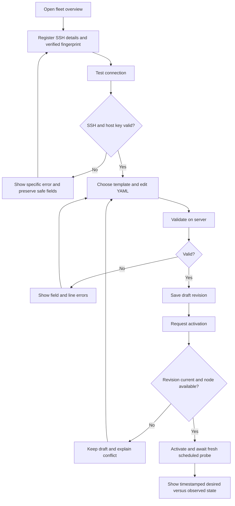
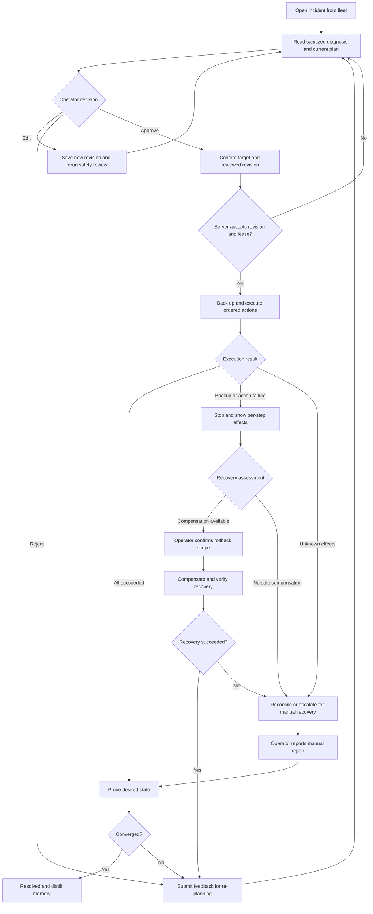
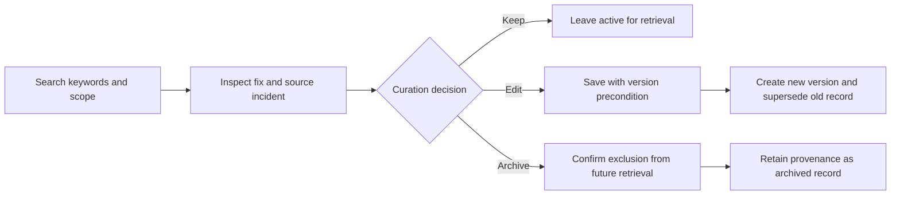

---
toc:
    depth_to: 2
puppeteer:
    format: "A4"
    printBackground: true
    timeout: 3000
    margin:
        top: 10mm
        bottom: 10mm
        left: 14mm
        right: 14mm
---

<style>
.markdown-preview.markdown-preview {
    font-family: "Times New Roman", "宋体";
    font-size: 11pt;
}
.markdown-preview.markdown-preview svg,
.markdown-preview.markdown-preview img {
    max-width: 100% !important;
    height: auto !important;
    display: block;
    margin: 10px auto;
}
</style>

<center><h3 style="margin: 10px;">Design<br/>A Declarative Personal SysOps Agent with Adaptive Long-Term Memory</h3><b>2450313 徐佳咏、2351428 徐之涵、2352626 马小云、2451405 刘宸瑞</b></center>

## 0. Table of contents

[TOC]

---

## 1. Design Summary

Since Part I SRS, we have translated our black-box requirements into an implementation-ready architecture packaged within a single Go binary, an embedded SQLite datastore, and a Vue 3 web console. We decomposed the system into four cohesive subsystems—Web & API Gateway, State Reconciliation Engine, Agent & Memory Orchestrator, and SysOps SSH & Safety—formalized across C4 Logical, Deployment, and Technology views, UML behavioral/structural models, and Architecture Decision Records.

**What Changed and Why**

Translating high-level requirements into concrete interaction and state models exposed three operational gaps that required refining our Part I baseline:

1. **Transactional Remediation with Pre-Mutation Backups and Compensation (Refining `UC-05`)**:
   Part I assumed approved multi-step remediation plans would either wholly succeed or fail cleanly. In practice, a command failing midway leaves a target Linux host in a partially mutated state. Applying the Compensating Transaction Pattern, every mutating action in `propose_remediation_plan` now requires a pre-mutation backup (`backup_cmd` saving snapshots to `/var/tmp/sysops-backup/<incident_id>`) and a paired `rollback_cmd`. Execution runs sequentially under fail-fast semantics: if step $k$ fails, execution halts, the incident transitions to `Partially_Failed`, and the Web UI exposes per-step status alongside a reviewed reverse rollback workflow that assesses the failed step as well as completed steps.
2. **Per-Node Concurrency Locking and Incident Coalescing (Refining `UC-03`, `UC-04`, `UC-05`)**:
   Part I lacked mutual exclusion when multiple state drifts occur simultaneously on the same host. We introduced a Per-Node Lease Lock and Coordinator (`IDLE`, `PROBING`, `DIAGNOSING`, `PENDING_APPROVAL`, `REMEDIATING`). On a locked node, identical drift signals coalesce into the active incident, while distinct drifts enter a serialized queue (`QUEUED_ON_LOCK`) rather than spawning duplicate LLM loops. An exclusive `REMEDIATING` lock also suspends routine `UC-03` probes on that host until post-remediation verification finishes.
3. **Deterministic Tool Execution Interceptor (Refining `UC-04`, `UC-09`)**:
   To correct our Part I component diagram—where the Review Agent appeared to invoke SSH/Plan tools directly—we introduced a deterministic Go Tool Execution Interceptor. The Diagnostic Agent emits all tool calls; the Interceptor intercepts each call, queries the Review Agent strictly as a sidecar classifier (`READ_ONLY`, `MUTATING`, `DESTRUCTIVE`), and routes approved read-only commands to SSH or suspends mutating plans at the `UC-05` approval gate.

All architectural views, ADRs, relational schemas, UML models, and updated UI mockups are complete, establishing a concrete baseline for Part III PoC validation.

---

## 2. Architecture and Key Decisions

### 2.1 Logical architecture

The system adopts a modular monolith and Ports and Adapters architecture organized into four subsystems:

1. **Web & API Gateway**: Serves the embedded Vue 3 SPA, exposes REST endpoints for node/manifest management, HITL approval (`UC-05`), and memory curation (`UC-08`), and streams real-time diagnostic and step-execution states via Server-Sent Events (SSE).
2. **State Reconciliation Engine**: Parses declarative YAML manifests (`UC-02`), schedules deterministic SSH probes (`UC-03`), and enforces per-node mutual exclusion via the Node Lease Lock & Incident Coordinator.
3. **Agent & Memory Orchestrator**: Executes the bounded ReAct diagnostic loop (`UC-04`), interactive chat (`UC-06`), FTS5 memory retrieval, and post-incident memory distillation (`UC-07`), intercepting all agent tool calls via the Tool Execution Interceptor.
4. **SysOps SSH & Safety Subsystem**: Enforces `UC-09` guardrails via the Command Review Adjudicator (safety classification) and Secret Redaction Middleware (credential scrubbing), and executes probes, backups, repairs, and rollbacks through the Transactional SSH Executor.


### 2.2 Deployment architecture

To meet the Single-Binary Zero-Config (`SRS 7.1`) and Agentless Control Plane (`SRS 6.7`) requirements, the runtime topology spans three nodes without external databases or remote monitoring agents:

1. **Control Plane Host**: Runs the `sysops-agent` Go executable (embedding compiled Vue 3 static assets via `go:embed`), paired with a local SQLite database (`sysops.db` in WAL mode) and an AES-256-GCM host key (`master.key`) for credential encryption. It also exposes port to provide the web console to the operator.
2. **Target Linux Nodes (1–20 Hosts)**: Standard Linux servers accessible via `sshd` (Port 22). During `UC-05` execution, pre-mutation file/state snapshots are staged in `/var/tmp/sysops-backup/<incident_id>/` on the target host.
3. **LLM Inference Endpoint**: Any cloud or self-hosted (Ollama/vLLM) OpenAI-compatible API endpoint accessed over HTTPS.


### 2.3 Technology architecture

| Layer                   | Selected Technology                   | Alternatives Considered       | Rationale & Trade-offs                                                                                                                                                             |
| :---------------------- | :------------------------------------ | :---------------------------- | :--------------------------------------------------------------------------------------------------------------------------------------------------------------------------------- |
| **Backend Runtime**     | **Go**                                | Python (FastAPI), Rust        | Compiles backend, concurrency scheduler, SSH pool, and frontend into one zero-dependency binary, avoiding Python runtime packaging overhead.                                       |
| **Web & Streaming**     | **Gin + SSE (Server-Sent Events)**    | WebSockets, gRPC-Web          | Diagnostic traces and step statuses stream unidirectionally while approvals use REST `POST`; SSE provides lighter connection management and auto-reconnection than WebSockets.     |
| **Frontend UI**         | **Vue 3 + TypeScript + Tailwind CSS** | React / Next.js, HTMX         | Compiles to compact static assets while supporting reactive state needed for the YAML Policy Builder and step-by-step Rollback Console.                                            |
| **Datastore & Memory**  | **Embedded SQLite (WAL + FTS5**)      | PostgreSQL + pgvector, Milvus | External vector DBs break single-binary deployment. SysOps faults rely on exact lexical tokens (unit names, exit codes, error flags), where FTS5 BM25 ranking excels at zero cost. |
| **Node Transport**      | **Native Go SSH**                     | Ansible Runner, Custom Agent  | Custom agents violate zero-footprint rules; Ansible subprocesses add startup overhead.                                                                                             |
| **LLM Integration**     | **OpenAI-Compatible JSON Tool API**   | LangChain, Vendor SDKs        | Thin custom client avoids heavy framework abstraction and enables zero-code switching across cloud or local LLM providers (`SRS 7.3`).                                             |
| **Shell Safety Parser** | **Go `mvdan.cc/sh/v3` AST Parser**    | Regex Matching                | Parses shell pipelines, subshells, and redirections into an AST before Review Agent evaluation, preventing obfuscated command bypasses where simple regex filters fail.            |

### 2.4 Key decisions

【每个人都撰写，最后徐佳咏整理总结】

【徐之涵】【刘宸瑞】

#### ADR-01: Single-Binary Agentless Control Plane with Per-Node Lease Locking

- **Context**: The system must deploy as a lightweight personal tool (`SRS 7.1`) while preventing concurrent drift probes (`UC-03`), agentic diagnostics (`UC-04`), and state-mutating repairs (`UC-05`) from colliding on the same target Linux host.
- **Options**: (1) Distributed microservices + Redis locks + remote agents; (2) Uncoordinated SSH goroutines; (3) Single-binary Go daemon with SQLite-backed Per-Node Lease Locks.
- **Decision**: Adopt Option 3, enforcing a per-node lock state machine (`IDLE`, `PROBING`, `DIAGNOSING`, `PENDING_APPROVAL`, `REMEDIATING`) with heartbeat-renewed TTLs (`lease_expires_at`).
- **Consequences**: Identical drift signals on a locked node coalesce into the active incident (`coalesced_count++`), distinct drifts queue serially (`QUEUED_ON_LOCK`), and `REMEDIATING` locks suppress routine `UC-03` probes until post-repair verification completes. Lease expiry triggers fencing and recovery; it never automatically permits a competing mutation.

#### ADR-04: REST Commands and Server-Sent Events for Live Feedback

- **Author / status**: Ma Xiaoyun (2352626); selected for the Part II design, pending Part III implementation validation.
- **Context**: Vue 3 must display long-running diagnosis and repair progress without blocking navigation. Gin must preserve the approval gate, node lease ownership, and an auditable command history even if a browser disconnects. The client needs server-to-browser updates; approvals and edits are discrete requests.
- **Alternatives**:

| Option | Benefits | Costs / limitations |
| :--- | :--- | :--- |
| Periodic REST polling | Simple HTTP infrastructure; easy retry | Repeated empty requests and delayed progress; useful only as a degraded mode |
| WebSocket | Full duplex and low message overhead | Application-defined reconnect, replay and authorization handling; unnecessary for discrete operator commands |
| REST + SSE (selected) | Native browser EventSource, named events, ordered IDs and reconnect support; ordinary HTTP command semantics | One-way text stream; proxy buffering and replay retention require explicit design |

- **Decision**: Use versioned JSON REST endpoints for reads and commands and one multiplexed, same-origin SSE connection per active console tab. Stream sanitized diagnostic summaries, reviewed tool outcomes, plan revisions and execution progress. Never stream raw private model reasoning or credentials. REST responses and persisted resource snapshots remain authoritative; SSE does not execute commands.
- **Rationale**: This fits the embedded Vue/Gin deployment and separates explicit operator intent from background observation. An approval references an immutable plan revision and an idempotency key, so reconnecting or clicking twice cannot create another execution.
- **Consequences**: Commit each state change and its event record in one SQLite transaction; an ordered durable-log dispatcher publishes by event ID. Resume from `Last-Event-ID`; when history expires, send `stream.reset` and obtain a fresh snapshot. Disable approval while disconnected or refreshing. Heartbeats and disabled proxy buffering are required. A bounded slow-client queue disconnects lagging consumers for replay instead of blocking SSH workers. The persistence contract below is required for the Part III data model.
- **Validation**: Interrupt a stream during execution, replay duplicate events, submit approval twice, and approve an obsolete revision. The UI must converge to the persisted snapshot, one execution must be scheduled, and obsolete approval must fail with `409`.

### 2.5 Quality attributes

【刘宸瑞】

### 2.6 Architectural Risks

【刘宸瑞】

### 2.7 Agentic Systems

【徐之涵】

---

## 3. Design Models

### 3.1 Domain & Structural Class Diagrams

【刘宸瑞】

### 3.2 Relational Data Model

【徐之涵】

### 3.3 Agent & Memory Diagrams

【徐之涵】

### 3.4 State Machine Diagrams

【刘宸瑞】

### 3.5 Drift & Remediation Diagrams

【刘宸瑞】

### 3.6 API Interfaces

**Owner: Ma Xiaoyun (2352626).** The following is the proposed implementation contract between the Vue 3 console and the Gin gateway. Paths are relative to `/api/v1`. Identifiers are opaque strings; timestamps use UTC RFC 3339. DTOs expose domain resources rather than SQLite rows. State names below follow the conceptual states in Sections 1 and 4; other diagram owners should use the same vocabulary when integrating their sections.

#### 3.6.1 Shared conventions and trust boundary

| Concern | Contract |
| :--- | :--- |
| Transport | Same-origin HTTPS in deployed environments; JSON requests and responses, except `text/event-stream`. Loopback-only local development may use HTTP. |
| Authentication | Standalone first-run setup binds a one-time setup token printed to the local console to a loopback-only bootstrap page; the operator sets a password and receives the first HttpOnly, SameSite=Strict cookie. Subsequent login verifies that password with rate limits; Secure under HTTPS. `GET /session` returns operator identity and a CSRF token. |
| Authorization | Every endpoint, including SSE and replay, verifies the session and resource access. Unsafe methods require `X-CSRF-Token` and an allowed Origin. No session or SSH secrets in URLs, event payloads, or browser storage. |
| Responses | Success: `{"data": ..., "request_id": "req-42"}`. Lists add `page: {next_cursor: string or null}`. A `204` has no body. Errors use the envelope below. |
| Pagination | List endpoints accept `limit` (default 20, maximum 100) and opaque `cursor`; ordering is stable by `(created_at, id)`. Memory search uses a generation-pinned index snapshot and cursor binds query, filters, generation and last rank/ID; expired snapshots return `409` and require a fresh search. |
| Concurrency | Mutable resource responses include an ETag derived from `version`. PATCH, PUT, DELETE and activation require `If-Match`; missing preconditions return `428`, stale versions `412`. Approval additionally checks `plan_revision` and current incident state atomically. |
| Retry safety | All resource-creation and asynchronous POSTs require `Idempotency-Key`. Persist key, operator, route, request hash and response atomically; matching retries return the original resource/operation and key reuse with different input returns `409`. Retain receipts for the deployment lifetime, including deleted resources; `GET /idempotency/{key}` recovers the result. |
| Asynchronous work | `202` includes `{data: {operation_id, status: "Queued", resource_id}, request_id}` and a `Location` header for `GET /operations/{id}`. Operation status is `Queued`, `Running`, `Unknown`, `Reconciling`, `Succeeded` or `Failed`; acceptance is never presented as success. |
| Validation / errors | `400` malformed JSON; `401` no session; `403` denied/CSRF/safety block; `404` absent resource; `409` state/lease conflict; `413` oversized input; `422` semantic validation; `429` throttled; `503` service unavailable. `429`/`503` may include `Retry-After`. |
| Sensitive fields | Node credentials are write-only and encrypted server-side. Responses return `credential_configured`, never a key/passphrase. Logs, memory content and event text are redacted before persistence/egress and rendered as text, never executable HTML. |
| SSH destination policy | Deployment config defines permitted hostnames/CIDRs. Resolve DNS at connection time, reject any resolved address outside allowlists (including private/link-local ranges unless explicitly allowed), and pin the validated resolved address for that attempt. Canonicalize host+port and enforce uniqueness across node records. |

```json
{
  "error": {
    "code": "PLAN_REVISION_CONFLICT",
    "message": "The plan changed. Reload and review revision 4.",
    "details": {"current_revision": 4}
  },
  "request_id": "req-42"
}
```

| Method and path | Request | Response |
| :--- | :--- | :--- |
| `GET /settings` | None | `200` settings + ETag/version, redacted endpoint/model, key_configured and autonomy limits; API key is never returned |
| `PUT /settings/llm` | `endpoint, model, api_key?`; If-Match | `200` updated settings + ETag; omitted key preserves the existing key; empty key is rejected; validate before commit, and preserve old settings on failure |
| `PUT /settings/autonomy` | `max_steps, allowed_risk_levels, approval_required`; If-Match | `200` updated settings + ETag; max_steps is an integer in 1..100; approval_required must be true; allowed_risk_levels is a subset of READ_ONLY and MUTATING; DESTRUCTIVE is always blocked |

**Required persistence and recovery contract (Section 3.2 integration)**

- `events(id INTEGER PRIMARY KEY AUTOINCREMENT, resource_id, resource_version, type, payload, committed_at)`: insert with each state transition in the same SQLite transaction. Retain 24 hours or 100,000 rows; a cursor older than retained history triggers reset. Only the ordered log reader publishes; heartbeats have no ID.
- `idempotency(operator_id, key, route, request_hash, http_status, response, resource_id, operation_id, created_at)`: UNIQUE(operator_id, key). Acceptance, resource/operation creation, response receipt and event insertion share one transaction. Keep receipts for the deployment lifetime, including deleted resources; never silently reuse expired keys. `GET /idempotency/{key}` authenticates the owner and returns the original receipt, or 404. Duplicate concurrent requests serialize on the unique key; mismatched route/hash returns 409. A replayed receipt is returned before evaluating a now-stale precondition.
- `operations` additionally persists `worker_id, claim_expires_at, lease_generation, remote_step_id`. Claim with one conditional transaction checking Queued status AND the current unexpired node owner/generation. Stale queued operations fail with `LEASE_LOST`; never rebind them silently. Renew claims conditionally on owner and generation.
- At startup and on claim timeout, atomically move orphaned Running operations to Unknown and quarantine their host. A recovery worker moves Unknown to Reconciling, inspects remote step evidence and desired state, then records Succeeded or Failed with evidence; unresolved work returns to Unknown for manual intervention. Never blindly replay a possibly executed command.
- Closing SSH does not stop a remote process. TTL expiry revokes permission for further steps but does not release the host for another owner. Confirm all old remote commands and descendants have stopped (and reconcile their effects) before advancing the monotonic generation and granting a new mutating lease. If this cannot be proven, keep the host quarantined; availability is sacrificed to prevent concurrent writes. Apply this rule to backups, mutations and compensation.
- Canonical endpoint uniqueness applies on both create and edit. Normalize hostname case/trailing dot and IP literals; additionally share the lease across registered aliases of the same verified remote host identity. Resolve and validate destinations again on every connection, including tests and probes.
- Standalone `POST /session/bootstrap` accepts the one-use console token and password on loopback only; atomically disable bootstrap after success and store an Argon2id password hash. `POST /session/login` verifies the password, rotates the session ID and issues the cookie; `DELETE /session` revokes it. Bootstrap/login validate Origin and use rate limits; these are the only pre-session exceptions to the session/CSRF requirement. Remote administrators use a local tunnel for bootstrap. All other unsafe routes require the session CSRF token.

#### 3.6.2 Resource representations

| Resource | Required read fields and meaning |
| :--- | :--- |
| Node | `id, name, host, port, username, credential_configured, host_key_fingerprint, connection_status, health_status, lock_state, active_incident_id, last_probe_at, version`. Connectivity, health and lock state are separate; an unreachable node is not implicitly healthy. |
| Manifest | `id, node_id, name, yaml, version, active, validation_status, updated_at`. Draft edits do not replace the active revision until activation succeeds. |
| Incident | `id, node_id, manifest_id, manifest_version, status, drift_summary, coalesced_count, root_cause_summary, plan_revision, actions, version, updated_at`. Details include sanitized observations and matched memory IDs. |
| Plan action | `id, order, description, command, risk_level, backup_cmd, rollback_cmd, review_status, backup_status, execution_status, rollback_status, exit_code`. Classification uses `READ_ONLY`, `MUTATING`, `DESTRUCTIVE`; execution uses `Pending`, `Running`, `Succeeded`, `Failed`, `Skipped`, `Unknown`. |
| Memory | `id, symptom_keywords, root_cause, remediation_steps, scope_tags, status, version, supersedes_id, source_incident_id, hit_count, last_verified_at`. Status is `Active`, `Superseded`, or `Archived`. Editing a verified fix creates a new version and preserves provenance. |
| Operation | `id, kind, resource_id, status, created_at, finished_at, result, error`. A failed operation does not imply that remote effects were reverted. |

#### 3.6.3 Node and manifest APIs (UC-01, UC-02, UC-03)

| Method and path | Request / query | Success and behavior |
| :--- | :--- | :--- |
| `GET /nodes` | Optional `health_status`, pagination | `200` paginated node summaries |
| `POST /nodes` | `name, host, port` (default 22), `username, credential: {private_key, passphrase?}, host_key_fingerprint`; idempotency key | `201` node + Location; canonical host+port unique; enforce configured hostname/CIDR allowlist and resolve/revalidate at connection time; trust fingerprint after out-of-band verification |
| `GET /nodes/{id}` | None | `200` node detail + ETag |
| `PATCH /nodes/{id}` | Changed connection fields or replacement credential; If-Match | `200` updated node; `409` if connection changes conflict with active work |
| `DELETE /nodes/{id}` | If-Match | `204` unregister and remove stored credential; `409` while work is active; never uninstall software from the remote host |
| `POST /nodes/{id}/connection-tests` | Empty JSON; idempotency key | `202` operation for SSH authentication and pinned host-key verification; mismatch fails closed |
| `POST /manifests/validate` | `node_id, yaml` (maximum 64 KiB UTF-8) | `200 {data: {valid: true, normalized_summary}, request_id}` or `422` with `line, column, field, message` errors; no save, probe or shell execution |
| `GET /nodes/{id}/manifests` | Pagination | `200` saved policy revisions and active selection |
| `POST /nodes/{id}/manifests` | `name, yaml`; idempotency key | `201` validated draft, inactive; server revalidates content |
| `GET /manifests/{id}` | None | `200` policy + ETag |
| `PATCH /manifests/{id}` | `yaml` and/or `name`; If-Match | `200` new draft version; invalid input `422`; active revision remains pinned |
| `POST /manifests/{id}/activations` | `version`; If-Match and idempotency key | `202` activation operation; revalidate and atomically switch the active revision; `409` during conflicting node work |
| `GET /nodes/{id}/drift` | None | `200 {data: {manifest_version, observed_at, fresh, checks[]}, request_id}`; each check contains `resource, expected, actual, result`; absent observations are explicitly unknown |
| `POST /nodes/{id}/drift-probes` | Empty JSON; idempotency key | `202` probe operation after atomically acquiring an idle node lease; `409 NODE_BUSY` if locked, with no operation created; UI disables Probe now while locked |

YAML validation uses a safe schema parser, rejects unknown resource types and duplicate keys, and bounds aliases/depth. The frontend's feedback is advisory; the backend performs the same validation on every save and activation. Authentication failure, host-key mismatch and timeout are distinct connection-test error codes.

#### 3.6.4 Incident, approval and execution APIs (UC-04, UC-05, UC-09)

| Method and path | Request / query | Success and constraints |
| :--- | :--- | :--- |
| `GET /incidents` | Optional `node_id, status`, pagination | `200` incident summaries; canonical statuses include `QUEUED_ON_LOCK` and `PENDING_APPROVAL` |
| `GET /incidents/{id}` | None | `200` authoritative detail, plan, action progress and ETag |
| `PATCH /incidents/{id}/plan` | `plan_revision, actions[]`; If-Match | `200` new revision with `review_status: Pending`; invalidates previous approval and schedules review of commands, backups and rollback commands |
| `POST /incidents/{id}/approvals` | `plan_revision, decision` (`approve` or `reject`), `feedback`; idempotency key | `202` accepted execution or re-planning operation; rejection requires nonempty feedback. Approval is allowed only for the current reviewed plan in `PENDING_APPROVAL` |
| `POST /incidents/{id}/rollbacks` | `execution_id, plan_revision, reason`; idempotency key | `202` compensation operation; only after execution stops and backup/step outcomes are assessed; stale state or no eligible recovery returns `409` |
| `POST /incidents/{id}/replans` | `feedback`; idempotency key | `202` diagnosis operation after rejection or a settled failure; cannot overlap execution or recovery |
| `POST /incidents/{id}/resolutions` | `resolution_note`; idempotency key | `202` verification of a reported manual repair; only a successful desired-state probe marks it `Resolved` |
| `GET /operations/{id}` | None | `200` command result; supports recovery after a lost HTTP response |

The server atomically checks session, plan revision, review verdict, incident state and node lease before scheduling execution, binding each accepted operation to that lease generation. Workers claim through an atomic conditional `Queued -> Running` transition that writes an exclusive worker ID; if no row changes, no work starts. Recheck owner and generation before every remote mutation. On lease expiry or release, revoke further dispatch and confirm remote commands and descendants have stopped before another owner may mutate; closing the transport alone is insufficient. If termination/outcome is uncertain, quarantine the host, mark effects `Unknown` and reconcile before granting a new mutating lease. `DESTRUCTIVE` commands remain blocked even when an operator clicks Approve. A browser disconnect does not cancel accepted work. Backups must succeed before their associated mutation starts; failures stop subsequent steps. A failed SSH command can have partially changed state: the executor assesses the failed step as well as completed steps before selecting compensation. Unknown effects are shown as `Unknown` and may require manual escalation. Rollback is a separate explicit action, uses reviewed compensation in reverse dependency order, and does not imply desired-state convergence. `Resolved` requires a fresh probe.

An accepted execution pins an immutable reviewed plan revision, action payload, node connection version and active manifest revision. Block plan edits, connection changes and policy activation while execution is queued, running or uncertain (409); workers execute the pinned payload, never a mutable current plan. A plan review result is accepted only if its revision/hash still matches. Approval atomically changes the incident out of PENDING_APPROVAL, so different idempotency keys cannot approve the same revision twice. Rollback acceptance likewise permits only one active compensation operation per execution.

Settings connection validation must enforce a deployment-configured HTTPS endpoint/port allowlist, validate and pin resolved IPs on every request, and reject redirects to avoid forwarding API keys to another host. Apply timeouts and response-size limits. Existing operations pin their settings version; a settings change applies to subsequently accepted work.

Example approval request and response:

```http
POST /api/v1/incidents/inc-104/approvals
Content-Type: application/json
X-CSRF-Token: <session-token>
Idempotency-Key: 6769b62d-3bfe-4f96-a3a6-1dc1408e10e1

{"plan_revision":3,"decision":"approve","feedback":"Reviewed backup and service interruption."}
```

```json
{
  "data": {"operation_id":"op-207","status":"Queued","resource_id":"inc-104"},
  "request_id":"req-42"
}
```

#### 3.6.5 Memory and interactive diagnosis APIs (UC-06, UC-07, UC-08)

| Method and path | Request / query | Success and behavior |
| :--- | :--- | :--- |
| `GET /memories` | `q, scope_tag, status` (default Active), pagination | `200` FTS5 keyword results with provenance and verification timestamps; user text is escaped/parameterized, not concatenated into SQL/FTS syntax |
| `GET /memories/{id}` | None | `200` record + ETag and version lineage |
| `PATCH /memories/{id}` | Edited `symptom_keywords, root_cause, remediation_steps, scope_tags`; If-Match | `200` new current version, old one Superseded; does not fabricate a fresh verification timestamp |
| `POST /memories/{id}/archives` | `reason`; If-Match and idempotency key | `200` Archived record excluded from default retrieval; retains incident audit links |
| `GET /chat-sessions/{id}` | None | `200` authorized session detail with turn_version and latest message cursor |
| `GET /chat-sessions/{id}/messages` | `before, limit` | `200` ordered transcript page; reset snapshots include active session IDs and latest message cursor |
| `POST /chat-sessions` | `node_id`; idempotency key | `201` session bound to an authorized node, including initial turn_version and Location |
| `POST /chat-sessions/{id}/messages` | `content` (1–8000 characters), `turn_version`; idempotency key | `202` operation receipt also includes assigned turn_sequence and new turn_version; stale turn version returns `409`; only one turn runs per session in submission order |

Chat messages/fragments and their events are persisted atomically in one transaction, with stable message ID, turn sequence, fragment sequence and completion status. Reset reloads active transcripts from the history endpoint before replay; deduplicate fragments by message/fragment sequence. Turn acceptance atomically increments session turn_version and inserts a unique (session_id, turn_sequence); only the earliest unfinished turn may claim the session. Recovery of an uncertain turn blocks later turns. Responses retain the review/redaction pipeline; mutating proposals create incidents requiring approval.

Memory distillation is an internal UC-07 action after verified resolution; the browser has no unrestricted endpoint for claiming a fix is verified or changing `hit_count`. Archiving, rather than physical deletion, implements removal from the active retrieval pool.

#### 3.6.6 SSE event contract and recovery

`GET /events` multiplexes authorized node, incident, operation, memory and chat updates on one connection. An initial `GET /sync` returns `{nodes, active_incidents, operations, chat_sessions, event_cursor}` from one consistent database snapshot. The client then opens `/events?after=<event_cursor>`. The event-log dispatcher reads durable rows strictly by increasing ID and advances a client cursor only after ordered delivery; concurrent commits cannot publish out of order. On automatic reconnect the `Last-Event-ID` header takes precedence. Historical details and memory search use their normal REST endpoints.

```text
id: 1042
event: action.updated
retry: 3000
data: {"schema_version":1,"occurred_at":"2026-11-12T07:20:00Z","resource_type":"incident","resource_id":"inc-104","resource_version":8,"payload":{"action_id":"a2","execution_status":"Failed","exit_code":1,"summary":"Service restart failed; remaining actions skipped."}}

```

| Event | Payload / UI use |
| :--- | :--- |
| `node.updated` | Node health, connection and lock state; update fleet badges |
| `diagnosis.summary` | Sanitized observation, tool outcome and turn index; append concise evidence |
| `plan.updated` | Revision and review status; invalidate an obsolete approval dialog |
| `incident.updated` | State and coalesced count; update incident status |
| `action.updated` | Backup, execution or compensation progress; update individual step |
| `operation.updated` | Command status and result reference; settle a pending request |
| `memory.updated` | Record ID, status and version; refresh search/detail if visible |
| `chat.message` | Message ID, sanitized text fragment and completion flag |
| `stream.reset` | Reason `cursor_expired` or `cursor_invalid`; close, resnapshot and reopen |

Events have durable monotonically increasing IDs. Delivery is at least once: the Vue store ignores duplicate IDs and older resource versions, and fetches details if a version gap occurs. Proposed retention is 24 hours with a 100,000-event cap; either limit can require a reset. Named `heartbeat` events every 15 seconds carry server time and let clients distinguish a healthy idle stream from a dead connection. Gin flushes events immediately with `Cache-Control: no-cache`; reverse proxies must disable buffering and permit an idle timeout above the heartbeat interval. Payloads are bounded to 16 KiB; longer outputs are truncated with an explicit marker and retrieved as bounded, redacted detail pages if implemented.

If no observable named heartbeat/event arrives for 45 seconds, show a stale-data banner and disable mutation controls; ordinary quiet streams remain healthy because heartbeat events are observable. Reconnect normally; on reset, refresh `/sync` before re-enabling actions. If SSE repeatedly fails, poll visible resource snapshots every five seconds with backoff; require a fresh incident read before any approval, and still rely on server-side revision validation. The server rechecks session validity on each heartbeat and event dispatch; logout/revocation or session expiration closes the stream and routes the user to session reauthentication. Streaming failure never triggers a retry of an approval POST with a new key.

```mermaid
sequenceDiagram
    actor Operator
    participant UI as Vue Console
    participant API as Gin Gateway
    participant DB as SQLite
    participant Worker as Remediation Worker
    UI->>API: GET /sync
    API->>DB: Read consistent snapshot and cursor
    API-->>UI: Snapshot and cursor 1040
    UI->>API: GET /events?after=1040
    Operator->>UI: Review and approve revision 3
    UI->>API: POST approvals (revision 3, idempotency key)
    API->>DB: Atomically validate, accept command and append event
    alt Stale revision or conflicting state
        API-->>UI: 409; reload plan
    else Accepted once
        API-->>UI: 202 with operation ID
        Worker->>DB: Atomic UPDATE queued -> running; set exclusive owner and lease generation
        Worker->>DB: Verify owner/generation before each mutation
        Worker->>Worker: Backup, execute, verify or stop on failure
        Worker->>DB: Persist step state and event atomically
        API-->>UI: SSE action.updated
        Note over UI,API: Connection lost; accepted work continues
        UI->>API: Reconnect with Last-Event-ID
        API->>DB: Read retained events after cursor
        API-->>UI: Replay or stream.reset
    end
```

---

## 4. Updated Requirements

1. **CHG-01 — Transactional Remediation & Rollback (`SRS 5.2.3 UC-05` & `5.4 propose_remediation_plan`)**
    - **Change**: Replaced atomic batch execution with sequential fail-fast execution backed by mandatory pre-mutation snapshots (`backup_cmd` saving state to `/var/tmp/sysops-backup/<incident_id>/`, verified with `exit_code == 0` before running `command`) and paired compensation commands (`rollback_cmd`). If step $k$ fails, remaining steps $k+1..N$ are skipped, the incident enters `Partially_Failed`, and the Web UI exposes per-step statuses (`Succeeded`, `Failed`, `Skipped`) with explicitly reviewed rollback of all affected steps, including failed step $k$ when it had partial effects, in reverse dependency order, or re-planning.
    - **Rationale**: Multi-step SSH mutations are non-atomic; midway failure leaves target nodes in an inconsistent state without pre-change backups and compensation logic.
2. **CHG-02 — Per-Node Concurrency Locking & Coalescing (`SRS 5.1 UC-03`, `5.2.2 UC-04` & `5.2.3 UC-05`)**
    - **Change**: Introduced a per-node lease lock (`IDLE`, `PROBING`, `DIAGNOSING`, `PENDING_APPROVAL`, `REMEDIATING`) in SQLite. On drift detection, if a node is locked by the same drift signature, `coalesced_count` increments without spawning a second LLM loop; if locked by a distinct drift signature, the new incident enters `QUEUED_ON_LOCK` and re-probes the node upon lock release. Active `REMEDIATING` locks suppress routine `UC-03` probe ticks.
    - **Rationale**: Prevents duplicate LLM loops, concurrent SSH write races, and false-positive drift alerts while services restart.
3. **CHG-03 — Tool Execution Interceptor Boundary (`SRS 5.2.2 UC-04`, `5.2.5 UC-09` & `5.4 Diagram`)**
    - **Change**: Replaced direct agent-to-agent tool routing in the Part I component diagram with a deterministic Go Tool Execution Interceptor. The Diagnostic Agent initiates all tool calls; the Interceptor queries the Review Agent strictly for a safety verdict (`READ_ONLY`, `MUTATING`, `DESTRUCTIVE`) and dispatches read-only probes or suspends mutating plans for `UC-05` approval.
    - **Rationale**: Aligns the structural model with `UC-04`/`UC-09` semantics, where the Diagnostic Agent calls tools and the Review Agent acts solely as a policy classifier.

---

## 5. UI and UX Design

### 5.1 Key Screens Mockups

**Owner: Ma Xiaoyun (2352626).** The console retains the four primary HW1 screens and adds explicit lease, revision, connection and recovery states. The following standalone HTML files are static design prototypes with fictional data; they do not connect to a server or execute commands. Their navigation links support presentation walkthroughs. Form-like values and action labels illustrate the intended Vue components, not an implemented application.

| Screen / route | Main components and actions | Requirements and changes |
| :--- | :--- | :--- |
| Fleet / `/nodes` | Health summary, node table, connection result, lease owner, pending-approval entry | UC-01/03; distinguish unreachable from drifted; expose queued incidents and coalescing (CHG-02) |
| Settings / `/settings` | LLM endpoint, model, write-only API key, autonomy limits and validation status | First-run setup and safe configuration; secrets never read back |
| Policy / `/nodes/:id/policy` | YAML editor, validation errors, revision selector, desired/observed comparison | UC-02/03; save draft separately from activation; preserve the active policy on invalid edits |
| Incident / `/incidents/:id` | Sanitized evidence, root-cause summary, plan review, backups, per-step outcomes, recovery panel | UC-04/05/09; fresh approval after edits (CHG-03); failure and compensation visibility (CHG-01) |
| Memory / `/memories` | Keyword/scope filters, source incident, version lineage, edit/archive controls | UC-07/08; distinguish reused, superseded and archived knowledge; preserve provenance |

#### 5.1.1 Fleet overview and node onboarding

[Open the fleet prototype](./mockups/screen1_overview.html).

The operator sees separate health and execution-lock badges, the last successful probe time, and the active incident for each node. The registration drawer collects a host, port, SSH user, write-only credentials and a fingerprint verified out of band. Connection testing reports authentication failure, host-key mismatch and timeout separately. An empty fleet presents an Add node entry and a short onboarding checklist. A stale observation never renders as a green Healthy state.

@import "./mockups/screen1_overview.html"

#### 5.1.2 Policy builder and drift inspector

[Open the policy prototype](./mockups/screen2_policy.html).

The drift inspector includes a “Probe now” action that creates an idempotent probe operation and shows queued/running/result state; a busy node returns 409 without accepting work. The YAML editor shows line/column errors and a plain-language intent summary. Validate checks the current content without saving or executing it. Save draft retains a candidate revision; Activate requires server revalidation and a matching revision. A lease conflict keeps the draft and explains why activation is unavailable. The comparison panel labels its policy version and observation timestamp, making old probe results distinguishable from results for a newly activated policy. Navigation away from unsaved edits requires a discard/keep-editing choice.

@import "./mockups/screen2_policy.html"

#### 5.1.3 Diagnosis, approval and recovery console

[Open the incident prototype](./mockups/screen3_approval.html).

The page presents two labeled snapshots of the same example incident: before approval and after partial failure. These snapshots are not simultaneous live states. The approval view shows the target node, immutable revision, sanitized evidence, exact commands, risk classification, backup and compensation plan. The operator reviews the complete ordered plan; arbitrary checkbox selection of dependent steps is not supported. Editing creates a new revision and disables approval until review completes. Reject requires feedback. Confirmation repeats the node, revision and expected service impact.

The progress view differentiates backup, mutation and rollback outcomes. A failed backup prevents mutation; a failed command stops later commands. If a response is lost or SSH times out, the UI shows an unknown result until the server reconciles it. Recoverable partial failure offers a separately confirmed rollback with its scope and limits. Rollback failure or uncertain effects surface escalation rather than a success toast. A successful rollback restores prior state; a successful desired-state probe is separately required for resolution. The connection banner records the last event time; stale data disables approval while the UI resynchronizes.

@import "./mockups/screen3_approval.html"

#### 5.1.4 Adaptive memory hub

[Open the memory prototype](./mockups/screen4_memory.html).

Search supports keyword and scope filters and shows Active records by default. Detail includes the source incident, verified time, hit count and revision lineage. Editing a reusable fix creates a new version, while archiving removes a one-off result from active retrieval after confirmation. Neither action modifies historical execution evidence or falsely marks an edited fix as verified. No-result, loading and failed-search states retain the user's query. Interactive chat is a secondary node-scoped panel: read-only probes use the normal safety gate, and any mutating proposal links to the same incident approval screen.

@import "./mockups/screen4_memory.html"

[Open the settings prototype](./mockups/screen5_settings.html). The additional settings screen collects the model endpoint, model name, write-only replacement key and autonomy bounds, with first-run login guidance. It shares the Chinese UI language and navigation of the four original prototypes.

@import "./mockups/screen5_settings.html"

#### 5.1.5 Interaction, accessibility and frontend state

- **Feedback and recovery**: Pending requests show progress and disable duplicate submissions. Server validation errors appear next to fields and in a focusable summary; a `request_id` is available for troubleshooting. A `409`/`412` preserves local edits for comparison but requires reload and review before resubmission.
- **Accessibility**: Status badges use text as well as color. Inputs have visible labels; dialogs trap focus and restore it on close; keyboard focus remains visible. Summarized progress uses a polite live region rather than announcing every streamed fragment. Color contrast targets WCAG 2.2 AA (4.5:1 for normal text), subject to Part III verification.
- **Responsive layout**: Desktop uses a sidebar and two-column detail panels. Below 800 px the panels stack; long code wraps or scrolls within its own area. Critical confirmation controls remain reachable without relying on hover.
- **Vue ownership**: Route views compose NodeTable, PolicyEditor, IncidentTimeline, PlanReview, ActionProgress and MemoryDetail components. A shared resource store owns snapshots, versions and connection freshness. Editor drafts remain separate from server state; the single tab-level event service updates the store and closes on logout. A route change must not cancel an accepted backend operation.

### 5.2 User Flows

#### 5.2.1 Onboard a node and activate a policy



#### 5.2.2 Diagnose, approve, verify and recover



Connection loss is orthogonal to this business flow: accepted work continues while the UI reconnects. No disconnected page may infer completion from elapsed time. The snapshot/replay sequence in Section 3.6.6 restores the visible state without resubmitting work.

#### 5.2.3 Curate reusable memory



#### 5.2.4 Part III usability and contract checks

| Scenario | Observable acceptance criterion |
| :--- | :--- |
| First-time onboarding | A Linux/SSH-familiar user registers three test nodes and activates a template within the SRS ten-minute target; failed connections identify a corrective action |
| Invalid YAML / conflicting activation | Line/field errors are understandable; the current active revision remains unchanged; the draft is recoverable |
| Plan edit / stale browser tab | Editing forces a new review; the old tab cannot approve the obsolete revision; blocked commands never become executable |
| Double click / lost response | Same idempotency key returns the same operation; no second repair starts |
| Disconnect during repair | Progress resynchronizes without duplicate timeline entries or a repeated mutation; expired replay history causes a clean snapshot reset |
| Backup failure / partial mutation | The UI distinguishes no mutation from partial/unknown effects, stops later steps and displays the recovery outcome accurately |
| Memory curation | Archived records disappear from default results; edited content retains lineage and cannot claim unperformed verification |
| Keyboard and narrow viewport | All review/confirmation actions are keyboard reachable; focus order is logical and long commands do not hide critical controls |

These are planned checks, not completed user-study or production-test results.

---

## 6. Open Issues and Risks

【每个人都撰写至少一条，最后徐佳咏整理总结】

【徐之涵】【刘宸瑞】

1. **Lock Starvation & Cascade Resolution of Queued Incidents**:
    - Uncertainty: While an incident waits in `PENDING_APPROVAL` for operator review, distinct drifts on the same node wait in `QUEUED_ON_LOCK`. Delayed human approval could delay diagnosing secondary drifts, or the primary fix (e.g., freeing disk space) might implicitly resolve the queued drift.
    - Part III PoC Validation: Test a two-tier lock (allowing read-only `UC-04` diagnosis under a shared lock while `PENDING_APPROVAL` is idle, reserving exclusive locks for `REMEDIATING`) and enforce an automatic `UC-03` re-probe on dequeue to auto-close already healed incidents.

2. **Stale Approval and SSE Replay Consistency (Ma Xiaoyun)**:
    - Uncertainty: Browser reconnection, multiple tabs, proxy buffering and bounded replay retention can leave a visible plan behind the server state. Native EventSource reconnection alone does not guarantee consistent UI state or exactly-once execution.
    - Proposed mitigation: Durable state/event transactions, snapshot cursors, resource versions, revision-bound approval and persisted idempotency keys (ADR-04, Section 3.6). State and event history retention must be agreed with the database owner.
    - Part III validation: Disconnect for both shorter and longer than the replay window; duplicate events; restart Gin; submit approval from two tabs; lose the approval HTTP response. Pass if state converges after recovery, obsolete approval is rejected, and each accepted command starts at most one execution. A crash during remote mutation must surface an unknown outcome rather than blindly re-executing it.

3. **Recovery Scope and Operator Comprehension (Ma Xiaoyun)**:
    - Uncertainty: A failed command may have partial side effects, while a successful rollback may restore the previous unhealthy state. The existing CHG-01 shorthand of rolling back only steps before the failure needs coordination with the execution owner for failed-step assessment.
    - Part III validation: Inject a backup failure, a partially applied command, and a compensation failure. Ask operators to identify which steps changed the host and whether desired state has actually converged. Keep recovery, verification and resolution visibly distinct; require manual escalation when effects cannot be established safely.

---

## 7. AI Tools Reflection

【每个人都撰写，最后徐佳咏整理总结】

### xjy

- Tool chain: Gemini 4 Argon in Google AI Studio and OpenCode
- Cost: covered by Google AI Pro & OpenCode Go subscription
- Pros / cons: communicate about the project concept, helpful in brain storming, English translations, and generating UML diagrams, but easily provides ideas that are too complex or too simple
- Verification: manually review & rewrite
- Enhancement: correct & rewrite AI output to align with our true design intent
- Artifacts: no specific artifacts

### xzh

【徐之涵】

### mxy

- **Tool chain**: OpenAI Codex assisted this Part II drafting session with repository inspection, English technical writing, API contract design, Mermaid flows and HTML mockups.
- **Cost**: covered by GPT plus subscription.
- **Benefits**: AI helped translate the task allocation and HW1 requirements into a consistent REST/SSE proposal, enumerate exceptional UI states and produce reusable screen artifacts.
- **Limitations**: Generated contracts can introduce unimplemented assumptions, including session authentication, durable event retention and revision-based concurrency. They require agreement with the backend, database and execution owners. HTML prototypes demonstrate layout and navigation rather than a working Vue/Gin system.
- **Verification in this session**: The draft was compared with the task allocation, existing design and HW1 requirements. Static checks cover prototype references and section completeness; the PoC, fault-injection and usability checks listed in Section 5.2.4 remain future work. 
- **Design corrections**: Approval is tied to a reviewed revision; edited commands are re-reviewed; SSE reconnect does not resubmit mutations; compensation is distinguished from desired-state resolution; diagnostic output uses sanitized summaries .
- **Artifacts**: ADR-04; Section 3.6; Section 5; the four HTML prototypes in `hw2/mockups`; personal open issues and annotated references. .

### lcr

【刘宸瑞】

---

## 8. Annotated References

【每个人按需撰写】

【徐之涵】【刘宸瑞】

1. **B. Beyer, C. Jones, J. Petoff, and N. R. Murphy, Eds., _Site Reliability Engineering: How Google Runs Production Systems_. Sebastopol, CA, USA: O'Reilly Media, 2016.**
   This foundational work formalizes Site Reliability Engineering (SRE) principles including declarative state management, toil elimination through idempotent automation, alert deduplication, and safe change management. Chapters on Eliminating Toil, Practical Alerting, and Data Processing Pipelines demonstrate how uncoordinated automation and concurrent alert storms often worsen production incidents rather than resolving them.
   These principles directly shaped our State Reconciliation Engine and Per-Node Lease Lock Coordinator (`Section 2.1`, `ADR-01`). Rather than treating periodic SSH checks as stateless cron jobs that blindly invoke an LLM on every failure tick, we separated deterministic drift detection (`UC-03`, \$0 token cost) from bounded agentic diagnosis (`UC-04`). Specifically, the book's analysis of concurrent automation hazards motivated our per-node lock state machine (`IDLE`, `PROBING`, `DIAGNOSING`, `PENDING_APPROVAL`, `REMEDIATING`), which coalesces duplicate drift alerts, serializes distinct faults on the same host, and suppresses routine health probes during active `REMEDIATING` windows. Finally, its emphasis on post-change verification informed our mandatory post-remediation `UC-03` convergence check before marking any incident `Resolved`.

2. **WHATWG, _HTML Living Standard_, “Server-sent events.”** <https://html.spec.whatwg.org/multipage/server-sent-events.html>
   This specification defines the browser EventSource interface and the text/event-stream format, including named events, event identifiers, retry intervals, and reconnection behavior. It provides the protocol foundation for the live diagnostic and remediation feedback proposed in ADR-04. The distinction between a persistent observation channel and discrete operator commands is particularly relevant to this project: the browser receives progress continuously, while approval remains an explicit authenticated HTTP request with its own validation and audit trail.

   The specification influenced the event envelope and recovery sequence in Section 3.6.6. Named events separate node changes, diagnostic summaries, plan revisions, and individual action outcomes. Event identifiers allow a reconnecting client to indicate its last observed position. Named heartbeat events keep idle connections observable to JavaScript without advancing the durable event cursor. A single multiplexed stream per console tab also reduces unnecessary connections as the operator navigates between screens.

   A critical limitation is that native reconnection does not create durable application history or guarantee exactly-once effects. Accordingly, our design adds persisted event records, bounded retention, snapshot cursors, duplicate suppression, and explicit reset handling. Approval idempotency belongs to the REST command path rather than the streaming protocol. Part III must test these application guarantees through disconnection, process restart, expired cursors, and slow consumers. This reference supports the transport choice, but it does not establish that our proposed database and frontend recovery implementation is correct.

3. **R. Fielding, M. Nottingham, and J. Reschke, _HTTP Semantics_, RFC 9110, June 2022.** <https://www.rfc-editor.org/rfc/rfc9110>
   RFC 9110 defines the semantics shared by HTTP implementations, including request methods, representation metadata, conditional requests, and response status codes. It is relevant because the Vue console and Gin gateway require a predictable interface for both ordinary resource management and potentially consequential remediation commands. Consistent semantics help the frontend distinguish a successful read, an accepted background operation, a validation problem, and a conflict with current server state.

   Section 3.6 applies these ideas by keeping resource retrieval on GET and using explicit POST commands for approval, activation, and recovery. A 202 response means that work has been accepted; it does not claim that the remote host has been repaired. The returned operation resource allows the client to inspect eventual results even after an HTTP response is lost. ETag and If-Match preconditions protect policy and memory edits from overwriting newer versions. The additional plan revision check binds approval to the exact content reviewed by the operator.

   The reference also clarifies an important design boundary: POST is not inherently idempotent. Our persisted Idempotency-Key behavior is an application contract that requires atomic acceptance, request fingerprinting, and explicit retention. It cannot make arbitrary SSH effects transactional. After a worker crash, uncertain remote outcomes still require reconciliation rather than blind execution. Part III should therefore test stale edits, repeated submissions, conflicting key reuse, and lost responses separately from execution recovery. HTTP semantics provide a common vocabulary for these outcomes, while domain invariants remain the responsibility of the control plane.

4. **W3C, _Web Content Accessibility Guidelines (WCAG) 2.2_, Recommendation.** <https://www.w3.org/TR/WCAG22/>
   WCAG 2.2 defines technology-independent accessibility success criteria organized around perceivable, operable, understandable, and robust interfaces. Its guidance is relevant to an operations console because critical information must remain understandable when users navigate by keyboard, use assistive technology, or work on a small screen. A visually attractive dashboard is insufficient if an operator cannot distinguish a stale observation from a verified result or cannot reach the approval controls reliably.

   The guidance influenced Section 5.1.5 in several concrete ways. Health and execution badges include explicit text instead of relying on color alone. Validation feedback identifies the relevant YAML field or line and preserves the user's draft. Keyboard focus should remain visible, enter confirmation dialogs predictably, and return to the initiating control when a dialog closes. Progress updates should be summarized in a polite live region so that frequent SSE messages do not overwhelm a screen reader. Long shell commands need wrapping or local scrolling without hiding the surrounding confirmation context.

   These principles also shaped the planned evaluation in Section 5.2.4. The implementation should be checked for contrast, keyboard reachability, logical focus order, error recovery, and narrow-screen behavior. The static prototypes illustrate content hierarchy and status labeling, but they cannot demonstrate complete accessibility of future Vue components, dialogs, or live announcements. Therefore, this document treats WCAG AA as a design target rather than a certified result. Part III testing should combine automated checks with keyboard walkthroughs and assistive-technology inspection of the consequential approval and recovery flows.

---

## 9. Team member contributions

【最后徐佳咏撰写】
