---
toc:
    depth_to: 2
puppeteer:
    format: "A4"
    printBackground: true
    timeout: 3000
    margin:
        top: 10mm
        bottom: 10mm
        left: 14mm
        right: 14mm
---

<style>
.markdown-preview.markdown-preview {
    font-family: "Times New Roman", "宋体";
    font-size: 11pt;
}
.markdown-preview.markdown-preview svg,
.markdown-preview.markdown-preview img {
    max-width: 100% !important;
    height: auto !important;
    display: block;
    margin: 10px auto;
}
</style>

<center><h3 style="margin: 10px;">Design<br/>A Declarative Personal SysOps Agent with Adaptive Long-Term Memory</h3><b>2450313 徐佳咏、2351428 徐之涵、2352626 马小云、2451405 刘宸瑞</b></center>

## 0. Table of contents

[TOC]

---

## 1. Design Summary

Since Part I SRS, we have translated our black-box requirements into an implementation-ready architecture packaged within a single Go binary, an embedded SQLite datastore, and a Vue 3 web console. We decomposed the system into four cohesive subsystems—Web & API Gateway, State Reconciliation Engine, Agent & Memory Orchestrator, and SysOps SSH & Safety—formalized across C4 Logical, Deployment, and Technology views, UML behavioral/structural models, and Architecture Decision Records.

**What Changed and Why**

Translating high-level requirements into concrete interaction and state models exposed three operational gaps that required refining our Part I baseline:

1. **Transactional Remediation with Pre-Mutation Backups and Compensation (Refining `UC-05`)**:
   Part I assumed approved multi-step remediation plans would either wholly succeed or fail cleanly. In practice, a command failing midway leaves a target Linux host in a partially mutated state. Applying the Compensating Transaction Pattern, every mutating action in `propose_remediation_plan` now requires a pre-mutation backup (`backup_cmd` saving snapshots to `/var/tmp/sysops-backup/<incident_id>`) and a paired `rollback_cmd`. Execution runs sequentially under fail-fast semantics: if step $k$ fails, execution halts, the incident transitions to `PARTIALLY_FAILED`, and the Web UI exposes per-step status alongside a reviewed reverse rollback workflow that assesses the failed step as well as completed steps.
2. **Per-Node Concurrency Locking and Incident Coalescing (Refining `UC-03`, `UC-04`, `UC-05`)**:
   Part I lacked mutual exclusion when multiple state drifts occur simultaneously on the same host. We introduced a Per-Node Lease Lock and Coordinator (`IDLE`, `PROBING`, `DIAGNOSING`, `PENDING_APPROVAL`, `REMEDIATING`). On a locked node, identical drift signals coalesce into the active incident, while distinct drifts enter a serialized queue (`QUEUED_ON_LOCK`) rather than spawning duplicate LLM loops. An exclusive `REMEDIATING` lock also suspends routine `UC-03` probes on that host until post-remediation verification finishes.
3. **Deterministic Tool Execution Interceptor (Refining `UC-04`, `UC-09`)**:
   To correct our Part I component diagram—where the Review Agent appeared to invoke SSH/Plan tools directly—we introduced a deterministic Go Tool Execution Interceptor. The Diagnostic Agent emits all tool calls; the Interceptor intercepts each call, queries the Review Agent strictly as a sidecar classifier (`READ_ONLY`, `MUTATING`, `DESTRUCTIVE`), and routes approved read-only commands to SSH or suspends mutating plans at the `UC-05` approval gate.

All architectural views, ADRs, relational schemas, UML models, and updated UI mockups are complete, establishing a concrete baseline for Part III PoC validation.

---

## 2. Architecture and Key Decisions

### 2.1 Logical architecture

The system adopts a modular monolith and Ports and Adapters architecture organized into four subsystems:

1. **Web & API Gateway**: Serves the embedded Vue 3 SPA, exposes REST endpoints for node/manifest management, HITL approval (`UC-05`), and memory curation (`UC-08`), and streams real-time diagnostic and step-execution states via Server-Sent Events (SSE).
2. **State Reconciliation Engine**: Parses declarative YAML manifests (`UC-02`), schedules deterministic SSH probes (`UC-03`), and enforces per-node mutual exclusion via the Node Lease Lock & Incident Coordinator.
3. **Agent & Memory Orchestrator**: Executes the bounded ReAct diagnostic loop (`UC-04`), interactive chat (`UC-06`), FTS5 memory retrieval, and post-incident memory distillation (`UC-07`), intercepting all agent tool calls via the Tool Execution Interceptor.
4. **SysOps SSH & Safety Subsystem**: Enforces `UC-09` guardrails via the Command Review Agent (safety classification) and Secret Redaction Middleware (credential scrubbing), and executes probes, backups, repairs, and rollbacks through the Transactional SSH Executor.

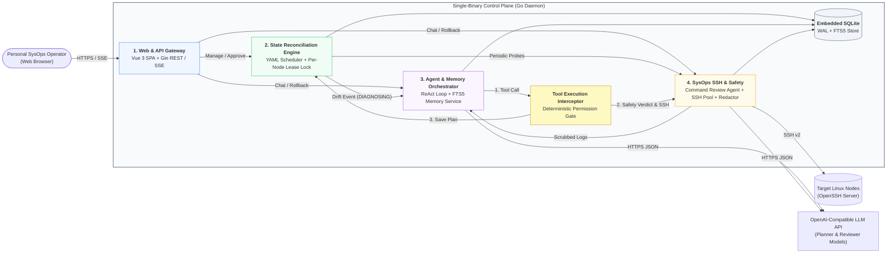

### 2.2 Deployment architecture

To meet the Single-Binary Zero-Config (`SRS 7.1`) and Agentless Control Plane (`SRS 6.7`) requirements, the runtime topology spans three nodes without external databases or remote monitoring agents:

1. **Control Plane Host**: Runs the `sysops-agent` Go executable (embedding compiled Vue 3 static assets via `go:embed`), paired with a local SQLite database (`sysops.db` in WAL mode) and an AES-256-GCM host key (`master.key`) for credential encryption. It also exposes port to provide the web console to the operator.
2. **Target Linux Nodes (1–20 Hosts)**: Standard Linux servers accessible via `sshd` (Port 22). During `UC-05` execution, pre-mutation file/state snapshots are staged in `/var/tmp/sysops-backup/<incident_id>/` on the target host.
3. **LLM Inference Endpoint**: Any cloud or self-hosted (Ollama/vLLM) OpenAI-compatible API endpoint accessed over HTTPS.

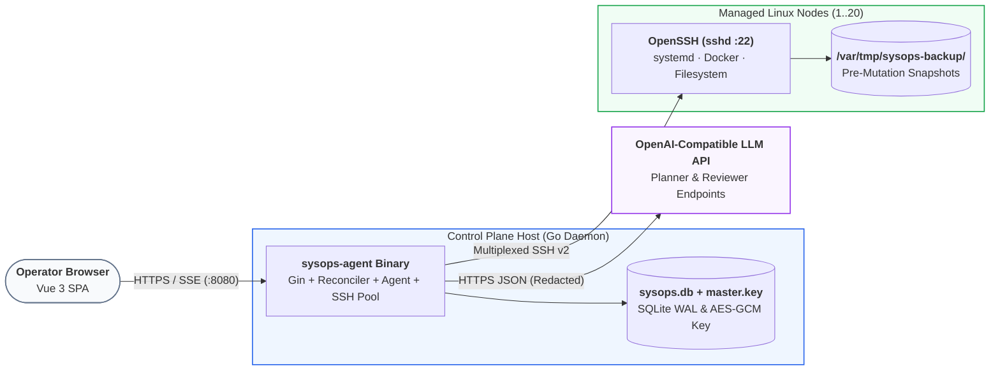

### 2.3 Technology architecture

| Layer                   | Selected Technology                   | Alternatives Considered       | Rationale & Trade-offs                                                                                                                                                             |
| :---------------------- | :------------------------------------ | :---------------------------- | :--------------------------------------------------------------------------------------------------------------------------------------------------------------------------------- |
| **Backend Runtime**     | **Go**                                | Python (FastAPI), Rust        | Compiles backend, concurrency scheduler, SSH pool, and frontend into one zero-dependency binary, avoiding Python runtime packaging overhead.                                       |
| **Web & Streaming**     | **Gin + SSE (Server-Sent Events)**    | WebSockets, gRPC-Web          | Diagnostic traces and step statuses stream unidirectionally while approvals use REST `POST`; SSE provides lighter connection management and auto-reconnection than WebSockets.     |
| **Frontend UI**         | **Vue 3 + TypeScript + Tailwind CSS** | React / Next.js, HTMX         | Compiles to compact static assets while supporting reactive state needed for the YAML Policy Builder and step-by-step Rollback Console.                                            |
| **Datastore & Memory**  | **Embedded SQLite (WAL + FTS5**)      | PostgreSQL + pgvector, Milvus | External vector DBs break single-binary deployment. SysOps faults rely on exact lexical tokens (unit names, exit codes, error flags), where FTS5 BM25 ranking excels at zero cost. |
| **Node Transport**      | **Native Go SSH**                     | Ansible Runner, Custom Agent  | Custom agents violate zero-footprint rules; Ansible subprocesses add startup overhead.                                                                                             |
| **LLM Integration**     | **OpenAI-Compatible JSON Tool API**   | LangChain, Vendor SDKs        | Thin custom client avoids heavy framework abstraction and enables zero-code switching across cloud or local LLM providers (`SRS 7.3`).                                             |
| **Shell Safety Parser** | **Go `mvdan.cc/sh/v3` AST Parser**    | Regex Matching                | Parses shell pipelines, subshells, and redirections into an AST before Review Agent evaluation, preventing obfuscated command bypasses where simple regex filters fail.            |

### 2.4 Key decisions

【每个人都撰写，最后徐佳咏整理总结】

#### ADR-01: Single-Binary Agentless Control Plane with Per-Node Lease Locking

- **Context**: The system must deploy as a lightweight personal tool (`SRS 7.1`) while preventing concurrent drift probes (`UC-03`), agentic diagnostics (`UC-04`), and state-mutating repairs (`UC-05`) from colliding on the same target Linux host.
- **Options**: (1) Distributed microservices + Redis locks + remote agents; (2) Uncoordinated SSH goroutines; (3) Single-binary Go daemon with SQLite-backed Per-Node Lease Locks.
- **Decision**: Adopt Option 3, enforcing a per-node lock state machine (`IDLE`, `PROBING`, `DIAGNOSING`, `PENDING_APPROVAL`, `REMEDIATING`) with heartbeat-renewed TTLs (`lease_expires_at`).
- **Consequences**: Identical drift signals on a locked node coalesce into the active incident (`coalesced_count++`), distinct drifts queue serially (`QUEUED_ON_LOCK`), and `REMEDIATING` locks suppress routine `UC-03` probes until post-repair verification completes. Lease expiry triggers fencing and recovery; it never automatically permits a competing mutation.

#### ADR-02: Embedded SQLite FTS5 Memory Retrieval with Three-Branch Adaptive Evolution

- **Context:** The control plane must remain lightweight, agentless, and deployable as a single Go binary with a local SQLite database (`SRS 7.1`). It must also retrieve past verified incident solutions during `UC-04` without repeatedly asking the LLM to solve the same operational failure from scratch. Personal SysOps incidents often contain highly specific lexical identifiers (such as `nginx.service`, `OOMKilled`, an exit code, or a configuration error), while remembered fixes must retain provenance, distinguish stale versions, and never become autonomous execution instructions.

- **Options:** (1) Use local SQLite FTS5 with BM25 text ranking and explicit version/status columns; (2) deploy PostgreSQL with pgvector for combined relational and embedding-based search; or (3) maintain a separate vector database such as Milvus with embedding generation and synchronization. The alternatives can improve semantic recall when users describe equivalent problems using different wording, but add operational dependencies, model/embedding costs, data synchronization, and backup complexity that conflict with the small-scale deployment target.

- **Decision:** Select **SQLite WAL + FTS5** as the primary memory store. Index sanitized `symptom_keywords`, `root_cause`, `remediation_steps`, and `scope_tags` using an external-content `memories_fts` table synchronized with `memories`. Use parameterized queries, operational-token normalization, BM25 ranking, explicit host/service scope checks, and `status = ACTIVE`, returning a bounded top-k set (default `search_memory.count = 3`) within a fixed context-token budget. Retrieval returns historical evidence, not instructions. New one-off candidates require operator acceptance before becoming `ACTIVE`. Apply the deterministic `UC-07` **three-branch evolution rule** only after verified resolution: **unmatched** incidents create a staged candidate that becomes active only after the operator accepts it; **matched, unchanged** successful fixes increment `hit_count` and update `last_verified_at`; **matched, modified** fixes insert a successor version and mark the prior version `SUPERSEDED`. Persist selected memory IDs with incidents; preserve `source_incident_id`, verification timestamps, version lineage, and incident-scoped idempotency receipts; use a durable UC-07 job claimed by a worker after resolution, and allow explicit discard or archiving without destroying audit history.

- **Consequences and Trade-offs:** The decision avoids a separate search service, supports reproducible and inexpensive retrieval of exact system-error tokens, and integrates memory updates with other SQLite operations in atomic transactions. It also gives operators clear provenance and predictable version behavior. In exchange, FTS5 cannot guarantee semantic matching across paraphrases or changing log vocabulary, may require normalization for punctuation-rich SysOps identifiers, and does not independently determine whether an older fix is still safe in a new host context. Search hits are **advisory evidence only**: command execution remains subject to `CHG-03` interception and `UC-05` approval. Part III should validate retrieval precision/recall and stale-memory behavior on a small fault-injection corpus before considering an optional semantic reranker.

#### ADR-03: Transactional Remediation with Pre-Mutation Backups, Step Compensation, and a Local Safety Pipeline

- **Context**: Approved remediation plans (`UC-05`) execute multiple mutating shell commands over SSH. SSH commands are non-transactional: if step $k$ of $N$ fails midway, the target host is left in a partially mutated state with no way to reverse the $k-1$ steps that already succeeded. In parallel, the Diagnostic Agent may emit unsafe or obfuscated commands, and raw SSH outputs may carry credentials that must never reach external LLM providers (`SRS 7.2`, `7.9`).
- **Options**: (1) Execute approved plans directly and rely on ad-hoc manual cleanup scripts when something breaks; (2) Require LVM/ZFS snapshots or a remote agent daemon on every target node to guarantee whole-transaction rollback; (3) Compensating-transaction execution inside the control plane: every mutating action carries a mandatory `backup_cmd` plus a paired `rollback_cmd`, steps run sequentially under fail-fast semantics, and the whole pipeline is gated by an independent command review agent and a local secret redaction middleware.
- **Decision**: Adopt Option 3. Each `RemediationAction` in `propose_remediation_plan` now requires a `backup_cmd` (staging file/state snapshots under `/var/tmp/sysops-backup/<incident_id>/` on the target node, verified with `exit_code == 0` before the mutating `command` runs) and a paired `rollback_cmd` restoring that snapshot. Steps execute sequentially; if step $k$ fails, steps $k+1 \dots N$ are skipped, the incident transitions to `PARTIALLY_FAILED`, and the Web UI exposes per-step statuses (`Succeeded`, `Failed`, `Skipped`) with a reviewed reverse rollback workflow assessing all affected steps (including failed step $k$ when it had partial effects) or re-planning. Independently, the deterministic Go Tool Execution Interceptor queries the Command Review Agent strictly as a classifier (`READ_ONLY` / `MUTATING` / `DESTRUCTIVE`) and hard-blocks any `DESTRUCTIVE` verdict, while the Secret Redaction Middleware masks credential patterns in all SSH outputs before they reach the LLM API or SQLite.
- **Consequences**: Any single-step failure becomes recoverable as long as its pre-mutation backup succeeded; the residual risk shifts to backup/rollback correctness, which the UI surfaces per-step and the design tracks as an open issue in `Section 6`. Each candidate command incurs one extra LLM classification round-trip, mitigated by the fail-closed `mvdan.cc/sh/v3` AST parser that rejects obfuscated syntax before review. Backup artifacts accumulate on target nodes over time, requiring the retention policy to be validated in Part III.

#### ADR-04: REST Commands and Server-Sent Events for Live Feedback

- **Author / status**: Ma Xiaoyun (2352626); selected for the Part II design, pending Part III implementation validation.
- **Context**: Vue 3 must display long-running diagnosis and repair progress without blocking navigation. Gin must preserve the approval gate, node lease ownership, and an auditable command history even if a browser disconnects. The client needs server-to-browser updates; approvals and edits are discrete requests.
- **Alternatives**:

| Option | Benefits | Costs / limitations |
| :--- | :--- | :--- |
| Periodic REST polling | Simple HTTP infrastructure; easy retry | Repeated empty requests and delayed progress; useful only as a degraded mode |
| WebSocket | Full duplex and low message overhead | Application-defined reconnect, replay and authorization handling; unnecessary for discrete operator commands |
| REST + SSE (selected) | Native browser EventSource, named events, ordered IDs and reconnect support; ordinary HTTP command semantics | One-way text stream; proxy buffering and replay retention require explicit design |

- **Decision**: Use versioned JSON REST endpoints for reads and commands and one multiplexed, same-origin SSE connection per active console tab. Stream sanitized diagnostic summaries, reviewed tool outcomes, plan revisions and execution progress. Never stream raw private model reasoning or credentials. REST responses and persisted resource snapshots remain authoritative; SSE does not execute commands.
- **Rationale**: This fits the embedded Vue/Gin deployment and separates explicit operator intent from background observation. An approval references an immutable plan revision and an idempotency key, so reconnecting or clicking twice cannot create another execution.
- **Consequences**: Commit each state change and its event record in one SQLite transaction; an ordered durable-log dispatcher publishes by event ID. Resume from `Last-Event-ID`; when history expires, send `stream.reset` and obtain a fresh snapshot. Disable approval while disconnected or refreshing. Heartbeats and disabled proxy buffering are required. A bounded slow-client queue disconnects lagging consumers for replay instead of blocking SSH workers. Section 3.2 specifies the corresponding persistence tables (`events`, `idempotency`, `operations`).
- **Validation**: Interrupt a stream during execution, replay duplicate events, submit approval twice, and approve an obsolete revision. The UI must converge to the persisted snapshot, one execution must be scheduled, and obsolete approval must fail with `409`.

### 2.5 Quality attributes

Because this system autonomously executes commands on personal Linux hosts, a single unsafe command or a leaked secret can cause irreversible damage within seconds, whereas a slower diagnosis or a slightly heavier binary only degrades convenience. We therefore rank the quality attributes as follows: **Security > Reliability & Recoverability > Performance & Resource Efficiency > Maintainability**, and the architecture addresses each priority through the mechanisms below:

| Priority | Quality Attribute | Architectural Mechanism | Measurable Target (`SRS §7`) |
| :-- | :-- | :-- | :-- |
| **P0** | **Security** | Independent Command Review Agent classifies every candidate command (`UC-09` Part A); the `mvdan.cc/sh/v3` AST parser fails closed on obfuscated syntax; `DESTRUCTIVE` verdicts are hard-blocked unconditionally; SSH keys and LLM API keys are encrypted with AES-256-GCM derived from `master.key`; the Secret Redaction Middleware masks credentials before any LLM call or SQLite write (`UC-09` Part B). | 0% unauthorized state-mutating execution; 100% redaction coverage on standard credential patterns (`SRS 7.2`, `7.9`) |
| **P1** | **Reliability & Recoverability** | Compensating transactions: per-step `backup_cmd` + `rollback_cmd` with fail-fast execution and the `PARTIALLY_FAILED` state (CHG-01, `ADR-03`); per-node lease locks with heartbeat TTLs prevent concurrent probes and deadlocked nodes (CHG-02, `ADR-01`); bounded SSH timeouts with exponential backoff isolate unreachable nodes; deterministic drift detection keeps alerting even when the LLM API is down (`SRS 7.5`). | 0% unrecoverable partial mutations; drift detection and alerting uninterrupted under LLM outage |
| **P2** | **Performance & Resource Efficiency** | Agentless SSH transport leaves zero footprint on target nodes; SQLite WAL + FTS5 is embedded in a single Go binary; deterministic probes run in Go with \$0 LLM cost; context windows are bounded by log `--tail` slices and `search_memory count` limits; SSE streams diagnostics with lightweight one-way connections. | < 300 MB RAM and < 10% idle CPU while monitoring 20 nodes at 60 s intervals; probes < 2 s/node; end-to-end diagnosis < 120 s (`SRS 7.4`, `7.7`) |
| **P3** | **Maintainability** | Modular monolith with Ports and Adapters: four subsystems interact through narrow interfaces (drift events, tool-call interception, SSH execution); the OpenAI-compatible LLM adapter allows provider switches via configuration only; the deterministic Go interceptor keeps safety-policy logic testable without an LLM in the loop. | Switching LLM providers requires configuration changes only (`SRS 7.3`) |

The dominant trade-off lies in the safety tier: the fail-closed policy will occasionally reject a legitimate but unusual diagnostic command, forcing the agent to retry with a safer formulation. For a personal tool where the operator is often the only line of defense, we deliberately accept this false-positive cost over the alternative of any unsafe command slipping through unsupervised.

### 2.6 Architectural Risks

| Risk | Likelihood / Impact | Mitigation |
| :-- | :-- | :-- |
| **R1 — LLM latency, outage, or hallucination** | High / Medium | Deterministic `UC-03` probes and alerts never depend on the LLM (`SRS 7.5`); the ReAct loop is bounded by `max_turns` (default 8); hallucinated commands are neutralized by the Command Review Agent; unresolved incidents degrade to `ESCALATED` with logs instead of blocking the scheduler. |
| **R2 — SSH execution timeout or midway failure** | Medium / High | Strict per-command timeouts and exponential backoff on unreachable nodes (`SRS 7.5`); pre-mutation `backup_cmd` verified before each step; fail-fast step execution plus paired `rollback_cmd` restore affected steps via the reviewed reverse rollback (CHG-01, `ADR-03`). |
| **R3 — Verbose logs exhaust the LLM context window** | High / Medium | `exec_readonly_shell` returns bounded slices (`journalctl -n 50`, `docker logs --tail 50`); the Secret Redaction Middleware masks credentials in outputs before transmission; `search_memory` caps retrieved records (`count = 3`); the distillation step compresses transcripts before storage (`UC-07`). |
| **R4 — Concurrent probes and duplicate LLM loops** | Medium / Medium | Per-node lease lock state machine coalesces identical drift signals and serializes distinct drifts into `QUEUED_ON_LOCK` (CHG-02, `ADR-01`); `REMEDIATING` locks suppress routine probe ticks, eliminating false drift alerts while services restart. |
| **R5 — Obfuscated commands bypass the safety review** | Medium / High | The `mvdan.cc/sh/v3` AST parser resolves pipelines, subshells, and redirections before classification, so `eval`/base64 tricks are expanded and fail closed as `MUTATING` or `DESTRUCTIVE` (`UC-09` 1a); the reviewer is a separate model call with no access to the diagnostic context, preventing prompt-injection laundering. |
| **R6 — Backup or rollback failure during remediation** | Medium / High | Backups are verified (`exit_code == 0`) before the mutating command runs; per-step statuses and rollback results are streamed via SSE; if rollback itself fails, the incident escalates to manual intervention with the exact pre-mutation snapshot path attached; retention and rollback verification are scheduled for Part III PoC validation (`Section 6`). |

### 2.7 Agentic Systems

#### 2.7.1 Agent Roles and Trust Boundaries

The Agent & Memory Orchestrator performs bounded, evidence-driven diagnosis after the State Reconciliation Engine detects drift (`UC-03`). It consists of a **Diagnostic Agent**, a **Memory Service**, a post-resolution **Memory Distillation** workflow, and a deterministic Go **Tool Execution Interceptor**. The Diagnostic Agent uses an OpenAI-compatible LLM to form hypotheses, request observations, and propose a remediation plan; it has no direct SSH, database-write, or approval authority. The Memory Service performs local SQLite FTS5 retrieval and persists versioned records. The distillation workflow transforms *verified* resolved incidents into reusable, sanitized troubleshooting knowledge (`UC-07`).

The independent **Command Review Agent** belongs to the SysOps SSH & Safety subsystem, not to the tool-execution control path. It returns a classification (`READ_ONLY`, `MUTATING`, or `DESTRUCTIVE`) for candidate shell commands, but never invokes the SSH executor or the remediation tools. Instead, the deterministic Go interceptor mediates every agent-originated tool call, applies lifecycle and permission checks, obtains safety verdicts when shell commands are involved, and routes requests to the appropriate service. This separation addresses `CHG-03` and prevents an LLM from granting itself execution privileges.

#### 2.7.2 Internal Orchestration and Tool-Call Architecture

The following diagram distinguishes agent reasoning, deterministic authorization, human approval, SSH execution, and memory operations. The inter-agent review call returns only a safety verdict; all actual dispatch remains with the interceptor and the execution subsystem.

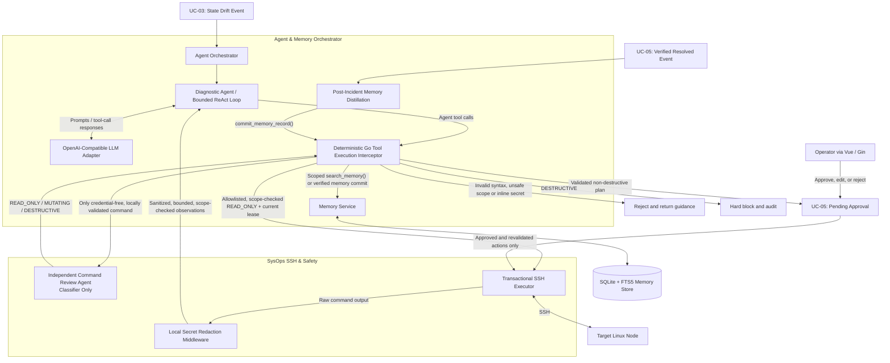

**Tool contracts and execution boundaries**

| Tool | Main inputs | Behavior and authority |
| :--- | :--- | :--- |
| `search_memory` | `keywords: string[]`, `scope_context: {node_id, os_family, os_version?, service_name, service_version?}`, `count: int = 3` | Uses scoped, parameterized FTS5 search on `ACTIVE` memory versions; an incompatible OS/service scope is excluded even when keywords match. Results are historical evidence, never executable instructions; cap record text and the *aggregate* prompt budget. |
| `exec_readonly_shell` | `incident_id`, `node_id`, `command`, `scope_context` | The interceptor first parses the complete command AST, checks a narrow allowlist of diagnostic templates **and argument/path restrictions**, rejects inline secrets locally, then obtains a review verdict only for a safe-to-disclose command. A `READ_ONLY` verdict alone is insufficient: re-check current node lease generation and data-access scope immediately before SSH dispatch, cap output, and apply outbound content policy after local redaction. |
| `propose_remediation_plan` | `incident_id`, `node_id`, `root_cause`, `actions[]` (`description`, `command`, `backup_cmd`, `rollback_cmd`, `risk_level`) | Persists an immutable proposal for `UC-05`, never executes it. All three commands per step are locally checked for secrets and reviewed before approval/execution; `DESTRUCTIVE` and unknown commands are rejected. The SSH subsystem rechecks approval, plan revision and lease before dispatch. |
| `commit_memory_record` | `incident_id: string`, `symptom_keywords`, `root_cause`, `remediation_steps`, `scope_tags`, `matched_memory_id?: string`, `is_modified: bool` **required** | Internal UC-07 service tool (not an arbitrary LLM SQL write). Verifies `incident_id` is resolved and owns an idempotency receipt; derives/validates an `ACTIVE` matched memory and explicit `is_modified` from the *verified* fix before an atomic three-branch update. For unmatched one-off incidents the candidate may be discarded instead of promoted. The required flag refines the optional field in the Part I tool sketch. |

#### 2.7.3 Short-Term Context and Long-Term Memory Retrieval

For each incident, the orchestrator constructs a **short-term diagnostic context** from the active YAML manifest, observed drift, node and service identifiers, bounded and sanitized diagnostic output, relevant operator feedback, and at most three retrieved memories (`search_memory` default `count = 3`). SQLite FTS5 with BM25 ranking prioritizes exact operational tokens such as service names, exit codes, and log error signatures. Only `ACTIVE` memories matching the incident's applicable scope should enter retrieval; `SUPERSEDED` and `ARCHIVED` versions are excluded from the default search. Retrieved fixes are advisory evidence and must not bypass command review or human approval.

The orchestrator retains concise observations and tool outcomes rather than unbounded raw logs. SSH probes use bounded commands (for example, `journalctl -n 50` or `docker logs --tail 50`), and context can be summarized between turns while preserving key error signatures and causal evidence. The local Secret Redaction Middleware removes credentials, tokens, and private keys before diagnostic output is persisted in SQLite, sent to an external LLM endpoint, or streamed to the UI. The web console receives sanitized progress summaries, not private raw model reasoning. An OpenAI-compatible adapter permits local or cloud inference without changing the orchestration logic.

**Scope, input trust, and size limits.** The Memory Service receives `scope_context` from the *trusted* node/manifest record, not from a model-generated tag; it first filters for compatible OS/service identity and active status, then ranks by BM25. `count = 3` is not a size budget: bound each stored field and each returned record, cap the combined injected memory text (proposed maximum: 4,000 tokens), and reserve a separate token budget for the manifest and live observations. Treat retrieved repairs and SSH logs as untrusted data susceptible to prompt injection; instruction-like text in these sources never changes the command allowlist or approval policy. Large or unsupported data is truncated, summarized locally, or withheld instead of being sent wholesale to the model.

#### 2.7.4 Bounded ReAct Diagnosis (`UC-04`)

When `UC-03` detects drift and the per-node coordinator grants a `DIAGNOSING` lease (`CHG-02`), the orchestrator first searches historical memories and builds the initial context. The Diagnostic Agent then follows a bounded **Reason–Act–Observe** loop: (1) infer a likely cause from available evidence; (2) issue a diagnostic tool call; (3) let the interceptor and safety subsystem vet and execute an eligible read-only probe; and (4) incorporate the redacted observation into the next inference step. The configured default ceiling is `max_turns = 8` (`SRS UC-04`). The orchestrator also applies cancellation to every LLM HTTP request (proposed 30-second per-call deadline) and a 120-second end-to-end diagnosis budget from `SRS 7.7`. On timeout, it cancels the in-flight request, stops renewing the diagnosis lease once it is safe to do so, records a sanitized timeout outcome, and escalates; a hung provider cannot indefinitely hold the node or cause an unbounded retry. If a command is not read-only, the interceptor refuses it and instructs the agent to collect evidence through safe probes or defer the change to the remediation plan.

If sufficient evidence is obtained, the agent submits a structured root-cause summary and ordered remediation actions through `propose_remediation_plan`. The incident transitions to `PENDING_APPROVAL` and waits for explicit operator review (`UC-05`); the Diagnostic Agent never runs the proposed mutations itself. If the turn ceiling is reached or useful diagnosis cannot proceed, the incident is marked `ESCALATED` with the available sanitized evidence, rather than guessing or automatically repairing the host. If the LLM endpoint is unavailable, deterministic drift detection and alerting continue independently, while agent diagnosis is deferred or escalated (`SRS 7.5`).

#### 2.7.5 Safety, Human Handoff, and Post-Resolution Memory

The local interceptor provides the enforceable boundary between untrusted model output and privileged tools. A `READ_ONLY` classification constrains mutation risk but **does not authorize reading arbitrary files**: the trusted Go control plane permits only approved, parameter-bounded diagnostics (for example `df`, `free`, `systemctl status <approved-unit>`, `journalctl -u <approved-unit> -n 50 --no-pager` and `docker logs --tail 50 <approved-container>`). General file-reading, arbitrary path arguments, redirections, nested shells, `eval`, and unsupported pipelines fail closed. Both the requested data source and the sanitized output must remain within the node/service scope approved for that incident; redaction is defense in depth, not a substitute for access control. A deterministic local preflight rejects commands containing inline tokens/passwords/private keys before any shell, backup, or rollback command reaches a potentially remote Review Agent. Commands and logs with unrecognized sensitivity must not be sent to external LLM endpoints. Command parsing and review must fail closed on unsupported or obfuscated shell syntax; the Review Agent's result is input to a deterministic policy decision, not permission by itself. The interceptor checks ownership and the monotonically increasing `lease_generation` *again at the SSH dispatch boundary*; an expired or replaced generation cannot start a command. Node takeover stays blocked until any prior remote command has been positively stopped or recovered, rather than relying on TTL expiry alone. `DESTRUCTIVE` commands are hard-blocked and audited. `MUTATING` operations are prohibited during autonomous diagnosis and require a reviewed, versioned plan plus explicit human approval. After approval, the SysOps SSH & Safety subsystem performs the `backup_cmd`, then the change, and finally post-change verification; failures enter the compensating recovery path described in `CHG-01`, `ADR-03`, and `Section 3.5.2`. The approval and recovery details belong to `UC-05` and the SSH subsystem, rather than the Diagnostic Agent.

Only after the desired-state probe confirms recovery and the incident reaches `RESOLVED` does `UC-07` begin memory distillation. The system extracts the observed symptoms, confirmed root cause, verified remediation, and any operator modifications, scrubs sensitive content, and invokes `commit_memory_record`. Its three-branch policy stages an unmatched one-off candidate for approval before an active memory is created, increments `hit_count` and refreshes `last_verified_at` for an unchanged successful reuse, or inserts a new version and marks the old entry `SUPERSEDED` when the fix was modified. Operators first review unmatched one-off candidates in a non-indexed `PENDING_REVIEW` distillation state: accepting promotes the candidate to `ACTIVE`, while discarding records a `DISCARDED` receipt without making the memory searchable. After promotion, operators may also edit or archive memories (`UC-08`). Selected `matched_memory_id` and environmental scope are persisted with the incident before diagnosis completes. The server compares the canonical verified remediation against the current active matched record (including operator modifications); a mere FTS similarity hit is not automatically considered the same pattern. All new or successor verified records set `last_verified_at` to the incident's actual verification time; manual curation never fabricates verification. This process separates temporary diagnostic context from reusable, provenance-linked long-term knowledge, while ensuring that unverified LLM suggestions are never treated as successful fixes.

**Design consistency:** This section implements the `UC-04`, `UC-07`, and `UC-09` behaviors in Part I SRS; the `CHG-01` transactional plan, `CHG-02` node lease coordination, and `CHG-03` deterministic interceptor refinements in Part II; and the REST/SSE and versioned memory interfaces specified in Section 3.6.

---

## 3. Design Models

### 3.1 Domain & Structural Class Diagrams

The class model below spans the four subsystems, emphasizing the objects that realize the drift-detection, diagnosis, safety, transactional remediation, and memory lifecycles:

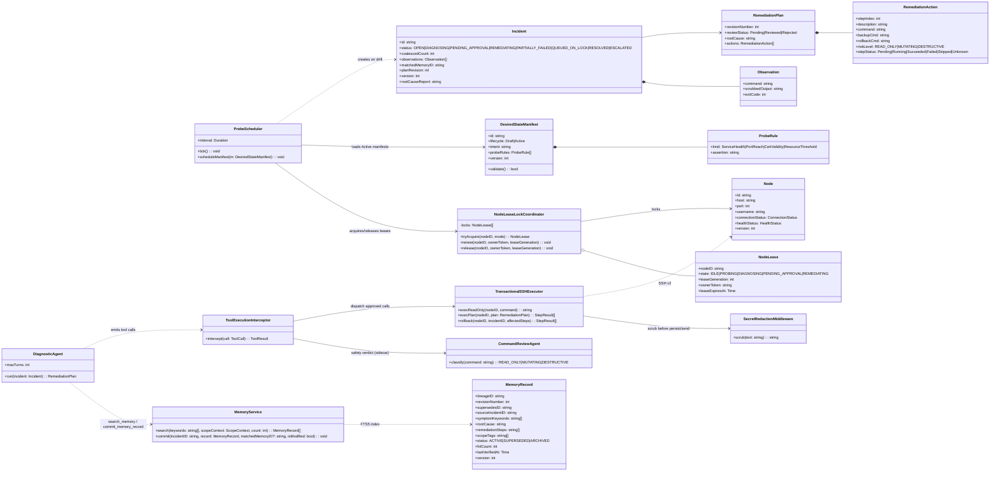

Key structural decisions:

- **Scheduler / Coordinator separation**: `ProbeScheduler` triggers deterministic checks, but it never talks to SSH or the LLM directly; every probe goes through `NodeLeaseLockCoordinator` first, so concurrency policy is enforced in exactly one place.
- **`Incident` as the shared aggregate**: it owns `Observation`s (the redacted diagnostic evidence) and references one `RemediationPlan`, which lets the Web UI render the full trace from a single SQLite-backed aggregate.
- **`RemediationAction` carries its own recovery contract**: each action bundles `backupCmd` and `rollbackCmd` (ADR-03), so the `TransactionalSSHExecutor` can enforce fail-fast semantics and reverse rollback without any per-target-host agent or snapshot service.
- **Interceptor as the only tool gateway**: `DiagnosticAgent` emits tool calls exclusively into `ToolExecutionInterceptor`, which consults `CommandReviewAgent` as a pure sidecar classifier and routes verdicts to `TransactionalSSHExecutor` — matching the corrected `UC-04`/`UC-09` control flow from CHG-03.

### 3.2 Relational Data Model

#### 3.2.1 Data Model and Persistence Boundaries

The control plane uses **embedded SQLite** with Write-Ahead Logging (WAL) for operational state and **FTS5** for keyword-based incident-memory retrieval. This choice preserves the project's single-binary, agentless deployment requirement (`ADR-01`) and avoids a separate database or vector-search service (`ADR-02`). The schema must support three connected lifecycles: (1) a managed node's declarative policy and detected drift (`UC-02/03`); (2) bounded, reviewed diagnosis and human-approved, recoverable remediation (`UC-04/05/09`); and (3) verified incident-to-memory distillation, retrieval, versioning, and curation (`UC-07/08`).

Database columns store **durable domain facts**, whereas the API presents versioned resource representations. For example, the API's `lock_state` is derived from the `node_leases` row; `manifest_version` resolves to an immutable `manifest_revisions` record; and the incident's current plan revision is represented by the latest `remediation_plans` row. Operational event delivery is supported by a durable `events` outbox, not by treating an SSE connection as persistent storage.

#### 3.2.2 Entity–Relationship Diagram

The following logical ER diagram shows primary and foreign keys (`PK`, `FK`). SQLite uses `TEXT` for opaque IDs and UTC timestamps, `INTEGER` for versions/counters, and JSON-valid `TEXT` for compact structured fields. Abbreviated attributes are expanded in the schema summary below; the separate executable SQL sketch is intentionally not part of this document.

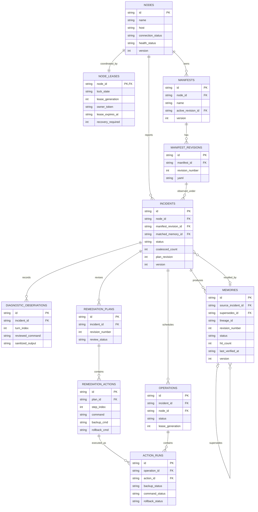

`MEMORIES.supersedes_id` points to an earlier version within the same lineage; a newly revised entry is the active successor of the old one. `INCIDENTS.matched_memory_id` records the principal verified, scoped historical memory selected **during diagnosis, before resolution**, so restart/retry does not lose the relationship. Persist it in the same transaction as the relevant diagnostic observation (or an incident–memory selection record), including the matched memory version and scope used for selection. An optional incident–memory match table can record the remaining retrieved candidates for provenance. A high BM25 score by itself never establishes an actual match. `EVENTS`, `IDEMPOTENCY`, and `MEMORY_DISTILLATIONS` are infrastructure/audit tables explained below and intentionally omitted from the main domain diagram for readability. The distillation table also acts as a **durable work queue**: the incident-resolution transaction inserts a `PENDING` work record atomically with `RESOLVED`, making a post-crash retry possible. A `PENDING_REVIEW` work state stores unmatched one-off candidates outside the searchable `memories` table.

#### 3.2.3 Core Tables, Keys, and Indexes

| Table | Important columns and constraints | Purpose / access pattern |
| :--- | :--- | :--- |
| `nodes` | `id` PK; `name`, `host`, `port`, `username`, `host_key_fingerprint`, `connection_status`, `health_status`, `last_probe_at`, `version`; encrypted credential blob never returned by API | Registered Linux nodes (`UC-01/03`). `connection_status` is not conflated with health or lock state. |
| `node_leases` | `node_id` PK/FK; `lock_state`, `owner_token`, monotonic `lease_generation`, `lease_expires_at`, `recovery_required` | SQLite-backed per-node coordinator (`CHG-02`); exclusive ownership and safety on uncertain remote execution. |
| `manifests` + `manifest_revisions` | `manifests.node_id` FK; active revision pointer; immutable `(manifest_id, revision_number)` unique key; YAML and validation state in revisions | Versioned declarative policies. A running incident stays bound to the revision observed when drift occurred, even when a policy is edited later. |
| `incidents` | `id` PK; `node_id`, `manifest_revision_id` FKs; `status`, `drift_signature`, `drift_summary`, `coalesced_count`, `root_cause_summary`, `matched_memory_id`, `matched_memory_version`, `plan_revision`, `version`, `resolved_at` | Traces a fault from `OPEN`/`DIAGNOSING` to `PENDING_APPROVAL`, `RESOLVED`, or `ESCALATED`, including `QUEUED_ON_LOCK` and `PARTIALLY_FAILED`. |
| `diagnostic_observations` | `id` PK; `incident_id` FK; `turn_index`, `tool_name`, `review_verdict`, sanitized command/observation, `created_at` | Bounded, redacted evidence for the ReAct trace; no raw secrets or private model reasoning are stored (`UC-04/09`). |
| `remediation_plans` + `remediation_actions` | `(incident_id, revision_number)` unique; ordered `(plan_id, step_index)` unique; each action has `command`, mandatory `backup_cmd` and `rollback_cmd`, risk and review metadata | Immutable reviewed plan revisions. A plan edit creates a new revision; previously approved steps cannot silently change (`CHG-01`, `ADR-03`, and Section 3.5.2). |
| `operations` + `action_runs` | `operations` records operation/worker/lease generation; `action_runs` records backup, command and compensation states for a specific approved action | Tracks execution and recovery outcomes without mutating the reviewed command definitions. Timeout/uncertain status is explicit. |
| `memories` | `id` PK; `lineage_id`, `revision_number`, `supersedes_id` FK; `source_incident_id` FK; `symptom_keywords`, `root_cause`, `remediation_steps`, `scope_tags`, `status`, `hit_count`, `last_verified_at`, `version` | Reusable, verified, redacted knowledge with provenance, optimistic concurrency, and audit-preserving version lineage (`UC-07/08`). |
| `events` | Autoincrement `id`; `resource_type`, `resource_id`, `resource_version`, `type`, sanitized JSON `payload`, `committed_at` | Durable SSE outbox. Keep up to **24 hours or 100,000 entries**, whichever threshold is reached first; reclaim old rows in short background batches. Expired replay cursors cause `stream.reset` and a fresh consistent `/sync` snapshot (per the proposed Web/API contract). |
| `idempotency` + `memory_distillations` | `(operator_id, key)` unique for operator commands; `memory_distillations.incident_id` unique, plus `state` (`PENDING`, `RUNNING`, `PENDING_REVIEW`, `COMPLETED`, `DISCARDED`, `FAILED`), `candidate_json`, `memory_id`, `claimed_at`, `retry_count` | Durable UC-07 work/receipt; resolution plus `PENDING` work is committed together, while one-off candidates wait for operator decision outside the active memory index. |

Indexes target the most common operations: `incidents(node_id, status, updated_at)`, `remediation_plans(incident_id, revision_number)`, `remediation_actions(plan_id, step_index)`, `memories(status, last_verified_at)`, and an FTS5 index on searchable memory text. A partial unique index on `memories(lineage_id) WHERE status = 'ACTIVE'` prevents two simultaneously active versions of one troubleshooting pattern; `UNIQUE(supersedes_id)` prevents a previous version from acquiring two immediate successors. Foreign keys are enabled on every SQLite connection; WAL supports concurrent readers while short transactions serialize writes.

#### 3.2.4 SQLite FTS5 Search and Context Retrieval

The `memories_fts` virtual table indexes four searchable fields in `memories`: `symptom_keywords`, `root_cause`, `remediation_steps`, and `scope_tags`. An **external-content** FTS5 index keyed by the `memories` rowid and synchronized through insert/update/delete triggers avoids a second independent source of truth. The Memory Service normalizes diagnostic terms, constructs a safely escaped FTS query, and uses bound parameters to prevent user-provided text from being interpreted as arbitrary SQL or untrusted FTS query syntax. `scope_context` is obtained from trusted current node/manifest metadata (`node_id`, OS distribution/version, service identity/version); incompatible records are excluded before any result is injected into the LLM. Each memory field has an enforced storage length limit; retrieved content is truncated/summarized to a total memory budget (proposed 4,000 tokens), not merely bounded by record count. It joins ranked FTS matches back to `memories`, filters `status = 'ACTIVE'` and applicable scope, and uses `bm25(...)` ranking with a configurable top-`k` limit (default `search_memory.count = 3` in Part I SRS).

For example, a future incident involving `nginx.service` and an address-in-use error can recover a prior verified memory containing those tokens; it does **not** automatically execute its stored remediation steps. Keyword retrieval is lightweight and particularly useful for exact SysOps identifiers, but it can miss semantically similar incidents with different wording. This limitation is a known trade-off of `ADR-02`, not a claim of semantic-equivalent search. `SUPERSEDED` and `ARCHIVED` records remain available for audit but are excluded from normal retrieval.

#### 3.2.5 Adaptive Memory Evolution (`UC-07`)

A memory write is authorized only after an incident has been **verified `RESOLVED`** (post-remediation desired-state check or verified manual resolution). The distillation pipeline receives the redacted symptom, confirmed cause, successful steps, scope tags, and a reference to any matched memory. The three outcomes below are serialized in short SQLite transactions. A newly unmatched candidate is staged first, and promotion or discard occurs in a separate transaction after the operator chooses; each committed resource change writes its matching durable event atomically:

| Verified outcome | Transactional update | Observable result |
| :--- | :--- | :--- |
| **New pattern** (`matched_memory_id IS NULL`) | Distiller stores a sanitized candidate in `memory_distillations` with `state = PENDING_REVIEW`. Operator may `DISCARD` it as a one-off, leaving a non-indexed receipt; on acceptance insert `ACTIVE` memory with new lineage, `revision_number = 1`, `source_incident_id`, `hit_count = 1`, and **`last_verified_at = incidents.resolved_at`**. | Unaccepted/discarded candidates never appear in FTS5; accepted candidate is searchable with incident provenance. |
| **Existing pattern, unchanged fix** (`is_modified = false`) | Verify the selected `matched_memory_id` is the current `ACTIVE` version with a compatible environment and verified matching remediation; atomically claim the incident receipt, then set `hit_count += 1`, `last_verified_at = incidents.resolved_at`, `version += 1`. | Existing verified knowledge gains another use without creating a new version. |
| **Existing pattern, modified fix** (`is_modified = true`) | Validate the current active matched lineage and operator-edited/verified differences; mark old record `SUPERSEDED` and insert a new `ACTIVE` row with the same lineage, `supersedes_id = old.id`, `revision_number + 1`, new incident provenance and **`last_verified_at = incidents.resolved_at`**. | Version history remains auditable; only new version is searchable by default. |

If the operator later edits a memory through `PATCH /memories/{id}`, the service follows the versioning path but **does not change `last_verified_at` merely because of the edit**. `POST /memories/{id}/archives` changes the current record to `ARCHIVED` rather than deleting evidence or incident links. All three branches use one unique `memory_distillations(incident_id)` work/receipt row, but pending review and the later operator decision are separate, crash-recoverable transactions. A repeated or retried distillation event must not create a duplicate memory or increment `hit_count` twice; all branches maintain the one-active-version-per-lineage invariant. **On resolution**, the control plane commits `RESOLVED`, `resolved_at` and a `PENDING` distillation job in a *single* SQLite transaction. The worker claims that job atomically; startup recovery reclaims interrupted jobs. It derives a tentative match from a persisted incident selection, validates its current scope/status/lineage, and compares a canonical normalized set of *verified* remediation steps with the selected memory. If the match is not genuinely the same fault pattern, it resets `matched_memory_id = NULL` and routes to a new candidate rather than superseding unrelated history. `is_modified` is **always supplied as an explicit boolean** after this deterministic validation; the Part I optional parameter is refined to required in the HW2 design. A `PENDING_REVIEW` candidate is decided by the operator before its first `ACTIVE` insertion. The operator acceptance/discard interaction is shown as a **conceptual UC-07 workflow only**: no additional public REST endpoint or API request/response shape is specified in this section. The Web/API owner will decide how this interaction maps to the existing API contract. Until that decision is agreed, unmatched candidates remain non-indexed in `PENDING_REVIEW`; the design must not silently promote them to `ACTIVE`. Any eventual operator decision must be authenticated, version-checked, idempotent, and durable so worker retries cannot duplicate a memory entry.

#### 3.2.6 Integrity, Safety, and API Alignment

The schema implements `CHG-01` by storing pre-mutation backups, compensation commands and individual execution outcomes; `CHG-02` by storing per-node lease ownership/generation and incident coalescing counts; and `CHG-03` by recording **reviewed tool outcomes** without granting database or SSH privileges to the LLM. All persisted diagnostic text, memory content and event payloads must pass local secret redaction before commit. SSH credentials are encrypted at rest and are never represented in responses or SSE payloads.

For the proposed team REST/SSE design, resource changes and their corresponding outbox events are committed atomically; the REST/SSE gateway can replay events by increasing event `id` after reconnection. Events are retained for up to 24 hours or 100,000 rows; a replay request older than retained history receives `stream.reset` and must fetch a fresh `/sync` snapshot. The UI's `GET /memories`, `GET /memories/{id}`, `PATCH /memories/{id}` and archive action map to `memories` and `memories_fts`, while node and incident DTO versions map to their corresponding `version` fields. A plan approval is bound to the current incident/plan revision and an idempotency key. This design keeps the Agent & Memory subsystem's persistence consistent with the separate SysOps SSH & Safety and Web/API designs without treating model output as an authoritative database mutation.

**Implementation note:** The ER diagram and table/index definitions above are the proposed HW2 design artifact. A separate executable SQL schema will be developed for Part III. For Part III, the new work-queue and review-state columns must also be reflected in the executable migration and tested against SQLite foreign-key/FTS5 behavior.

### 3.3 Agent & Memory Diagrams

This section specifies the interaction order for the Agent & Memory Orchestrator's two principal use cases. **Sequence 1** refines autonomous diagnosis (`UC-04`) with command-safety review and log sanitization (`UC-09`); **Sequence 2** refines adaptive memory distillation after a verified incident resolution (`UC-07`). The diagrams complement the component responsibilities defined in Section 2.7 and use the versioned SQLite persistence model from Section 3.2. All LLM-generated tool requests cross a **deterministic Go Tool Execution Interceptor**: the Command Review Agent is a classifier, never an SSH executor (`CHG-03`).

#### 3.3.1 Sequence 1: Autonomous Root-Cause Diagnosis, Tool Safety Review, and Log Redaction (`UC-04`, `UC-09`)

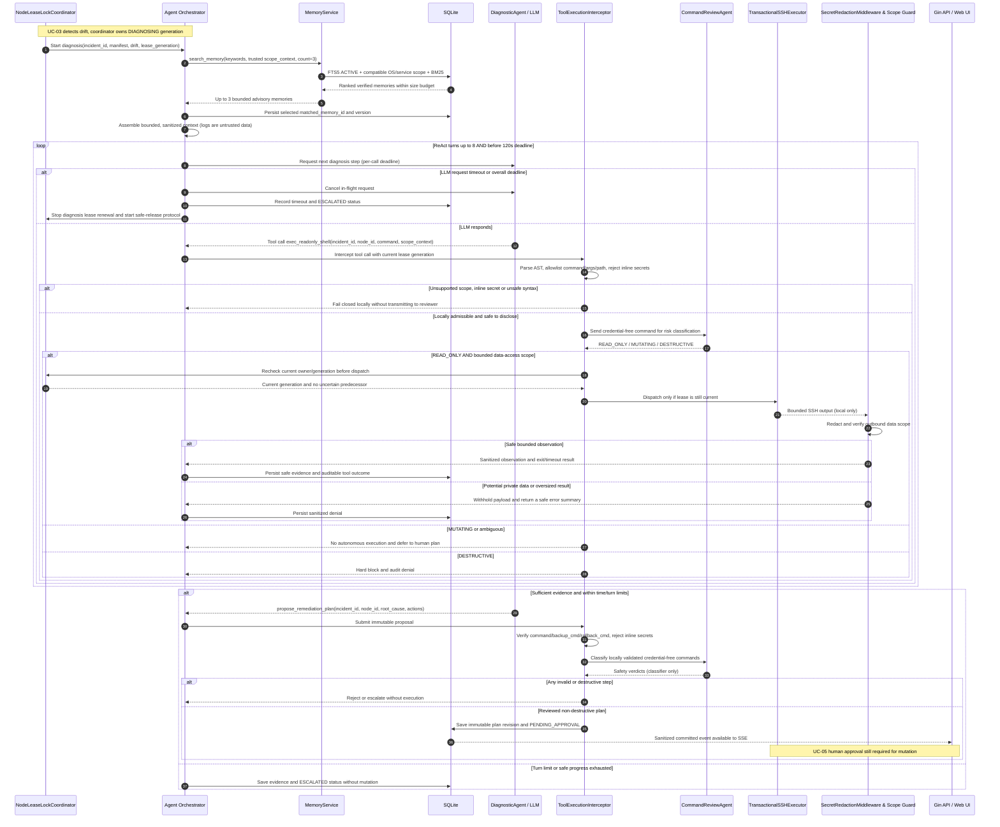

**Interaction rationale.** Before issuing model calls, the orchestrator performs scope-constrained FTS5 retrieval using trusted OS/service metadata and persists the chosen matched memory ID/version with the incident. Historical fixes and service logs are treated as *untrusted evidence*, not instructions. Per-record and total context budgets limit injected text; `max_turns = 8` and explicit LLM/request deadlines bound time, not merely completed turns.

The deterministic interceptor validates the *whole* shell command against a narrow diagnostic allowlist and its path/argument scope, rejects embedded credentials before sending anything to a potentially external Review Agent, and consults that reviewer only as a classifier. The reviewer does not execute commands. Even a `READ_ONLY` verdict cannot authorize arbitrary file reads; the SSH dispatcher checks the current node lease owner/generation immediately before dispatch. The previous lease owner must have no unknown remote execution before another generation takes over. SSH output is redacted and checked for allowed data scope *before* entering prompts, storage or SSE; sensitive or unbounded results are withheld.

A valid diagnosis yields an immutable, versioned proposal with reviewed `command`, `backup_cmd`, and `rollback_cmd`. It enters `PENDING_APPROVAL`, not automatic execution. Uncertain, invalid, unsafe or timed-out diagnosis escalates with sanitized evidence. The actual remediation and rollback remain under the human-approved UC-05 execution subsystem, consistent with `CHG-01` to `CHG-03`, `Section 3.5`, and `Section 3.6`.

#### 3.3.2 Sequence 2: Verified Incident Distillation and Three-Branch Memory Evolution (`UC-07`)

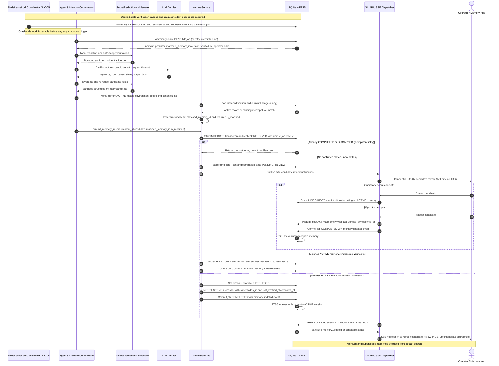

**Crash-safe trigger and provenance.** A verified `RESOLVED` transition and one `PENDING` distillation job are inserted in the same SQLite transaction. A worker atomically claims the durable job and retries interrupted work after restart; the memory service uses the incident ID to verify resolution and enforce at-most-once materialization via a unique incident receipt. The prior matched memory ID and version were saved during UC-04, so a delayed worker can recover the correct historical context.

**Deterministic matching.** The LLM distiller proposes sanitized text but is not trusted to choose the database update branch. The Memory Service validates any selected memory against the current `ACTIVE` lineage, OS/service scope, and the incident's verified root cause/repair. It compares normalized verified steps (including operator edits) against the matched verified recipe, not merely FTS score. Unrelated or uncertain matches are routed to a new candidate; otherwise the service supplies the explicit required `is_modified` boolean. `matched_memory_id` may be null only for an unmatched candidate.

**New candidate review and three-branch policy.** The operator-facing accept/discard transport remains an open integration decision with the Web/API owner; this sequence does not define a new public route. For an unmatched incident, the structured candidate remains `PENDING_REVIEW` and is **not** indexed into active FTS5 until the operator accepts it. The operator may discard a one-off anomaly; a `DISCARDED` receipt remains for idempotency. Accepted new memories set `last_verified_at` from the incident's actual verification time. An unchanged matched fix increments `hit_count`, while a modified matched fix creates a new active successor and supersedes the prior version; both use the incident verification time. Edits later made only through UC-08 must not imply a newly verified repair. Any `COMPLETED` or `DISCARDED` job is idempotent, so repeated signals cannot create duplicate versions or double-count use.

**API and safety alignment.** All evidence and distillation outputs are locally redacted and size-bounded before model transmission or persistence. Resource changes and sanitized `memory.updated` events are committed atomically to the durable event log. The Web/UI dispatcher streams the event only after commit, and default retrieval excludes `ARCHIVED` or `SUPERSEDED` records. Distillation failure does not undo a verified incident resolution; the durable work record transitions to retriable `FAILED` with bounded backoff and explicit operator visibility.

### 3.4 State Machine Diagrams

#### 3.4.1 Per-Node Lease Lock State Machine

The `NodeLeaseLockCoordinator` enforces a single lock per target node with heartbeat-renewed TTLs (ADR-01). Lock acquisition failures route drift signals into coalescing or `QUEUED_ON_LOCK` rather than spawning duplicate loops:

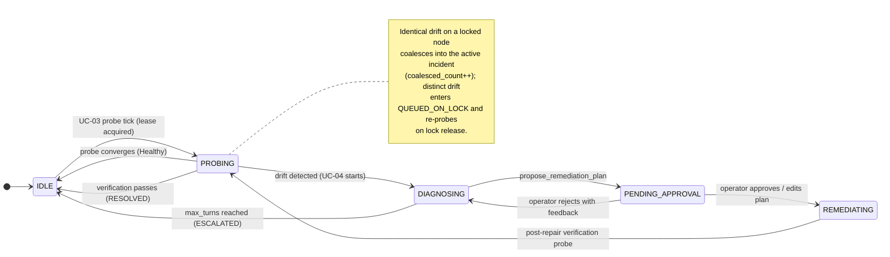

#### 3.4.2 Incident Lifecycle State Machine

The incident aggregate transitions through diagnosis, the HITL approval gate, and transactional remediation, including the `PARTIALLY_FAILED` recovery path introduced by CHG-01:

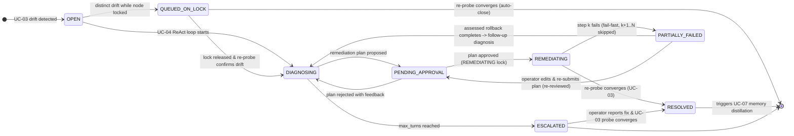

### 3.5 Drift & Remediation Diagrams

#### 3.5.1 Sequence 3: Periodic Drift Detection & Incident Coalescing (`UC-03`)

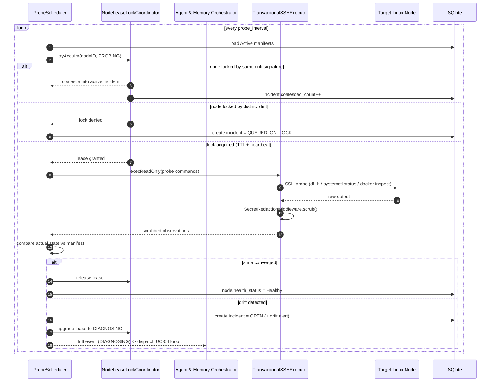

#### 3.5.2 Sequence 4: HITL Approval, Pre-Mutation Backup, Step Execution & Rollback (`UC-05`)

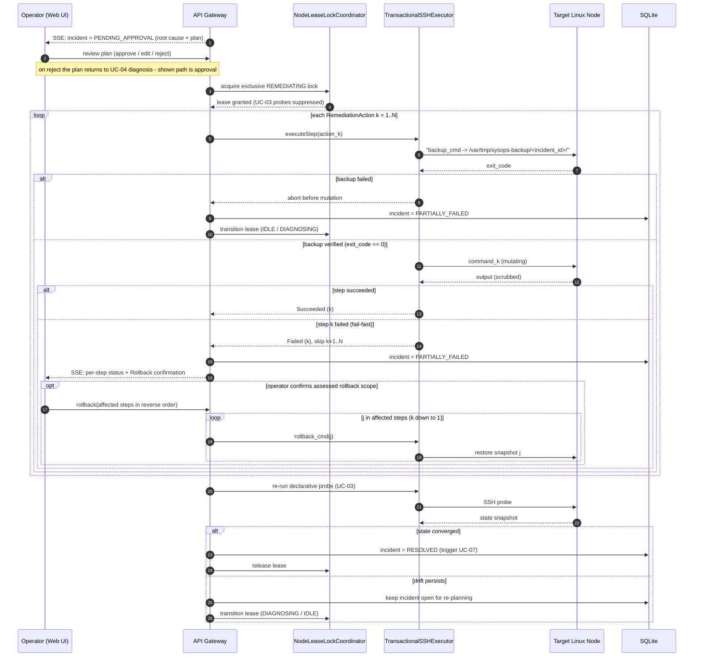

### 3.6 API Interfaces

**Owner: Ma Xiaoyun (2352626).** The following is the proposed implementation contract between the Vue 3 console and the Gin gateway. Paths are relative to `/api/v1`. Identifiers are opaque strings; timestamps use UTC RFC 3339. DTOs expose domain resources rather than SQLite rows. State names follow the canonical vocabulary established in Sections 1, 3.2, 3.4, and 4.

#### 3.6.1 Shared conventions and trust boundary

| Concern | Contract |
| :--- | :--- |
| Transport | Same-origin HTTPS in deployed environments; JSON requests and responses, except `text/event-stream`. Loopback-only local development may use HTTP. |
| Authentication | Standalone first-run setup binds a one-time setup token printed to the local console to a loopback-only bootstrap page; the operator sets a password and receives the first HttpOnly, SameSite=Strict cookie. Subsequent login verifies that password with rate limits; Secure under HTTPS. `GET /session` returns operator identity and a CSRF token. |
| Authorization | Every endpoint, including SSE and replay, verifies the session and resource access. Unsafe methods require `X-CSRF-Token` and an allowed Origin. No session or SSH secrets in URLs, event payloads, or browser storage. |
| Responses | Success: `{"data": ..., "request_id": "req-42"}`. Lists add `page: {next_cursor: string or null}`. A `204` has no body. Errors use the envelope below. |
| Pagination | List endpoints accept `limit` (default 20, maximum 100) and opaque `cursor`; ordering is stable by `(created_at, id)`. Memory search uses a generation-pinned index snapshot and cursor binds query, filters, generation and last rank/ID; expired snapshots return `409` and require a fresh search. |
| Concurrency | Mutable resource responses include an ETag derived from `version`. PATCH, PUT, DELETE and activation require `If-Match`; missing preconditions return `428`, stale versions `412`. Approval additionally checks `plan_revision` and current incident state atomically. |
| Retry safety | All resource-creation and asynchronous POSTs require `Idempotency-Key`. Persist key, operator, route, request hash and response atomically; matching retries return the original resource/operation and key reuse with different input returns `409`. Retain receipts for the deployment lifetime, including deleted resources; `GET /idempotency/{key}` recovers the result. |
| Asynchronous work | `202` includes `{data: {operation_id, status: "Queued", resource_id}, request_id}` and a `Location` header for `GET /operations/{id}`. Operation status is `Queued`, `Running`, `Unknown`, `Reconciling`, `Succeeded` or `Failed`; acceptance is never presented as success. |
| Validation / errors | `400` malformed JSON; `401` no session; `403` denied/CSRF/safety block; `404` absent resource; `409` state/lease conflict; `413` oversized input; `422` semantic validation; `429` throttled; `503` service unavailable. `429`/`503` may include `Retry-After`. |
| Sensitive fields | Node credentials are write-only and encrypted server-side. Responses return `credential_configured`, never a key/passphrase. Logs, memory content and event text are redacted before persistence/egress and rendered as text, never executable HTML. |
| SSH destination policy | Deployment config defines permitted hostnames/CIDRs. Resolve DNS at connection time, reject any resolved address outside allowlists (including private/link-local ranges unless explicitly allowed), and pin the validated resolved address for that attempt. Canonicalize host+port and enforce uniqueness across node records. |

```json
{
  "error": {
    "code": "PLAN_REVISION_CONFLICT",
    "message": "The plan changed. Reload and review revision 4.",
    "details": {"current_revision": 4}
  },
  "request_id": "req-42"
}
```

| Method and path | Request | Response |
| :--- | :--- | :--- |
| `GET /settings` | None | `200` settings + ETag/version, redacted endpoint/model, key_configured and autonomy limits; API key is never returned |
| `PUT /settings/llm` | `endpoint, model, api_key?`; If-Match | `200` updated settings + ETag; omitted key preserves the existing key; empty key is rejected; validate before commit, and preserve old settings on failure |
| `PUT /settings/autonomy` | `max_turns, allowed_risk_levels, approval_required`; If-Match | `200` updated settings + ETag; max_turns is an integer in 1..100 (default 8); approval_required must be true; allowed_risk_levels is a subset of READ_ONLY and MUTATING; DESTRUCTIVE is always blocked |

**Required persistence and recovery contract (Section 3.2 alignment)**

- `events(id INTEGER PRIMARY KEY AUTOINCREMENT, resource_type, resource_id, resource_version, type, payload, committed_at)`: insert with each state transition in the same SQLite transaction. Retain 24 hours or 100,000 rows; a cursor older than retained history triggers reset. Only the ordered log reader publishes; heartbeats have no ID.
- `idempotency(operator_id, key, route, request_hash, http_status, response, resource_id, operation_id, created_at)`: UNIQUE(operator_id, key). Acceptance, resource/operation creation, response receipt and event insertion share one transaction. Keep receipts for the deployment lifetime, including deleted resources; never silently reuse expired keys. `GET /idempotency/{key}` authenticates the owner and returns the original receipt, or 404. Duplicate concurrent requests serialize on the unique key; mismatched route/hash returns 409. A replayed receipt is returned before evaluating a now-stale precondition.
- `operations` additionally persists `worker_id, claim_expires_at, lease_generation, remote_step_id`. Claim with one conditional transaction checking Queued status AND the current unexpired node owner/generation. Stale queued operations fail with `LEASE_LOST`; never rebind them silently. Renew claims conditionally on owner and generation.
- At startup and on claim timeout, atomically move orphaned Running operations to Unknown and quarantine their host. A recovery worker moves Unknown to Reconciling, inspects remote step evidence and desired state, then records Succeeded or Failed with evidence; unresolved work returns to Unknown for manual intervention. Never blindly replay a possibly executed command.
- Closing SSH does not stop a remote process. TTL expiry revokes permission for further steps but does not release the host for another owner. Confirm all old remote commands and descendants have stopped (and reconcile their effects) before advancing the monotonic generation and granting a new mutating lease. If this cannot be proven, keep the host quarantined; availability is sacrificed to prevent concurrent writes. Apply this rule to backups, mutations and compensation.
- Canonical endpoint uniqueness applies on both create and edit. Normalize hostname case/trailing dot and IP literals; additionally share the lease across registered aliases of the same verified remote host identity. Resolve and validate destinations again on every connection, including tests and probes.
- Standalone `POST /session/bootstrap` accepts the one-use console token and password on loopback only; atomically disable bootstrap after success and store an Argon2id password hash. `POST /session/login` verifies the password, rotates the session ID and issues the cookie; `DELETE /session` revokes it. Bootstrap/login validate Origin and use rate limits; these are the only pre-session exceptions to the session/CSRF requirement. Remote administrators use a local tunnel for bootstrap. All other unsafe routes require the session CSRF token.

#### 3.6.2 Resource representations

| Resource | Required read fields and meaning |
| :--- | :--- |
| Node | `id, name, host, port, username, credential_configured, host_key_fingerprint, connection_status, health_status, lock_state, active_incident_id, last_probe_at, version`. Connectivity, health and lock state are separate; an unreachable node is not implicitly healthy. |
| Manifest | `id, node_id, name, yaml, version, active, validation_status, updated_at`. Draft edits do not replace the active revision until activation succeeds. |
| Incident | `id, node_id, manifest_id, manifest_version, status, drift_summary, coalesced_count, root_cause_summary, plan_revision, actions, version, updated_at`. Details include sanitized observations and matched memory IDs. |
| Plan action | `id, order, description, command, risk_level, backup_cmd, rollback_cmd, review_status, backup_status, execution_status, rollback_status, exit_code`. Classification uses `READ_ONLY`, `MUTATING`, `DESTRUCTIVE`; execution uses `Pending`, `Running`, `Succeeded`, `Failed`, `Skipped`, `Unknown`. |
| Memory | `id, symptom_keywords, root_cause, remediation_steps, scope_tags, status, version, supersedes_id, source_incident_id, hit_count, last_verified_at`. Status is `Active`, `Superseded`, or `Archived`. Editing a verified fix creates a new version and preserves provenance. |
| Operation | `id, kind, resource_id, status, created_at, finished_at, result, error`. A failed operation does not imply that remote effects were reverted. |

#### 3.6.3 Node and manifest APIs (UC-01, UC-02, UC-03)

| Method and path | Request / query | Success and behavior |
| :--- | :--- | :--- |
| `GET /nodes` | Optional `health_status`, pagination | `200` paginated node summaries |
| `POST /nodes` | `name, host, port` (default 22), `username, credential: {private_key, passphrase?}, host_key_fingerprint`; idempotency key | `201` node + Location; canonical host+port unique; enforce configured hostname/CIDR allowlist and resolve/revalidate at connection time; trust fingerprint after out-of-band verification |
| `GET /nodes/{id}` | None | `200` node detail + ETag |
| `PATCH /nodes/{id}` | Changed connection fields or replacement credential; If-Match | `200` updated node; `409` if connection changes conflict with active work |
| `DELETE /nodes/{id}` | If-Match | `204` unregister and remove stored credential; `409` while work is active; never uninstall software from the remote host |
| `POST /nodes/{id}/connection-tests` | Empty JSON; idempotency key | `202` operation for SSH authentication and pinned host-key verification; mismatch fails closed |
| `POST /manifests/validate` | `node_id, yaml` (maximum 64 KiB UTF-8) | `200 {data: {valid: true, normalized_summary}, request_id}` or `422` with `line, column, field, message` errors; no save, probe or shell execution |
| `GET /nodes/{id}/manifests` | Pagination | `200` saved policy revisions and active selection |
| `POST /nodes/{id}/manifests` | `name, yaml`; idempotency key | `201` validated draft, inactive; server revalidates content |
| `GET /manifests/{id}` | None | `200` policy + ETag |
| `PATCH /manifests/{id}` | `yaml` and/or `name`; If-Match | `200` new draft version; invalid input `422`; active revision remains pinned |
| `POST /manifests/{id}/activations` | `version`; If-Match and idempotency key | `202` activation operation; revalidate and atomically switch the active revision; `409` during conflicting node work |
| `GET /nodes/{id}/drift` | None | `200 {data: {manifest_version, observed_at, fresh, checks[]}, request_id}`; each check contains `resource, expected, actual, result`; absent observations are explicitly unknown |
| `POST /nodes/{id}/drift-probes` | Empty JSON; idempotency key | `202` probe operation after atomically acquiring an idle node lease; `409 NODE_BUSY` if locked, with no operation created; UI disables Probe now while locked |

YAML validation uses a safe schema parser, rejects unknown resource types and duplicate keys, and bounds aliases/depth. The frontend's feedback is advisory; the backend performs the same validation on every save and activation. Authentication failure, host-key mismatch and timeout are distinct connection-test error codes.

#### 3.6.4 Incident, approval and execution APIs (UC-04, UC-05, UC-09)

| Method and path | Request / query | Success and constraints |
| :--- | :--- | :--- |
| `GET /incidents` | Optional `node_id, status`, pagination | `200` incident summaries; canonical statuses include `QUEUED_ON_LOCK` and `PENDING_APPROVAL` |
| `GET /incidents/{id}` | None | `200` authoritative detail, plan, action progress and ETag |
| `PATCH /incidents/{id}/plan` | `plan_revision, actions[]`; If-Match | `200` new revision with `review_status: Pending`; invalidates previous approval and schedules review of commands, backups and rollback commands |
| `POST /incidents/{id}/approvals` | `plan_revision, decision` (`approve` or `reject`), `feedback`; idempotency key | `202` accepted execution or re-planning operation; rejection requires nonempty feedback. Approval is allowed only for the current reviewed plan in `PENDING_APPROVAL` |
| `POST /incidents/{id}/rollbacks` | `execution_id, plan_revision, reason`; idempotency key | `202` compensation operation; only after execution stops and backup/step outcomes are assessed; stale state or no eligible recovery returns `409` |
| `POST /incidents/{id}/replans` | `feedback`; idempotency key | `202` diagnosis operation after rejection or a settled failure; cannot overlap execution or recovery |
| `POST /incidents/{id}/resolutions` | `resolution_note`; idempotency key | `202` verification of a reported manual repair; only a successful desired-state probe marks it `RESOLVED` |
| `GET /operations/{id}` | None | `200` command result; supports recovery after a lost HTTP response |

The server atomically checks session, plan revision, review verdict, incident state and node lease before scheduling execution, binding each accepted operation to that lease generation. Workers claim through an atomic conditional `Queued -> Running` transition that writes an exclusive worker ID; if no row changes, no work starts. Recheck owner and generation before every remote mutation. On lease expiry or release, revoke further dispatch and confirm remote commands and descendants have stopped before another owner may mutate; closing the transport alone is insufficient. If termination/outcome is uncertain, quarantine the host, mark effects `Unknown` and reconcile before granting a new mutating lease. `DESTRUCTIVE` commands remain blocked even when an operator clicks Approve. A browser disconnect does not cancel accepted work. Backups must succeed before their associated mutation starts; failures stop subsequent steps. A failed SSH command can have partially changed state: the executor assesses the failed step as well as completed steps before selecting compensation. Unknown effects are shown as `Unknown` and may require manual escalation. Rollback is a separate explicit action, uses reviewed compensation in reverse dependency order, and does not imply desired-state convergence. `RESOLVED` requires a fresh probe.

An accepted execution pins an immutable reviewed plan revision, action payload, node connection version and active manifest revision. Block plan edits, connection changes and policy activation while execution is queued, running or uncertain (409); workers execute the pinned payload, never a mutable current plan. A plan review result is accepted only if its revision/hash still matches. Approval atomically changes the incident out of PENDING_APPROVAL, so different idempotency keys cannot approve the same revision twice. Rollback acceptance likewise permits only one active compensation operation per execution.

Settings connection validation must enforce a deployment-configured HTTPS endpoint/port allowlist, validate and pin resolved IPs on every request, and reject redirects to avoid forwarding API keys to another host. Apply timeouts and response-size limits. Existing operations pin their settings version; a settings change applies to subsequently accepted work.

Example approval request and response:

```http
POST /api/v1/incidents/inc-104/approvals
Content-Type: application/json
X-CSRF-Token: <session-token>
Idempotency-Key: 6769b62d-3bfe-4f96-a3a6-1dc1408e10e1

{"plan_revision":3,"decision":"approve","feedback":"Reviewed backup and service interruption."}
```

```json
{
  "data": {"operation_id":"op-207","status":"Queued","resource_id":"inc-104"},
  "request_id":"req-42"
}
```

#### 3.6.5 Memory and interactive diagnosis APIs (UC-06, UC-07, UC-08)

| Method and path | Request / query | Success and behavior |
| :--- | :--- | :--- |
| `GET /memories` | `q, scope_tag, status` (default Active), pagination | `200` FTS5 keyword results with provenance and verification timestamps; user text is escaped/parameterized, not concatenated into SQL/FTS syntax |
| `GET /memories/{id}` | None | `200` record + ETag and version lineage |
| `PATCH /memories/{id}` | Edited `symptom_keywords, root_cause, remediation_steps, scope_tags`; If-Match | `200` new current version, old one Superseded; does not fabricate a fresh verification timestamp |
| `POST /memories/{id}/archives` | `reason`; If-Match and idempotency key | `200` Archived record excluded from default retrieval; retains incident audit links |
| `GET /chat-sessions/{id}` | None | `200` authorized session detail with turn_version and latest message cursor |
| `GET /chat-sessions/{id}/messages` | `before, limit` | `200` ordered transcript page; reset snapshots include active session IDs and latest message cursor |
| `POST /chat-sessions` | `node_id`; idempotency key | `201` session bound to an authorized node, including initial turn_version and Location |
| `POST /chat-sessions/{id}/messages` | `content` (1–8000 characters), `turn_version`; idempotency key | `202` operation receipt also includes assigned turn_sequence and new turn_version; stale turn version returns `409`; only one turn runs per session in submission order |

Chat messages/fragments and their events are persisted atomically in one transaction, with stable message ID, turn sequence, fragment sequence and completion status. Reset reloads active transcripts from the history endpoint before replay; deduplicate fragments by message/fragment sequence. Turn acceptance atomically increments session turn_version and inserts a unique (session_id, turn_sequence); only the earliest unfinished turn may claim the session. Recovery of an uncertain turn blocks later turns. Responses retain the review/redaction pipeline; mutating proposals create incidents requiring approval.

Memory distillation is an internal UC-07 action after verified resolution; the browser has no unrestricted endpoint for claiming a fix is verified or changing `hit_count`. Archiving, rather than physical deletion, implements removal from the active retrieval pool.

#### 3.6.6 SSE event contract and recovery

`GET /events` multiplexes authorized node, incident, operation, memory and chat updates on one connection. An initial `GET /sync` returns `{nodes, active_incidents, operations, chat_sessions, event_cursor}` from one consistent database snapshot. The client then opens `/events?after=<event_cursor>`. The event-log dispatcher reads durable rows strictly by increasing ID and advances a client cursor only after ordered delivery; concurrent commits cannot publish out of order. On automatic reconnect the `Last-Event-ID` header takes precedence. Historical details and memory search use their normal REST endpoints.

```text
id: 1042
event: action.updated
retry: 3000
data: {"schema_version":1,"occurred_at":"2026-11-12T07:20:00Z","resource_type":"incident","resource_id":"inc-104","resource_version":8,"payload":{"action_id":"a2","execution_status":"Failed","exit_code":1,"summary":"Service restart failed; remaining actions skipped."}}

```

| Event | Payload / UI use |
| :--- | :--- |
| `node.updated` | Node health, connection and lock state; update fleet badges |
| `diagnosis.summary` | Sanitized observation, tool outcome and turn index; append concise evidence |
| `plan.updated` | Revision and review status; invalidate an obsolete approval dialog |
| `incident.updated` | State and coalesced count; update incident status |
| `action.updated` | Backup, execution or compensation progress; update individual step |
| `operation.updated` | Command status and result reference; settle a pending request |
| `memory.updated` | Record ID, status and version; refresh search/detail if visible |
| `chat.message` | Message ID, sanitized text fragment and completion flag |
| `stream.reset` | Reason `cursor_expired` or `cursor_invalid`; close, resnapshot and reopen |

Events have durable monotonically increasing IDs. Delivery is at least once: the Vue store ignores duplicate IDs and older resource versions, and fetches details if a version gap occurs. Proposed retention is 24 hours with a 100,000-event cap; either limit can require a reset. Named `heartbeat` events every 15 seconds carry server time and let clients distinguish a healthy idle stream from a dead connection. Gin flushes events immediately with `Cache-Control: no-cache`; reverse proxies must disable buffering and permit an idle timeout above the heartbeat interval. Payloads are bounded to 16 KiB; longer outputs are truncated with an explicit marker and retrieved as bounded, redacted detail pages if implemented.

If no observable named heartbeat/event arrives for 45 seconds, show a stale-data banner and disable mutation controls; ordinary quiet streams remain healthy because heartbeat events are observable. Reconnect normally; on reset, refresh `/sync` before re-enabling actions. If SSE repeatedly fails, poll visible resource snapshots every five seconds with backoff; require a fresh incident read before any approval, and still rely on server-side revision validation. The server rechecks session validity on each heartbeat and event dispatch; logout/revocation or session expiration closes the stream and routes the user to session reauthentication. Streaming failure never triggers a retry of an approval POST with a new key.

```mermaid
sequenceDiagram
    actor Operator
    participant UI as Vue Console
    participant API as Gin Gateway
    participant DB as SQLite
    participant Worker as Remediation Worker
    UI->>API: GET /sync
    API->>DB: Read consistent snapshot and cursor
    API-->>UI: Snapshot and cursor 1040
    UI->>API: GET /events?after=1040
    Operator->>UI: Review and approve revision 3
    UI->>API: POST approvals (revision 3, idempotency key)
    API->>DB: Atomically validate, accept command and append event
    alt Stale revision or conflicting state
        API-->>UI: 409; reload plan
    else Accepted once
        API-->>UI: 202 with operation ID
        Worker->>DB: Atomic UPDATE queued -> running; set exclusive owner and lease generation
        Worker->>DB: Verify owner/generation before each mutation
        Worker->>Worker: Backup, execute, verify or stop on failure
        Worker->>DB: Persist step state and event atomically
        API-->>UI: SSE action.updated
        Note over UI,API: Connection lost; accepted work continues
        UI->>API: Reconnect with Last-Event-ID
        API->>DB: Read retained events after cursor
        API-->>UI: Replay or stream.reset
    end
```

---

## 4. Updated Requirements

1. **CHG-01 — Transactional Remediation & Rollback (`SRS 5.2.3 UC-05` & `5.4 propose_remediation_plan`)**
    - **Change**: Replaced atomic batch execution with sequential fail-fast execution backed by mandatory pre-mutation snapshots (`backup_cmd` saving state to `/var/tmp/sysops-backup/<incident_id>/`, verified with `exit_code == 0` before running `command`) and paired compensation commands (`rollback_cmd`). If step $k$ fails, remaining steps $k+1..N$ are skipped, the incident enters `PARTIALLY_FAILED`, and the Web UI exposes per-step statuses (`Succeeded`, `Failed`, `Skipped`) with explicitly reviewed rollback of all affected steps, including failed step $k$ when it had partial effects, in reverse dependency order, or re-planning.
    - **Rationale**: Multi-step SSH mutations are non-atomic; midway failure leaves target nodes in an inconsistent state without pre-change backups and compensation logic.
2. **CHG-02 — Per-Node Concurrency Locking & Coalescing (`SRS 5.1 UC-03`, `5.2.2 UC-04` & `5.2.3 UC-05`)**
    - **Change**: Introduced a per-node lease lock (`IDLE`, `PROBING`, `DIAGNOSING`, `PENDING_APPROVAL`, `REMEDIATING`) in SQLite. On drift detection, if a node is locked by the same drift signature, `coalesced_count` increments without spawning a second LLM loop; if locked by a distinct drift signature, the new incident enters `QUEUED_ON_LOCK` and re-probes the node upon lock release. Active `REMEDIATING` locks suppress routine `UC-03` probe ticks.
    - **Rationale**: Prevents duplicate LLM loops, concurrent SSH write races, and false-positive drift alerts while services restart.
3. **CHG-03 — Tool Execution Interceptor Boundary (`SRS 5.2.2 UC-04`, `5.2.5 UC-09` & `5.4 Diagram`)**
    - **Change**: Replaced direct agent-to-agent tool routing in the Part I component diagram with a deterministic Go Tool Execution Interceptor. The Diagnostic Agent initiates all tool calls; the Interceptor queries the Review Agent strictly for a safety verdict (`READ_ONLY`, `MUTATING`, `DESTRUCTIVE`) and dispatches read-only probes or suspends mutating plans for `UC-05` approval.
    - **Rationale**: Aligns the structural model with `UC-04`/`UC-09` semantics, where the Diagnostic Agent calls tools and the Review Agent acts solely as a policy classifier.

---

## 5. UI and UX Design

### 5.1 Key Screens Mockups

**Owner: Ma Xiaoyun (2352626).** The console retains the four primary HW1 screens and adds explicit lease, revision, connection and recovery states. The following standalone HTML files are static design prototypes with fictional data; they do not connect to a server or execute commands. Their navigation links support presentation walkthroughs. Form-like values and action labels illustrate the intended Vue components, not an implemented application.

| Screen / route | Main components and actions | Requirements and changes |
| :--- | :--- | :--- |
| Fleet / `/nodes` | Health summary, node table, connection result, lease owner, pending-approval entry | UC-01/03; distinguish unreachable from drifted; expose queued incidents and coalescing (CHG-02) |
| Settings / `/settings` | LLM endpoint, model, write-only API key, autonomy limits and validation status | First-run setup and safe configuration; secrets never read back |
| Policy / `/nodes/:id/policy` | YAML editor, validation errors, revision selector, desired/observed comparison | UC-02/03; save draft separately from activation; preserve the active policy on invalid edits |
| Incident / `/incidents/:id` | Sanitized evidence, root-cause summary, plan review, backups, per-step outcomes, recovery panel | UC-04/05/09; fresh approval after edits (CHG-03); failure and compensation visibility (CHG-01) |
| Memory / `/memories` | Keyword/scope filters, source incident, version lineage, edit/archive controls | UC-07/08; distinguish reused, superseded and archived knowledge; preserve provenance |

#### 5.1.1 Fleet overview and node onboarding

[Open the fleet prototype](./mockups/screen1_overview.html).

The operator sees separate health and execution-lock badges, the last successful probe time, and the active incident for each node. The registration drawer collects a host, port, SSH user, write-only credentials and a fingerprint verified out of band. Connection testing reports authentication failure, host-key mismatch and timeout separately. An empty fleet presents an Add node entry and a short onboarding checklist. A stale observation never renders as a green Healthy state.

@import "./mockups/screen1_overview.html"

#### 5.1.2 Policy builder and drift inspector

[Open the policy prototype](./mockups/screen2_policy.html).

The drift inspector includes a “Probe now” action that creates an idempotent probe operation and shows queued/running/result state; a busy node returns 409 without accepting work. The YAML editor shows line/column errors and a plain-language intent summary. Validate checks the current content without saving or executing it. Save draft retains a candidate revision; Activate requires server revalidation and a matching revision. A lease conflict keeps the draft and explains why activation is unavailable. The comparison panel labels its policy version and observation timestamp, making old probe results distinguishable from results for a newly activated policy. Navigation away from unsaved edits requires a discard/keep-editing choice.

@import "./mockups/screen2_policy.html"

#### 5.1.3 Diagnosis, approval and recovery console

[Open the incident prototype](./mockups/screen3_approval.html).

The page presents two labeled snapshots of the same example incident: before approval and after partial failure. These snapshots are not simultaneous live states. The approval view shows the target node, immutable revision, sanitized evidence, exact commands, risk classification, backup and compensation plan. The operator reviews the complete ordered plan; arbitrary checkbox selection of dependent steps is not supported. Editing creates a new revision and disables approval until review completes. Reject requires feedback. Confirmation repeats the node, revision and expected service impact.

The progress view differentiates backup, mutation and rollback outcomes. A failed backup prevents mutation; a failed command stops later commands. If a response is lost or SSH times out, the UI shows an unknown result until the server reconciles it. Recoverable partial failure offers a separately confirmed rollback with its scope and limits. Rollback failure or uncertain effects surface escalation rather than a success toast. A successful rollback restores prior state; a successful desired-state probe is separately required for resolution. The connection banner records the last event time; stale data disables approval while the UI resynchronizes.

@import "./mockups/screen3_approval.html"

#### 5.1.4 Adaptive memory hub

[Open the memory prototype](./mockups/screen4_memory.html).

Search supports keyword and scope filters and shows Active records by default. Detail includes the source incident, verified time, hit count and revision lineage. Editing a reusable fix creates a new version, while archiving removes a one-off result from active retrieval after confirmation. Neither action modifies historical execution evidence or falsely marks an edited fix as verified. No-result, loading and failed-search states retain the user's query. Interactive chat is a secondary node-scoped panel: read-only probes use the normal safety gate, and any mutating proposal links to the same incident approval screen.

@import "./mockups/screen4_memory.html"

#### 5.1.5 LLM and autonomy settings

[Open the settings prototype](./mockups/screen5_settings.html).

The settings screen collects the model endpoint, model name, write-only replacement API key, and autonomy bounds (`max_turns` and allowed risk levels, with `DESTRUCTIVE` permanently blocked), paired with first-run loopback bootstrap and login guidance. It shares the Chinese UI language and navigation of the four original prototypes.

@import "./mockups/screen5_settings.html"

#### 5.1.6 Interaction, accessibility and frontend state

- **Feedback and recovery**: Pending requests show progress and disable duplicate submissions. Server validation errors appear next to fields and in a focusable summary; a `request_id` is available for troubleshooting. A `409`/`412` preserves local edits for comparison but requires reload and review before resubmission.
- **Accessibility**: Status badges use text as well as color. Inputs have visible labels; dialogs trap focus and restore it on close; keyboard focus remains visible. Summarized progress uses a polite live region rather than announcing every streamed fragment. Color contrast targets WCAG 2.2 AA (4.5:1 for normal text), subject to Part III verification.
- **Responsive layout**: Desktop uses a sidebar and two-column detail panels. Below 800 px the panels stack; long code wraps or scrolls within its own area. Critical confirmation controls remain reachable without relying on hover.
- **Vue ownership**: Route views compose NodeTable, PolicyEditor, IncidentTimeline, PlanReview, ActionProgress and MemoryDetail components. A shared resource store owns snapshots, versions and connection freshness. Editor drafts remain separate from server state; the single tab-level event service updates the store and closes on logout. A route change must not cancel an accepted backend operation.

### 5.2 User Flows

#### 5.2.1 Onboard a node and activate a policy

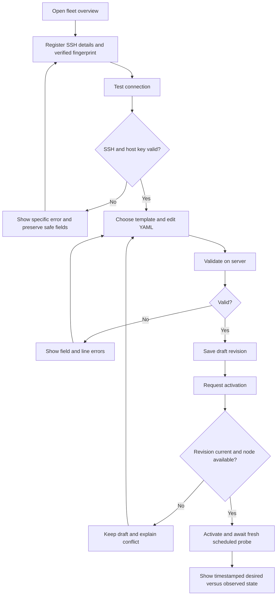

#### 5.2.2 Diagnose, approve, verify and recover

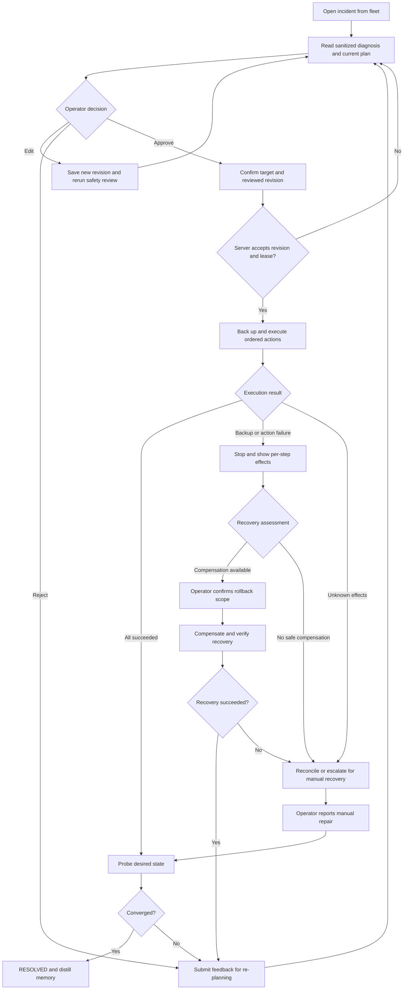

Connection loss is orthogonal to this business flow: accepted work continues while the UI reconnects. No disconnected page may infer completion from elapsed time. The snapshot/replay sequence in Section 3.6.6 restores the visible state without resubmitting work.

#### 5.2.3 Curate reusable memory

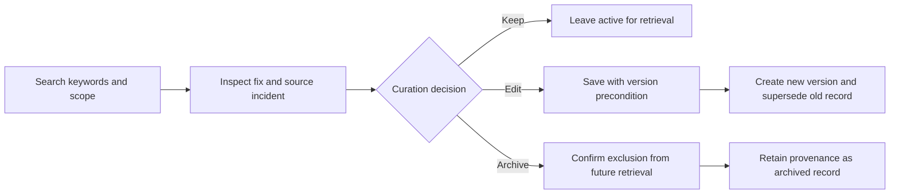

#### 5.2.4 Part III usability and contract checks

| Scenario | Observable acceptance criterion |
| :--- | :--- |
| First-time onboarding | A Linux/SSH-familiar user registers three test nodes and activates a template within the SRS ten-minute target; failed connections identify a corrective action |
| Invalid YAML / conflicting activation | Line/field errors are understandable; the current active revision remains unchanged; the draft is recoverable |
| Plan edit / stale browser tab | Editing forces a new review; the old tab cannot approve the obsolete revision; blocked commands never become executable |
| Double click / lost response | Same idempotency key returns the same operation; no second repair starts |
| Disconnect during repair | Progress resynchronizes without duplicate timeline entries or a repeated mutation; expired replay history causes a clean snapshot reset |
| Backup failure / partial mutation | The UI distinguishes no mutation from partial/unknown effects, stops later steps and displays the recovery outcome accurately |
| Memory curation | Archived records disappear from default results; edited content retains lineage and cannot claim unperformed verification |
| Keyboard and narrow viewport | All review/confirmation actions are keyboard reachable; focus order is logical and long commands do not hide critical controls |

These are planned checks, not completed user-study or production-test results.

---

## 6. Open Issues and Risks

【每个人都撰写至少一条，最后徐佳咏整理总结】

1. **Lock Starvation & Cascade Resolution of Queued Incidents**:
    - Uncertainty: While an incident waits in `PENDING_APPROVAL` for operator review, distinct drifts on the same node wait in `QUEUED_ON_LOCK`. Delayed human approval could delay diagnosing secondary drifts, or the primary fix (e.g., freeing disk space) might implicitly resolve the queued drift.
    - Part III PoC Validation: Test a two-tier lock (allowing read-only `UC-04` diagnosis under a shared lock while `PENDING_APPROVAL` is idle, reserving exclusive locks for `REMEDIATING`) and enforce an automatic `UC-03` re-probe on dequeue to auto-close already healed incidents.

2. **Backup Artifact Lifecycle & Rollback Trustworthiness**:
    - Uncertainty: Pre-mutation snapshots accumulate under `/var/tmp/sysops-backup/<incident_id>/` with no retention policy, and a `rollback_cmd` that itself fails midway (e.g., a partial config restore) can leave the host in a hybrid state worse than the original failure. We also have no automated check that a rollback actually restored the exact pre-mutation state.
    - Part III PoC Validation: Run a fault-injection test that kills the SSH session mid-step, then measure post-rollback convergence via the standard `UC-03` probe; define a backup retention/TTL policy (e.g., prune snapshots on `RESOLVED` or after N days); treat failed rollback verification as `ESCALATED` requiring manual intervention.

3. **Stale Approval and SSE Replay Consistency (Ma Xiaoyun)**:
    - Uncertainty: Browser reconnection, multiple tabs, proxy buffering and bounded replay retention can leave a visible plan behind the server state. Native EventSource reconnection alone does not guarantee consistent UI state or exactly-once execution.
    - Proposed mitigation: Durable state/event transactions, snapshot cursors, resource versions, revision-bound approval and persisted idempotency keys (ADR-04, Section 3.6). Both Section 3.2 and Section 3.6 specify a 24-hour / 100,000-row retention window for the `events` outbox, while background batch pruning and cursor-reset behavior remain to be validated under load.
    - Part III validation: Disconnect for both shorter and longer than the replay window; duplicate events; restart Gin; submit approval from two tabs; lose the approval HTTP response. Pass if state converges after recovery, obsolete approval is rejected, and each accepted command starts at most one execution. A crash during remote mutation must surface an unknown outcome rather than blindly re-executing it.

4. **Recovery Scope and Operator Comprehension (Ma Xiaoyun)**:
    - Uncertainty: A failed command may have partial side effects, while a successful rollback may restore the previous unhealthy state. The existing CHG-01 shorthand of rolling back only steps before the failure needs coordination with the execution owner for failed-step assessment.
    - Part III validation: Inject a backup failure, a partially applied command, and a compensation failure. Ask operators to identify which steps changed the host and whether desired state has actually converged. Keep recovery, verification and resolution visibly distinct; require manual escalation when effects cannot be established safely.

5. **Stale or Misleading Memory Retrieval across Host Versions (R-XZH)**:
    - Uncertainty: Keyword-based FTS5 can retrieve a previously successful fix that shares an error string with a new incident but was verified on a different Linux distribution, package version, service configuration, or host. Conversely, semantically similar issues with different wording may be missed. `hit_count` measures previously verified reuse, not present-day applicability. A historical repair must not become an automatic command merely because it ranks highly.
    - Proposed mitigation: Store source-incident provenance, verification timestamps, scope tags, and immutable version lineage; exclude `ARCHIVED` and `SUPERSEDED` entries from default retrieval; expose retrieval evidence to the diagnostic agent as context, not as a privileged instruction. Require fresh read-only diagnostics and independent review of any proposed command, followed by explicit human approval for mutation. Consider an age warning and scope-based ranking rules where environment information is available.
    - Part III PoC validation: Construct a labeled set of repeated and near-duplicate incidents (including mismatched OS/service versions and paraphrased log messages). Compare top-3 FTS5 retrieval results with expected relevant memories, record precision@3 and recall@3, and manually inspect false matches. Verify that archived or superseded records are not injected into default context, that a mismatched historical fix cannot bypass command review or HITL approval, and that an operator-edited replacement keeps the old memory in the audit trail. The exact acceptance thresholds should be agreed with the team before testing, rather than reported as measured results in Part II.

---

## 7. AI Tools Reflection

【每个人都撰写，最后徐佳咏整理总结】

### xjy

- Tool chain: Gemini 4 Argon in Google AI Studio and OpenCode
- Cost: covered by Google AI Pro & OpenCode Go subscription
- Pros / cons: communicate about the project concept, helpful in brain storming, English translations, and generating UML diagrams, but easily provides ideas that are too complex or too simple
- Verification: manually review & rewrite
- Enhancement: correct & rewrite AI output to align with our true design intent
- Artifacts: no specific artifacts

### xzh

- Tool chain: ChatGPT for technical writing, Mermaid diagrams, and relational data modeling
- Cost: covered by ChatGPT subscription
- Pros / cons: accelerated drafting and highlighted design dependencies, but could introduce incorrect details or overlook edge cases
- Verification: reviewed the drafts against the SRS, team design, and related pull requests; checked the diagrams and integration
- Enhancement: corrected and revised AI-generated text and diagrams to align with the SRS and team design
- Artifacts: 2.7, 3.2, 3.3, ADR-02, and related risk and references

### mxy

- **Tool chain**: OpenAI Codex assisted this Part II drafting session with repository inspection, English technical writing, API contract design, Mermaid flows and HTML mockups.
- **Cost**: covered by GPT plus subscription.
- **Benefits**: AI helped translate the task allocation and HW1 requirements into a consistent REST/SSE proposal, enumerate exceptional UI states and produce reusable screen artifacts.
- **Limitations**: Generated contracts can introduce unimplemented assumptions, including session authentication, durable event retention and revision-based concurrency. They require agreement with the backend, database and execution owners. HTML prototypes demonstrate layout and navigation rather than a working Vue/Gin system.
- **Verification in this session**: The draft was compared with the task allocation, existing design and HW1 requirements. Static checks cover prototype references and section completeness; the PoC, fault-injection and usability checks listed in Section 5.2.4 remain future work. 
- **Design corrections**: Approval is tied to a reviewed revision; edited commands are re-reviewed; SSE reconnect does not resubmit mutations; compensation is distinguished from desired-state resolution; diagnostic output uses sanitized summaries.
- **Artifacts**: ADR-04; Section 3.6; Section 5; the five HTML prototypes in `hw2/mockups`; personal open issues and annotated references.

### lcr

- Tool chain: Gemini 4 Argon in Google AI Studio and OpenCode (DeepSeek V4 Pro)
- Cost: covered by Google AI Pro & OpenCode Go subscription
- Pros / cons: efficient at turning SRS scenarios (`UC-03`, `UC-05`, `UC-09`) into mermaid sequence/state diagrams and at drafting ADR alternatives, but it tends to over-engineer safety mechanisms (e.g., suggesting sandboxed execution or filesystem snapshots that would break the agentless zero-footprint deployment), so every option had to be re-checked against the SSH-only architecture
- Verification: each diagram cross-checked against the SRS use case specifications; mermaid syntax validated in the preview pane before committing
- Enhancement: rewrote the class model to respect the four-subsystem boundaries; constrained ADR-03 to control-plane-only mechanisms consistent with the zero-footprint requirement; added the `PARTIALLY_FAILED` rollback path to the state machines that the AI draft omitted
- Artifacts: mermaid diagram sources embedded in `design.md`

---

## 8. Annotated References

【每个人按需撰写】

1. **B. Beyer, C. Jones, J. Petoff, and N. R. Murphy, Eds., _Site Reliability Engineering: How Google Runs Production Systems_. Sebastopol, CA, USA: O'Reilly Media, 2016.**
   This foundational work formalizes Site Reliability Engineering (SRE) principles including declarative state management, toil elimination through idempotent automation, alert deduplication, and safe change management. Chapters on Eliminating Toil, Practical Alerting, and Data Processing Pipelines demonstrate how uncoordinated automation and concurrent alert storms often worsen production incidents rather than resolving them.
   These principles directly shaped our State Reconciliation Engine and Per-Node Lease Lock Coordinator (`Section 2.1`, `ADR-01`). Rather than treating periodic SSH checks as stateless cron jobs that blindly invoke an LLM on every failure tick, we separated deterministic drift detection (`UC-03`, \$0 token cost) from bounded agentic diagnosis (`UC-04`). Specifically, the book's analysis of concurrent automation hazards motivated our per-node lock state machine (`IDLE`, `PROBING`, `DIAGNOSING`, `PENDING_APPROVAL`, `REMEDIATING`), which coalesces duplicate drift alerts, serializes distinct faults on the same host, and suppresses routine health probes during active `REMEDIATING` windows. Finally, its emphasis on post-change verification informed our mandatory post-remediation `UC-03` convergence check before marking any incident `RESOLVED`.

2. **P. Helland, "Life beyond Distributed Transactions: An Apostate's Opinion," in _Proceedings of the Conference on Innovative Data Systems Research (CIDR)_, 2007.**
   This position paper argues that large-scale systems cannot rely on distributed atomic transactions, because holding locks across heterogeneous, long-running, and sometimes-unreliable participants is impractical; instead, Helland advocates designing business operations as sequences of *local* actions paired with explicit compensation, accepting that failures leave partial effects that must be undone deliberately. Although written for enterprise data services, its reasoning transfers directly to remote shell execution: an SSH session has no transaction manager, a `systemctl restart` or config rewrite is a local, one-way side effect, and no two-phase commit can span the control plane and a target node's filesystem. This shaped `ADR-03` (transactional remediation) in three concrete ways. First, we gave up on atomic plan execution: `RemediationAction` steps run sequentially under fail-fast semantics, and an interrupted plan terminates in the explicit `PARTIALLY_FAILED` state rather than pretending to be clean. Second, we made compensation first-class by requiring every mutating action to carry a `backup_cmd` (verified before mutation) and a paired `rollback_cmd`, so recovery is an ordinary, reviewable workflow — the Web UI's reviewed reverse rollback of affected steps — instead of an emergency script. Third, we treat "undone" as unproven: after any rollback, the standard `UC-03` declarative probe re-runs, and the incident only closes when actual state convergence is observed, mirroring Helland's insistence that compensating logic itself needs verification. The paper also cautions that compensation code is rarely exercised in production, which prompted us to schedule rollback fault-injection tests in the Part III PoC plan (`Section 6`).

3. **WHATWG, _HTML Living Standard_, “Server-sent events.”** <https://html.spec.whatwg.org/multipage/server-sent-events.html>
   This specification defines the browser EventSource interface and the text/event-stream format, including named events, event identifiers, retry intervals, and reconnection behavior. It provides the protocol foundation for the live diagnostic and remediation feedback proposed in ADR-04. The distinction between a persistent observation channel and discrete operator commands is particularly relevant to this project: the browser receives progress continuously, while approval remains an explicit authenticated HTTP request with its own validation and audit trail.

   The specification influenced the event envelope and recovery sequence in Section 3.6.6. Named events separate node changes, diagnostic summaries, plan revisions, and individual action outcomes. Event identifiers allow a reconnecting client to indicate its last observed position. Named heartbeat events keep idle connections observable to JavaScript without advancing the durable event cursor. A single multiplexed stream per console tab also reduces unnecessary connections as the operator navigates between screens.

   A critical limitation is that native reconnection does not create durable application history or guarantee exactly-once effects. Accordingly, our design adds persisted event records, bounded retention, snapshot cursors, duplicate suppression, and explicit reset handling. Approval idempotency belongs to the REST command path rather than the streaming protocol. Part III must test these application guarantees through disconnection, process restart, expired cursors, and slow consumers. This reference supports the transport choice, but it does not establish that our proposed database and frontend recovery implementation is correct.

4. **R. Fielding, M. Nottingham, and J. Reschke, _HTTP Semantics_, RFC 9110, June 2022.** <https://www.rfc-editor.org/rfc/rfc9110>
   RFC 9110 defines the semantics shared by HTTP implementations, including request methods, representation metadata, conditional requests, and response status codes. It is relevant because the Vue console and Gin gateway require a predictable interface for both ordinary resource management and potentially consequential remediation commands. Consistent semantics help the frontend distinguish a successful read, an accepted background operation, a validation problem, and a conflict with current server state.

   Section 3.6 applies these ideas by keeping resource retrieval on GET and using explicit POST commands for approval, activation, and recovery. A 202 response means that work has been accepted; it does not claim that the remote host has been repaired. The returned operation resource allows the client to inspect eventual results even after an HTTP response is lost. ETag and If-Match preconditions protect policy and memory edits from overwriting newer versions. The additional plan revision check binds approval to the exact content reviewed by the operator.

   The reference also clarifies an important design boundary: POST is not inherently idempotent. Our persisted Idempotency-Key behavior is an application contract that requires atomic acceptance, request fingerprinting, and explicit retention. It cannot make arbitrary SSH effects transactional. After a worker crash, uncertain remote outcomes still require reconciliation rather than blind execution. Part III should therefore test stale edits, repeated submissions, conflicting key reuse, and lost responses separately from execution recovery. HTTP semantics provide a common vocabulary for these outcomes, while domain invariants remain the responsibility of the control plane.

5. **W3C, _Web Content Accessibility Guidelines (WCAG) 2.2_, Recommendation.** <https://www.w3.org/TR/WCAG22/>
   WCAG 2.2 defines technology-independent accessibility success criteria organized around perceivable, operable, understandable, and robust interfaces. Its guidance is relevant to an operations console because critical information must remain understandable when users navigate by keyboard, use assistive technology, or work on a small screen. A visually attractive dashboard is insufficient if an operator cannot distinguish a stale observation from a verified result or cannot reach the approval controls reliably.

   The guidance influenced Section 5.1.6 in several concrete ways. Health and execution badges include explicit text instead of relying on color alone. Validation feedback identifies the relevant YAML field or line and preserves the user's draft. Keyboard focus should remain visible, enter confirmation dialogs predictably, and return to the initiating control when a dialog closes. Progress updates should be summarized in a polite live region so that frequent SSE messages do not overwhelm a screen reader. Long shell commands need wrapping or local scrolling without hiding the surrounding confirmation context.

   These principles also shaped the planned evaluation in Section 5.2.4. The implementation should be checked for contrast, keyboard reachability, logical focus order, error recovery, and narrow-screen behavior. The static prototypes illustrate content hierarchy and status labeling, but they cannot demonstrate complete accessibility of future Vue components, dialogs, or live announcements. Therefore, this document treats WCAG AA as a design target rather than a certified result. Part III testing should combine automated checks with keyboard walkthroughs and assistive-technology inspection of the consequential approval and recovery flows.

6. **S. Yao, J. Zhao, D. Yu, N. Du, I. Shafran, K. Narasimhan, and Y. Cao, “ReAct: Synergizing reasoning and acting in language models,” in *Proceedings of the International Conference on Learning Representations (ICLR)*, 2023.** <https://arxiv.org/abs/2210.03629>
   Yao et al. introduce ReAct, a method that interleaves language-model reasoning with actions that gather information from tools or external environments. The core idea is that a system can revise its next action based on newly observed evidence rather than issuing an entire action plan without feedback. This is directly relevant to our `UC-04` diagnostic workflow: the Diagnostic Agent receives a drift report, proposes a bounded read-only inspection step, obtains a sanitized observation, and updates its diagnosis until it can justify a remediation proposal or reaches the configured turn ceiling. The paper informs the *reason–act–observe* structure, but it does not by itself provide security guarantees for a shell-capable agent. We therefore place a deterministic Go Tool Execution Interceptor between model-generated requests and privileged tools (`CHG-03`). The independent Command Review Agent supplies only a classification; the interceptor applies fail-closed policy, and mutation is reserved for the human-approved `UC-05` workflow. We also cap diagnosis at `max_turns = 8` and restrict logged output and memory retrieval to bounded context so an incident cannot produce an uncontrolled loop or context explosion. Thus, ReAct contributes the interaction pattern, while our own architecture adds explicit permissions, auditable handoff, safe degradation, and post-action verification appropriate to personal Linux operations. This separation is a central design decision because a convincing model-generated explanation is not equivalent to a safe command or a verified repair.

7. **SQLite Project, “SQLite FTS5 Extension,” SQLite Documentation.** <https://www.sqlite.org/fts5.html>
   The SQLite FTS5 documentation describes an embedded full-text indexing facility, including `MATCH` queries, the built-in `bm25()` ranking function, external-content tables, and the triggers needed to keep an external-content index synchronized with its underlying relational data. It supplies the technical foundation for `ADR-02` and the retrieval design in Section 3.2. Our system stores canonical structured memory records in the ordinary `memories` table and maintains a `memories_fts` index for searchable symptoms, root causes, remediation steps, and environment scope. FTS5 allows exact operational terms such as service identifiers and error messages to be retrieved without deploying PostgreSQL or a separate embedding service; the returned top-k results then help initialize the Diagnostic Agent's context. The documentation also makes clear that external-content indexes must be actively synchronized, which motivates our insert/update/delete triggers and the planned checks for index consistency during Part III. We use BM25 only as a lexical relevance signal, then apply the application's own `ACTIVE` status and scope filters; a high search rank never authorizes execution or proves that a historical fix still applies. The design is intentionally modest: it accepts the limitations of keyword matching, retains auditable superseded versions, and treats all retrieved steps as untrusted historical evidence subject to current diagnosis and safety gates. The official reference therefore supports both our implementation choice and its stated trade-offs, rather than serving as an unsupported claim that FTS5 solves semantic retrieval.

---

## 9. Team member contributions

【最后徐佳咏撰写】
