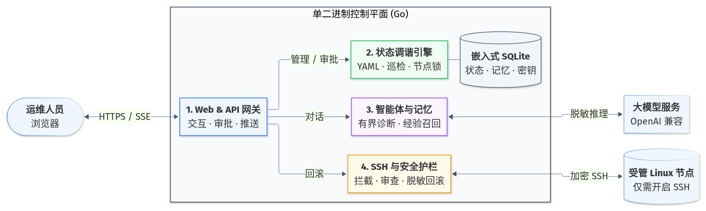
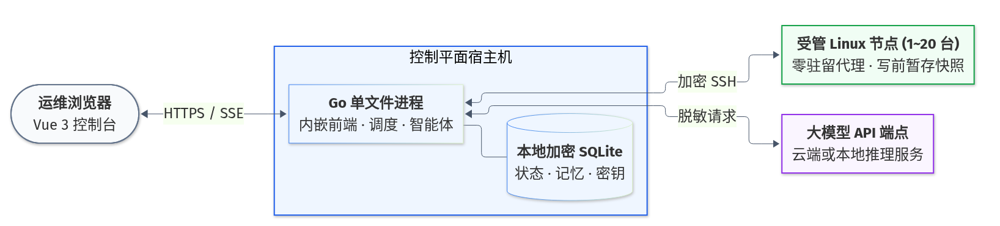
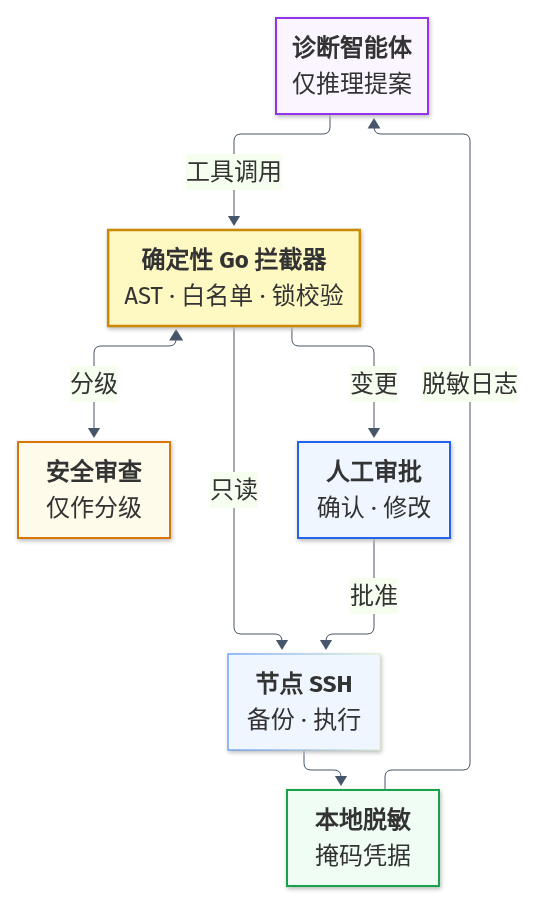
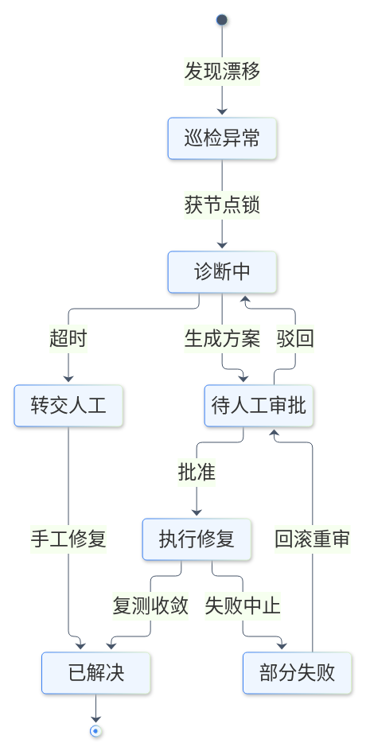
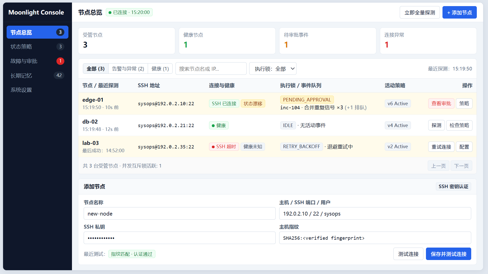
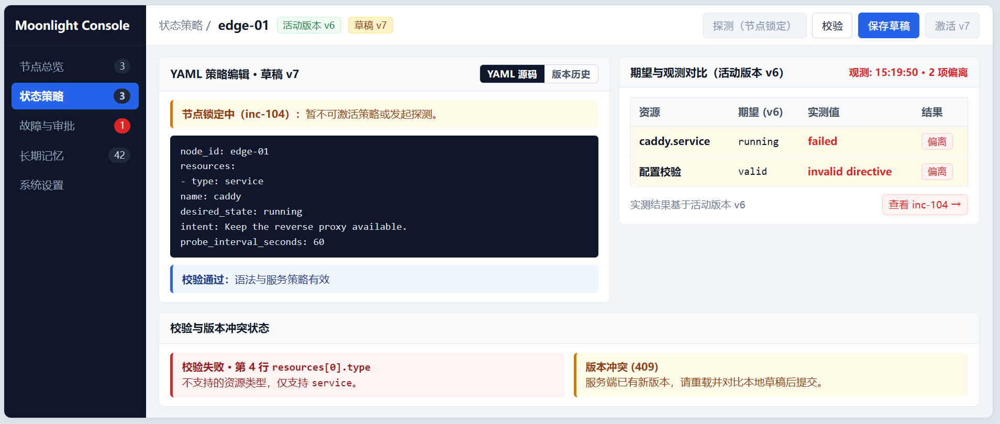
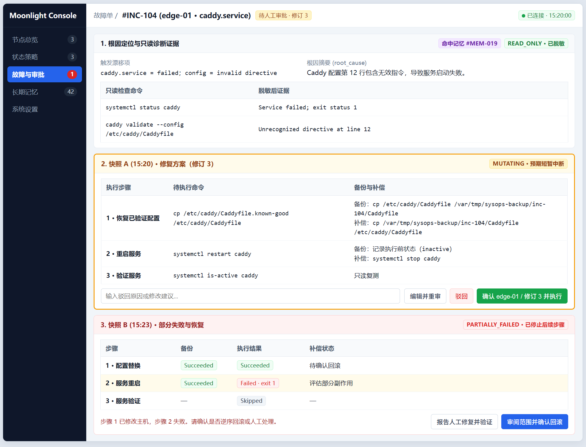
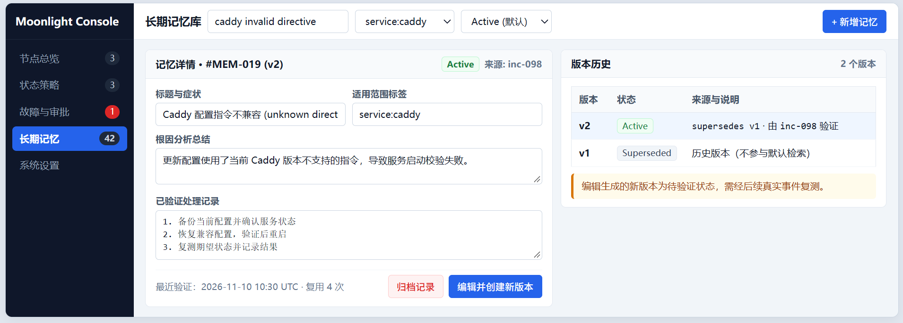

<!-- _class: cover -->

# A Declarative Personal SysOps Agent with Adaptive Long-Term Memory

## System Analysis & Design — Assignment 2 设计汇报

2450313 徐佳咏 &ensp; 2351428 徐之涵 &ensp; 2352626 马小云 &ensp; 2451405 刘宸瑞

---

<!-- header: 一、架构设计 -->

## 1.1 逻辑架构

采用模块化单体架构，将控制平面划分为 4 个子系统：

---

## 1.2 部署架构

Web 控制台、控制面单二进制文件、目标节点无入侵

---

## 1.3 技术架构与竞品对比

### 竞品对比与定位

| 对比对象        | 既有局限                  | 我们的定位                |
| :-------------- | :------------------------ | :------------------------ |
| **Ansible**     | playbook 完全静态，无推理 | 静态声明 + 大模型动态诊断 |
| **Datadog**     | 企业级部署过重            | 单二进制个人轻量部署      |
| **Claude Code** | Coding 特化，非多节点运维 | 多节点运维工具            |

弥合 重型企业平台 与 手工 SSH 排障 之间的断层

### 技术栈选型与权衡

| 层级         | 技术                   | 理由                       |
| :----------- | :--------------------- | :------------------------- |
| **后端传输** | **Go + 原生 SSH**      | 控制机单二进制文件，无依赖 |
| **存储检索** | **SQLite FTS5**        | 运维成本低，兼顾人类理解   |
| **前端通信** | **Vue 3 + SSE**        | 自动重连，单向推流         |
| **安全解析** | **Shell AST + 大模型** | 防止管道与子命令绕过       |

---

<!-- header: 二、关键设计决策与权衡 -->

## 2.1 并发控制与自适应记忆

### 1. 单二进制 + 节点锁

- **痛点**：防止同节点巡检、诊断与修复并发冲突
- **放弃**：微服务分布式锁、无锁自由并发
- **决策**：采用节点锁，同漂移合并、异类排队，用串行化换取零写竞争

### 2. SQLite FTS5 + 三分支演进

- **痛点**：需复用历史方案
- **放弃**：PostgreSQL + pgvector、Milvus
- **决策**：使用文本关键词搜索匹配，仅召回匹配的活跃经验，验证后按“新建 / 命中 / 修订”演进；效果上弱于向量语义，但明显减轻部署与运维成本，且适用于需频繁更新、人工修订的场景

---

## 2.2 事务恢复与实时通信

### 3. 分步补偿

- **痛点**：SSH 多步执行非原子，中途失败会破坏现场
- **放弃**：人工善后脚本、目标机快照或驻留 Agent
- **决策**：每个写操作强绑定回滚命令，失败即中止并进入部分失败态；代价是增加分析与审查耗时

### 4. 前端事件流

- **痛点**：长耗时操作需实时刷新，且断线不能重复执行
- **放弃**：高频轮询、全双工 WebSocket
- **决策**：服务端单向 SSE 推流，客户端自动重连；代价是客户端需维护历史窗口与过期全量同步

---

<!-- header: 三、核心专项设计与模型 -->

## 3.1 Agentic 工作流设计

- **角色分离**：诊断 Agent 仅推理提案；审查 Agent 只做危险分级，不接触执行器
- **危险指令拦截**：本地 AST 解析 + 独立审查 Agent
- **脱敏**：敏感凭据本地脱敏后再发送给大模型 API
- **熔断**：诊断运行轮次与总时长限制，超限自动转人工

---

## 3.2 状态机与恢复闭环

1. **巡检排重**：零模型成本发现漂移，并发信号自动合并或排队
2. **有界诊断**：结合历史记忆只读排查，输出带回滚契约的提案
3. **审批与补偿**：人工放行后独占执行；任一步失败立即中止，支持逆序回滚
4. **复测与蒸馏**：探针确认恢复后沉淀记忆

---

## 3.3 UI/UX 页面功能展示

### 节点总览与接入

- 分离展示 SSH 连接、健康与执行锁状态
- 支持私钥录入、一键测试等

### 声明式策略与漂移检查

- 左侧编辑 YAML 草稿，右侧实时对比期望与实测差异
- 节点锁定时自动禁用策略激活与手动探测

---

## 3.3 UI/UX 页面功能展示

### 诊断审批与失败恢复台

- 聚合脱敏排查证据、根因摘要与每步备份/回滚命令
- 中途失败时清晰标出各步状态，支持一键触发逆序回滚

### 自适应记忆

- 支持按故障关键词检索历史经验
- 保留完整版本，支持人工修订迭代或归档

---

<!-- _class: lead -->

# Thank You
